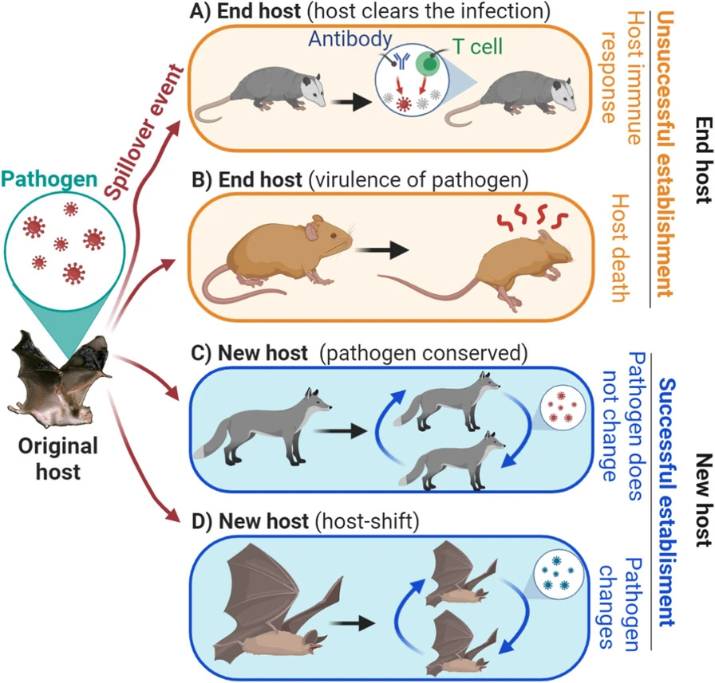
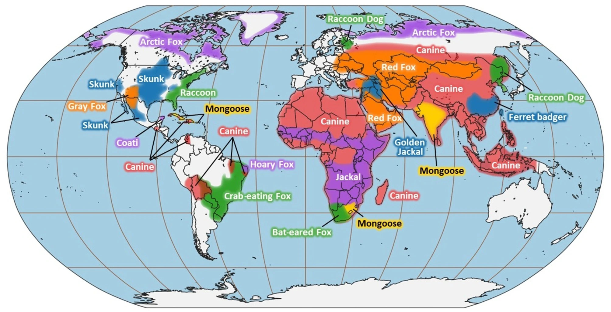
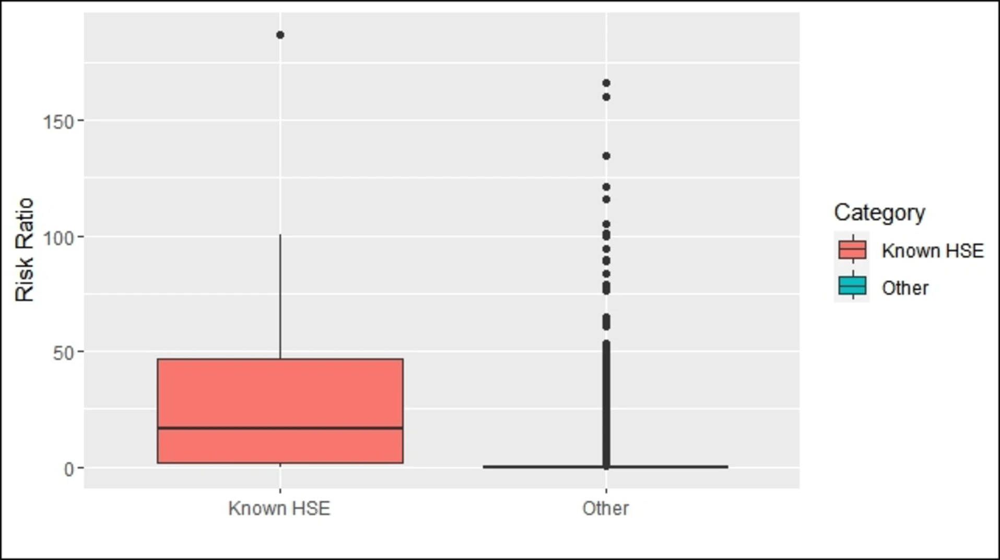

```{r}
#| label: load-packages
#| include: false
library(tidyverse)
library(ggthemes)
library(ggplot2)
library(patchwork)
library(emmeans)
library(car)
library(performance)
library(stats)
library(knitr)
library(GGally)
library(caret)
library(pROC)
```
```{r}
#| echo: false

default_chunk_hook  <- knitr::knit_hooks$get("chunk")

latex_font_size <- c("Huge", "huge", "LARGE", "Large", 
                     "large", "normalsize", "small", 
                     "footnotesize", "scriptsize", "tiny")

knitr::knit_hooks$set(chunk = function(x, options) {
  x <- default_chunk_hook(x, options)
  if(options$size %in% latex_font_size) {
    paste0("\n \\", options$size, "\n\n", 
      x, 
      "\n\n \\normalsize"
    )
  } else {
    x
  }
})

```

# Background

## Bernoulli Distribution

{width=25%}

From the swiss family, also known for a certain principle, differential equation, triangle, and numbers, also came the most elementary yet brilliant probability distribution.

Used when a variable has a binary outcome, the Bernoulli distribution is attributed to Jacob Bernoulli, and the probability mass function is given by: 

\begin{align*}
P(X = x) = f_X(x) = 
\begin{cases}
p & \text{if } x = 1, \\
1 - p & \text{if } x = 0.
\end{cases}
\end{align*}

Where $p$ is the probability of the event of interest. 

The expected value is given by [@soch_statproofbook]:

\begin{align*}
E(X) &= \sum_{x \in \mathcal{X}}x\cdot f_X(x) \\
&= 0\cdot f_X(0) + 1\cdot f_X(1) \\
&= 0\cdot (1-p) + 1 \cdot p \\
&= p
\end{align*}

The second moment of the distribution can solved similary: 

\begin{align*}
E(X^2) &= \sum_{x \in \mathcal{X}}x^2\cdot f_X(x) \\
&= 0^2 \cdot f_X(0) + 1^2 \cdot f_X(1) \\
&= 0^2 \cdot (1-p) + 1^2 \cdot p \\
&= p
\end{align*}

Now to solve for the variance:

\begin{align*}
Var(X) &= E(X^2) - E(X)^2 \\
&= p - p^2 \\
&= p(1-p)
\end{align*}

Plotting the variance in relation to p shows us:

```{r}
#| echo: false
#| label: fig-bernoulli_var
#| fig-cap: "Bernoulli Variable Variance"
#| fig-width: 6
#| fig-height: 4

var_dat <- tibble(p = seq(0,1, length.out = 1000)) |>
  mutate(var = p*(1-p))

ggplot(data = var_dat, aes(x = p, y = var)) + 
  geom_line() + 
  ylab("Variance") +
  xlab(bquote(p)) + 
  theme_clean()

```

The variance of a bernoulli variable is greatest when $p = 0.5$. 

## Logistic Regression

Typical linear regression is based on the linear combination of factors modelling a continuous variable: 

\begin{align*}
Y_i = \beta_0 + \beta_1 x_{1i} + \beta_2 x_{2i} + \cdots + \beta_{p-1} x_{(p-1)i} + \epsilon_i
\end{align*}

Because numeric $x_n$'s can range from $(-\infty, \infty)$, the model expects that the variable $Y$ we're regressing on can similarly range from $(-\infty, \infty)$. For a bernoulli distributed variable, the range of values is $x \in {0,1}$. To modify this to extend the range of values to $(-\infty, \infty)$, we use the logit function: 

$$log\left(\frac{P(Y_i=1)}{1-P(Y_i=1)}\right) = \beta_0 + \beta_1 x_{1i} + ... + \beta_{k-1} x_{(k-1)i} + \epsilon_i$$
where $p = P(Y_i = 1)$ is the probability of the event of interest occuring and $log\left(\frac{P(Y_i=1)}{1-P(Y_i=1)}\right)$ is the log odds of $Y_i=1$.

To obtain a prediction for each data point based on our $x_n$'s, we can invert the logit formula:

\begin{align*}
  log\left(\frac{P(Y_i=1)}{1-P(Y_i=1)}\right) &= \beta_0 + \beta_1 x_{1i} + \cdots + \beta_{p-1} x_{(p-1)i}\\
  \frac{P(Y_i=1)}{1-P(Y_i=1)} &= e^{\beta_0 + \beta_1 x_{1i} + \cdots + \beta_{p-1} x_{(p-1)i}}\\
  P(Y_i=1) &= (1-P(Y_i=1)) e^{\beta_0 + \beta_1 x_{1i} + \cdots + \beta_{p-1} x_{(p-1)i}}\\
  P(Y_i=1) &= e^{\beta_0 + \beta_1 x_{1i} + \cdots + \beta_{p-1} x_{(p-1)i}} - P(Y_i=1)e^{\beta_0 + \beta_1 x_{1i} + \cdots + \beta_{p-1} x_{(p-1)i}}\\
  P(Y_i=1) & + P(Y_i=1)e^{\beta_0 + \beta_1 x_{1i} + \cdots + \beta_{p-1} x_{(p-1)i}} = e^{\beta_0 + \beta_1 x_{1i} + \cdots + \beta_{p-1} x_{(p-1)i}} \\
  P(Y_i=1) & \left(1+e^{\beta_0 + \beta_1 x_{1i} + \cdots + \beta_{p-1} x_{(p-1)i}}\right)= e^{\beta_0 + \beta_1 x_{1i} + \cdots + \beta_{p-1} x_{(p-1)i}} \\
  P(Y_i=1) &= \frac{e^{\beta_0 + \beta_1 x_{1i} + \cdots + \beta_{p-1} x_{(p-1)i}}}{1+e^{\beta_0 + \beta_1 x_{1i} + \cdots + \beta_{p-1} x_{(p-1)i}}} \\
\end{align*}

That prediction is what we'll compare our actual data to assess model success.

## The Study

{width=60%}

As anyone who's cried to Old Yeller can tell you, rabies is a constant fear for those who have pets and who work around animals. Rabies is a deadly viral disease transmitted from one infected animal to another, primarily through bites and scratches. Most rabies infections in humans are due to infected bats, though other animals like skunks, raccoons, and foxes can also transmit the disease [@cdc]. 

[@escobar]
{width=60%}

Most of the time, animals that have been infected with rabies (the reservoirs) will die before spreading it to another animal, but on those rare occasions, that species has become a new host for the virus. This is what's known as a Host-Shift Event (HSE). Once a new species has been recoginized as a host for rabies, it's important to recognize this and adjust public health guidance accordingly. 

{width=80%}

In a 2025 article, Boutelle et al. investigate biological factors, such as body temperature, phylogenetic relatedness, weight, and others and their relationship to whether a HSE occurs, to complement the existing literature on genomic factors on HSEs. By considering every terestrial mammal species as a candidate, and scraping PubMed articles for known HSEs for that species, the researchers were able to create a dataset to test with a logistic regression model [@boutelle].  

## Goal of Statistical Analysis

The article uses the following variables as proxies for ecological and biological mechanisms for the spread of rabies: 

- Relatedness: How similar the host and reservoir species are genetically (patristic distance: greater means less related)
- Body temperature of the reservoir species (K)
- Difference in body temperature between the host and reservoir species (K)
- Litter size (log-transformed) of the reservoir species. Included to act as a proxy for the volume of inter-species interaction
- Adult body weight (log-tranformed grams)
- Weight difference between host and reservoir species (categorized for some reason). Included to test a hypothesis that there would be a small chance of transmission between animals of largely differing sizes
- Lineage: Whether the rabies virus transmitted by that species is traced to dogs or bats

In *R*, our formula call looks like this: 

```{r}

(formula <- HSE ~ relatedness + temp + temp_diff + litter_size + weight + weight_diff + lineage)

```

I should note that the authors mention using a backward selection model with a variance cutoff to select for the predictors in their model. This means that they started with a large model with many predictors, and checked if removing each one decreased model performance by some threshold, removing ones that are deemed *not necessary*. The inclination to reduce the number of predictor variables is reasonable. As we'll see later, there are only 28 positive cases, making large numbers of predictors difficult to work with. However, I, and many others are generally against using stepwise selection models in almost all cases [@gelman]. For logistic regression, it has been shown to increase the likelihood of bias in estimating predictor coefficients[@steyerberg]. A simpler thing to do is to take a theoretical, scientific oriented approach to building a model. The authors say:

> "Additional variables that may reflect host ecological characteristics were also considered as model parameters: population density, average longevity, age of maturity, social behavior, diet, and presence of incisor teeth." 

While some of these were removed due to limited data availability, others were removed due to the stepwise selection process. I personally think that the authors should have narrowed down the choices for predictors based on theoretical effect size and stuck with those. As my advisor usually says, avoid tests that allow you to not think. While appearing statistical and precise, stepwise selection is usually more biased than people think. 

With that being said, going forward, we'll be testing the assumptions of the logistic model, testing the effect of these variables on the likelihood of an HSE occuring, and testing the models ability to classify whether a species has had a known HSE. 

# Reproduction of the Study

I'd like to highlight the work of the [Colgate Data Science Collaboratory](https://shiny.colgate.edu/index.html), whose apps I've contributed to and, therefore, my analysis of the logistic regression model will closely resemble the [logistic regression app](https://shiny.colgate.edu/apps/Collaboratory-Apps/Logistic-Regression/). 

**Note that going forward, I'm going to refer to, what the authors call 'relatedness,' as (phylogenetic) dissimilarity, to avoid confusion about direction.**

## Data Cleaning

```{r}

#dat <- read_csv('Data Analysis II/logistic/rabies.csv')
dat <- read_csv('rabies.csv')

dat <- dat |>
  select(`Known HSE`, 
         Relatedness, 
         `Temperature (K)`, 
         `Temperature Difference`, 
         `Litter Size (log)`, 
         `Weight (g, log)`,
         `Weight Difference`, 
         Lineage)

dat <- dat[-1,]

colnames(dat) <- c("HSE", "relatedness", "temp", "temp_diff", "litter_size", "weight", "weight_diff", "lineage")

dat$HSE <- as.factor(dat$HSE)
dat$weight_diff <- factor(dat$weight_diff, levels = c("Low", "Medium", "High"))
dat$lineage <- factor(ifelse(dat$lineage == 1, "Bat", "Dog"), levels = c("Bat", "Dog"))

```

## Data Summary

```{r}
#| echo: false
#| label: fig-sum
#| fig-cap: "Pairwise Summaries"
#| warning: false
#| message: false
#| fig-width: 10
#| fig-height: 8

upper <- list(
  continuous = "points",
  discrete = wrap("colbar", size = 0), combo = "box_no_facet",
  na = "na"
)
lower <- list(
  continuous = "cor",
  discrete = wrap("colbar", size = 0), combo = "box_no_facet",
  na = "na"
)

ggpairs(data = dat, upper = upper, lower = lower, 
        columnLabels = c("Host-Shift", "Dissimilarity", "Sp. Temp. (K)", "Sp.-Host Temp. Diff. (K)", "Litter Size (log)", "Sp. Weight (log(g))", "Sp.-Host Weight Diff.", "Rabies Lineage")) + 
  theme_clean() + 
  theme(strip.text = element_text(size = 6), 
        axis.text.x = element_text(size = 8))


```

A few things to notice:

- The class imbalance is **extreme**. There are only 28 host-shift events to the 19,142 non-events. 
- Correlations between numeric variables are relatively strong, like between species temperature and species-host temperature difference, species weight and litter size, and species weight and relatedness. 

## Model Assumptions

### Randomized Quantile Residuals

First we'll look at the randomized quantile residuals:

```{r}
#| echo: false
#| label: fig-residuals
#| fig-cap: "Randomized Quantile Residuals of Logistic Model"
#| warning: false
#| message: false
#| fig-width: 10
#| fig-height: 6

#source('Data Analysis II/logistic/histoqq.R')
source('histoqq.R')

mod <- glm(formula, data = dat, binomial(link = "logit"))

set.seed(1313)
fitted <- mod$fitted.values
class <- mod$y
  
rq <- rep(NA, length(fitted))

for(i in 1:length(fitted)){
  a <- ifelse(class[i]==1, 1-fitted[i], 0          )
  b <- ifelse(class[i]==1, 1          , 1-fitted[i])
  rq[i] <- qnorm(runif(1, a, b))
}
  
pi = fitted
rqr = rq

p1 <- ggplot(tibble(x=pi, y=rqr, class = as.character(class)))+
  geom_hline(yintercept=0, linetype="dotted", color="red")+
  geom_point(aes(x=x, y=y, color = class), alpha = 0.5)+
  geom_smooth(aes(x=x, y=y), linetype="dotted")+
  theme_bw()+
  labs(x=bquote(pi), y="Randomized Quantile Residuals")
p2<-histoqq(rqr, color=T)
(p1+p2) +
  plot_layout(guides = "collect") &
  theme(legend.position="bottom")


```

Our model shows very good fit. The randomized quantile residuals are scattered relatively evenly, and they fit extremely closely to the qq-plot. Also, we see that the actual cases are more likely to have higher predicted probabilities than the non-cases. 

### Multicollinearity

Next we'll test the collinearity of the predictors of the model:

```{r}
#| echo: false
#| label: tbl-model_vif

vif <- data.frame(check_collinearity(mod))

vif$Term <- c("Dissimilarity", "Body Temperature (K)", "Species-Host Body Temp. Diff. (K)", "Litter Size", "Species Weight (log(g))", "Species-Host Weight Diff.", "Lineage")
vif <- vif[, c(1:4)]
colnames(vif) <- c("Term", "VIF", "Lower CI", "Upper CI")

knitr::kable(vif, digits = 3, label = "model_vif_unw", caption = "Model VIF", include.rownames = F)

```

All of the VIF values for the predictors in the model are low enough to not have to worry about high collinearity.

### Outliers \& Influential Points

```{r}
#| echo: false
#| label: fig-outliers
#| fig-cap: "Randomized Quantile Residuals of Logistic Model"
#| warning: false
#| message: false
#| fig-width: 10
#| fig-height: 6

####################################
# Create Data for Leverage Plot
####################################
d <- mod$model
n <- nrow(d)
p <- length(coef(mod))
d <- d %>%
  mutate(obs = 1:n)
ggdat <- d %>%
  mutate(h.values = hatvalues(mod))
####################################
# Create Leverage Plot
####################################
p1 <- ggplot(data = ggdat, aes(x = obs)) +
  geom_linerange(aes(ymin = 0, ymax = h.values)) +
  theme_bw() +
  xlab("Observation Number") +
  ylab("Leverage") +
  geom_hline(
    yintercept = 2 * p / n, linetype = "dotted",
    color = "orange", size = 0.75
  ) +
  geom_hline(
    yintercept = 3 * p / n, linetype = "dotted",
    color = "red", size = 0.75
  )
####################################
# Create Data for Cook's D Plot
####################################
ggdat <- d %>%
  mutate(cook.d = cooks.distance(mod))
####################################
# Create Cook's D Plot
####################################
p2 <- ggplot(data = ggdat, aes(x = obs)) +
  geom_linerange(aes(ymin = 0, ymax = cook.d)) +
  theme_bw() +
  theme(axis.text.x = element_text(
    angle = 60, vjust = 1,
    hjust = 1
  )) +
  xlab("Observation Number") +
  ylab("Cook's Distance") +
  geom_hline(
    yintercept = qf(p = 0.1, df1 = p, df2 = n - p),
    linetype = "dotted", color = "orange", size = 0.75
  ) +
  geom_hline(
    yintercept = qf(p = 0.5, df1 = p, df2 = n - p),
    linetype = "dotted", color = "red", size = 0.75
  ) + 
  geom_hline(yintercept = 0)
####################################
# Create Data for DFFITS Plot
####################################
ggdat <- d %>%
  mutate(dffits = dffits(mod))
####################################
# Create DFFITS Plot
####################################
p3 <- ggplot(data = ggdat, aes(x = obs)) +
  geom_linerange(aes(ymin = 0, ymax = dffits)) +
  theme_bw() +
  xlab("Observation Number") +
  ylab("DFFITs") +
  geom_hline(
    yintercept = c(-2 * sqrt(p / n), 2 * sqrt(p / n)),
    linetype = "dotted", size = 0.75, color = "orange"
  ) +
  geom_hline(
    yintercept = c(-2, 2), linetype = "dotted",
    size = 0.75, color = "red"
  ) + 
  geom_hline(yintercept = 0)
####################################
# Print Plots
####################################
(p1 | p2 | p3)
```

There are numerous points that have very high leverage on the model. The trend of leverage decreasing as the observation number increases could be explained by the fact that the dataset, as downloaded from the article, is ordered by predicted probability of an HSE, so the points with the highest predicted probabilities are influencing the model more. The Cook's distance and DFFITs plots are a bit nicer looking, as there's only a few points with noticeable large DFFITs values, and no concering Cook's distance values. 


## Model Fit

We can check our model fit with McFadden's Pseudo-$R^2$:
```{r}
#| echo: false
#| eval: false

r2_mcfadden(mod)

```

- $R^2 = 0.332$
- Adjusted-$R^2 = 0.290$

This is a relatively strong $R^2$. 

Similary we can check Tjur's $R^2$ and other indicators from the *performance* package[@performance]:

```{r}
#| echo: false
#| label: tbl-model_performance

mod_performance <- data.frame(model_performance(mod))

knitr::kable(mod_performance, digits = 3, label = "model_fit", caption = "Model Fit", include.rownames = F)

```

The Tjur's $R^2 = 0.067$, which is very weak. 

Later we'll see an (arguably) more reliable testing of model fit with cross validation.

## Model Inference

```{r}
#| echo: false
#| label: tbl-model_ANOVA

anova <- data.frame(Anova(mod))
rownames(anova) <- c("Dissimilarity", "Species Temp.", "Host-Reservoir Species Temp. Diff.", "Litter Size", "Species Weight", "Host-Reservoir Species Weight Diff.", "Lineage")
colnames(anova) <- c("LR Chi-Sq", "df", "p")

anova$p <- ifelse(anova$p<0.001, "<0.001", round(anova$p, 3))

anova <- anova |>
  mutate(significance = case_when(p == "<0.001" ~ "***", 
                                  p < 0.01 ~ "**", 
                                  p < 0.05 ~ "*", 
                                  p < 0.1 ~ ".", 
                                  p >= 0.1 ~ ""))


knitr::kable(anova, digits = 3, align = c("c", "r", "r", "r", "r"), label = "model_ANOVA", caption = "Model ANOVA", include.rownames = F)

```


```{r}
#| echo: false
#| label: tbl-model_sum

sum <- data.frame(summary(mod)$coefficients)
rownames(sum) <- c("Intercept", "Dissimilarity", "Species Temp. (K)", "Species-Host Temp. Diff. (K)", "Litter Size (log)", "Species Weight (log(g))", "Species-Host Weight Diff. = Medium", "Species-Host Weight Diff. = High", "Lineage = Dog")
colnames(sum) <- c("Estimate", "SE", "Z", "p")

sum$p <- ifelse(sum$p<0.001, "<0.001", round(sum$p, 3))

sum <- sum |>
  mutate(significance = case_when(p == "<0.001" ~ "***", 
                                  p < 0.01 ~ "**", 
                                  p < 0.05 ~ "*", 
                                  p < 0.1 ~ ".", 
                                  p >= 0.1 ~ ""), 
        `Odds % Change` = (exp(Estimate)-1)*100)

sum$`Odds % Change` <- round(sum$`Odds % Change`, 1)
sum$`Odds % Change`[1] <- ""

knitr::kable(sum, digits = 3, align = c("c", "r", "r", "r", "r"), label = "model_sum", caption = "Model Summary", include.rownames = F)

```

For our model, we predict:

- For every unit increase in dissimilarity, the odds of an HSE occuring decrease by 2.2\% ($Z = -5.403, p <0.001$).

```{r}
#| echo: false
#| label: fig-emtrend_related
#| fig-cap: "Predicted Probability by Relatedness"
#| warning: false
#| message: false
#| fig-width: 10
#| fig-height: 6

emt_grid <- data.frame(emmeans(mod, ~ relatedness, at = list(relatedness = seq(min(dat$relatedness), max(dat$relatedness), length.out = 50)), type = "response"))

ggplot(dat = emt_grid, aes(x = relatedness, y = prob,)) +
  geom_ribbon(aes(ymin = asymp.LCL, ymax = asymp.UCL), alpha = 0.2, color = NA) +
  geom_line(linewidth = 1) +
  theme_clean() + 
  xlab('Dissimilarity') +
  ylab("Predicted Probability of HSE")

```


- For every unit increase in reservoir species body temperature (K), the odds of an HSE occuring decrease by 27\% (non-statistically significant).
- For every unit increase in the difference in species-host body temperature (K), the odds of an HSE occuring decrease by 13.4\% (non-statistically significant).
- For every unit increase in litter size (log), the odds of an HSE occuring increase by 491.6\% ($Z = 3.785, p < 0.001$).

```{r}
#| echo: false
#| label: fig-emtrend_litter
#| fig-cap: "Predicted Probability by Litter Size"
#| warning: false
#| message: false
#| fig-width: 10
#| fig-height: 6

emt_grid <- data.frame(emmeans(mod, ~ litter_size, at = list(litter_size = seq(min(dat$litter_size), max(dat$litter_size), length.out = 50)), type = "response"))

ggplot(dat = emt_grid, aes(x = litter_size, y = prob,)) +
  geom_ribbon(aes(ymin = asymp.LCL, ymax = asymp.UCL), alpha = 0.2, color = NA) +
  geom_line(linewidth = 1) +
  theme_clean() + 
  xlab('Litter Size (log)') +
  ylab("Predicted Probability of HSE")

```


- For every unit increase in reservoir species weight (log(g)), the odds of an HSE occuring increase by 106.4\% ($Z = 3.841, p <0.001$).

```{r}
#| echo: false
#| label: fig-emtrend_weight
#| fig-cap: "Predicted Probability by Reservoir Species Weight"
#| warning: false
#| message: false
#| fig-width: 10
#| fig-height: 6

emt_grid <- data.frame(emmeans(mod, ~ weight, at = list(weight = seq(min(dat$weight), max(dat$weight), length.out = 50)), type = "response"))

ggplot(dat = emt_grid, aes(x = weight, y = prob,)) +
  geom_ribbon(aes(ymin = asymp.LCL, ymax = asymp.UCL), alpha = 0.2, color = NA) +
  geom_line(linewidth = 1) +
  theme_clean() + 
  xlab('Reservoir Species Weight (log(g))') +
  ylab("Predicted Probability of HSE")

```

- Having a medium difference in reservoir-host species weight compared to a low difference increases the odds of an HSE occuring by 4,317.8\% ($Z = 3.008, p = 0.003$).

- Having a high difference in reservoir-host species weight compared to a low difference increases the odds of an HSE occuring by 18,255.5\% ($Z = 3.828, p < 0.001$).

```{r}
#| echo: false
#| label: tbl-model_emm_weight_diff

mod_emm <- data.frame(pairs(emmeans(mod, ~ weight_diff)))

conf_emm <- confint(pairs(emmeans(mod, ~ weight_diff)))

mod_emm$percent_change <- (exp(mod_emm$estimate)-1)*100
mod_emm$percent_lower <- (exp(conf_emm$asymp.UCL)-1)*100
mod_emm$percent_upper <- (exp(conf_emm$asymp.LCL)-1)*100

colnames(mod_emm) <- c("Contrast", "Estimate", "SE", "df", "Z", "p", "Odds % Change", "Upper CI", "Lower CI")

mod_emm$p <- ifelse(mod_emm$p < 0.001, "<0.001", round(mod_emm$p, 3))

knitr::kable(mod_emm[,c(1,2,3,5,6,7,8,9)], digits = 3, label = "model_emm", caption = "Contrast of Reservoir-Host Weight Differences", align = c("c", "c", "r", "r", "c", "c", "c", "c"), include.rownames = F)

```

```{r}
#| echo: false
#| label: fig-emm_weight_diff
#| fig-cap: "Predicted Probability by Reservoir-Host Weight Differences"
#| warning: false
#| message: false
#| fig-width: 10
#| fig-height: 6


emm_grid <- data.frame(emmeans(mod, ~ weight_diff, type = "response"))

ggplot(dat = emm_grid, aes(x = weight_diff, y = prob)) +
  geom_point() + 
  geom_errorbar(aes(ymin = asymp.LCL, ymax = asymp.UCL), width = 0.25) +
  theme_clean() + 
  xlab('Reservoir-Host Weight Difference') +
  ylab("Predicted Probability of HSE") + 
  coord_flip()

```

- Having a rabies virus with lineage to a dog compared to a bat decreases the odds of an HSE occuring by 48.2\% (non-statistically significant). 

## Cross-Validation

To test the model, a common approach in any classification model, not just logistic regression, it to test how the model performs on unseen data. That is, the same data should not be used to train the model and to evaluate the classification ability. To do this, without getting new data, we can repeatedly train the model on a subset of the data, using that model to predict the data that we held out. Doing this over and over will give a more fair estimate of the model's prediction abilites on unseen data. 10-fold cross validation, where 10 models are made, leaving out a tenth of the data each time is common. However, when there's a large class imbalance, like with our data, a 10\% subset of our data is likely to have entirely one class in it, which would be unhelpful. Instead, a more time consuming procedure for cross-validation is the leave-one-out method, where you train the model on all but one data point, using that model to predict the left-out data point. Taking the overall accuracy of all those predictions can also give a good estimate of classification ability. Again, for computationally intensive models this is difficult, so it's really only very necessary with large class imbalances.  

The authors use the leave-one-out method, so that's what I did as well. Because the class imbalance is so great, the model doesn't give any points a predicted probability greater than 0.5, which is usually the threshold used to determine predictions. To get the best accuracy for each class, the authors optimize across a probability threshold, which I do as well, optimizing for the mean of sensitivity (correctly predicting positive cases) and specificity (correctly predicting negative cases). 

```{r}
#| echo: false
#| eval: false
#| label: CV

####################################
# Create Folds
####################################
set.seed(1313)
flds <- createFolds(dat[["HSE"]], k = nrow(dat))
logit.resps <- rep(NA, nrow(dat))
####################################
# Perform Cross Validation
####################################
for (i in 1:nrow(dat)) {
  dat.train <- dat[-flds[[i]], ]
  dat.test <- dat[flds[[i]], ]
  mod.crossvalidation <- glm(formula,
    data = dat.train, family = binomial(link = "logit")
  )
  logit.resps[i] <- predict(mod.crossvalidation,
    newdata = dat.test, type = "response"
  )
}

#saveRDS(logit.resps, file = "cv.rds")

readRDS('Data Analysis II/logistic/cv.rds')

####################################
# Optimize for Probability Threshold
####################################

thresholds <- seq(0.0001,0.35, by = 0.0001)
accuracies <- rep(NA, length(thresholds))
sensitivities <- rep(NA, length(thresholds))
specificities <- rep(NA, length(thresholds))
mean_acc <- rep(NA, length(thresholds))

for(i in 1:length(thresholds)){

results <- tibble(
  Truth = dat[["HSE"]],
  Prediction = ifelse(logit.resps > thresholds[i], "1", "0")
) %>%
  mutate(Outcome = ifelse(Truth == Prediction, "Correct",
    "Incorrect"
  ))

accuracies[i] <- mean(results$Prediction == results$Truth)

nTruePos <-
  sum(results$Prediction == results$Truth & results$Truth == "1")

nFalseNeg <-
  sum(results$Prediction != results$Truth & results$Truth == "1")

nTrueNeg <-
  sum(results$Prediction == results$Truth & results$Truth == "0")

nFalsePos <-
  sum(results$Prediction != results$Truth & results$Truth == "0")

specificities[i] <- nTrueNeg / (nTrueNeg + nFalsePos)
sensitivities[i] <- nTruePos / (nTruePos + nFalseNeg)

mean_acc[i] <- mean(c(specificities[i], sensitivities[i]))
}

cv_optim_dat <- tibble(threshold = thresholds, 
                       accuracy = accuracies,
                       mean_acc = mean_acc,
                       sensitivity = sensitivities, 
                       specificity = specificities)

```

I found that the optimal probability threshold for combined sensitivity and specificity was 0.001. So if a point had a predicted probability greater than 0.001, it was classified as a positive case. For that threshold, the model has an:

::: {#acc}
- Overall accuracy of 84.36\%
- Sensitivity of 89.29\%
- Specificity of 84.35\%
:::

**It should be noted that parameter optimization like we've done here is usually done without using data that the model is using for predictions, because doing so is a form of data leakage. To perform a completely unbiased, complete-grid hyperparameter optimization, my computer would have to generate 67,095,000 models of the data, which would likely complete soon after I graduate in 6 months.**

## ROC

Another way to assess model classification ability is with a Receiver Operating Characteristic (ROC) curve. The metric assesses the ability of the model to classify based on different thresholds of the True Positive Rate vs. the False Positive Rate. The greater the model is regardless of those thresholds is measured with the Area Under Curve (AUC) statistic, which measures exactly what it says:

```{r}
#| echo: false
#| label: fig-ROC
#| fig-cap: "Model ROC Curve"
#| warning: false
#| message: false
#| fig-width: 10
#| fig-height: 6

logit.resps <- readRDS("cv.rds")

rocobj <- roc(dat[["HSE"]], logit.resps)

ggroc(rocobj) +
  theme_bw() +
  xlab("Specificity") +
  ylab("Sensitivity") +
  geom_abline(
    slope = 1,
    intercept = 1, linetype = "dotted",
    color = "red"
  ) +
  ggtitle(
    "ROC Curve",
    paste("Leave-One-Out Cross Validation AUC = ", if_else(abs(rocobj$auc) >= 1, round(rocobj$auc, 2), signif(rocobj$auc, 3)), sep = "")
  )

```

An AUC of 0.895 is an incredibly strong result, indicating very good classification ability despite the class imbalance. 

## Conclusions

The overall logistic regression nmodel has a some strong evidence for its ability to classify whether a host-shift event has occured. I would take the [overall accuracy, sensitivity, and sensitivity numbers](#acc) with a grain of salt, as the tweaking of the probability threshold is not ideal. However, I think the promising ROC analysis gives us an indication that, were the class imbalance not so ridiculous, the model should still be viewed highly regardless ([@fig-ROC]). 

Our model gives strong indication that more genetic dissimilarity decreases the likelihood of a host-shift event for the rabies virus ([@tbl-model_sum]; [@fig-emtrend_related]). This supports the authors hypothesis that the rabies virus would have an easier time taking hold in a more similar species. 

Litter size, used as a proxy for within-species interaction, also gives strong evidence for contributing to a higher likelihood of a host-shift event ([@tbl-model_sum]; [@fig-emtrend_litter]). Though we can't say that this certainly tracks 1:1 with interaction with other species member, this also aligns with the authors hypothesis that larger litter sizes might mean more contact with other members of the species that could get infected with rabies. 

The weight of the reservoir species also seems to factor into the likelihood of a host-species shift occuring, where the heavier the species, the more susceptible it is to hosting the rabies virus ([@tbl-model_sum]; [@fig-emtrend_weight]). The authors hypothesize that smaller animal species are less likely to survive an infection with rabies, and therefore less likely to host the virus. Although they also mentioned that very large animal species might be so protected from bites that the virus wouldn't take hold at all, which would a) be hard to test with a linear model and b) doesn't resemble the positive monotonic shape of our plot [@fig-emtrend_weight]. If they researchers added a polynomial term along with the linear term, they didn't mention it in the manuscript, though that would be reasonable given their hypothesis. 

The researchers include the weight difference predictor to test the hypothesis that an animal being bit/scratched by another animal of a similar size would be likely to actually survive the attack and potentially transmit the virus. While I can theoretically understand categorizing the weight differences into small, medium, and large, I don't understand why they wouldn't just include the continuous predictor in the model, and categorize them later. Categorizing them first just serves to reduce the power of their model. Anyways, their hypothesis that differences in weight would decrease the likelihood of a host-shift event seems unlikely based on the results of the model ([@tbl-model_sum]; [@fig-emm_weight_diff]). The more similar the weight of two species were, the less chance there actually seems to be of an HSE occuring. 

Altogether, it's pretty rare to see such a strong model (significance-wise) with a good number of predictors and so few samples in either the positive/negative group. I'd like to see the same model's accuracy with new unseen data, which should hopefully become more available as host-shift events are documented. 

# Comparisons With the Article

## Results

The authors give the accuracy numbers for their model: 

> "The sensitivity analysis showed the highest average sensitivity and specificity using a risk cut-off of 0.002. At this threshold, the model identified known HSEs with 90% accuracy (sensitivity 90%, specificity 82%). R-squared value was 0.33 and leave-one-out cross validation resulted in an average accuracy of 90%. "

So while I calculated the optimal probability threshold based on the cross-validation results, I believe the authors of the paper did so based on the standard model. Either way, their value of 0.002 is pretty close to mine of 0.001. Compared to [my results](#acc) of the cross-validation, their overall accuracy was higher, sensitivity around the same, and their specificity a little lower. This could be due to a difference in strategy, where they might've been optimizing off of overall accuracy, whereas I optimized based on the average of the sensitivity and specificity. 

Later, the authors also calculated a 'risk ratio' for each point, based on the predicted probabilities, testing if the calculated risk ratios were greater for the actual HSEs versus the non-HSEs. By 'risk ratio', they mean the predicted probabilities divided by their probability threshold of 0.002. To compare, I'll attempt to calculate the same numbers and compare to their figure:


```{r}
#| echo: false
#| label: fig-risk
#| fig-cap: "Model Risk Ratios by HSE"
#| warning: false
#| message: false
#| fig-width: 10
#| fig-height: 6

risk_dat <- tibble(risk = logit.resps/0.001, 
                  HSE = dat$HSE)


ggplot(data = risk_dat, aes(x = HSE, y = risk)) + 
  geom_boxplot() + 
  theme_clean() + 
  geom_jitter(alpha = 0.1) + 
  xlab("Known HSE") + 
  ylab("'Risk Ratio'") + 
  scale_x_discrete(labels = c("No", "Yes"))


```

Compared to their figure:

{width=80%}

Comparing the papers gives very similar results, though this isn't a very common approach to testing a logistic model I don't believe. 

The rest of the results mainly focus on showing the species with the greatest 'risk ratios' rather than detailing the individual effects of each predictor, as my analysis focuses on, mainly because this article is to highlight the statistics of the logistic regression model.Still, it's a bit surprising to me that the researchers left the opportunity to test their biological hypotheses on the table in favor of jumping straight to implications for certain species and continents where those species reside. I would argue that the model coefficients and the analysis that follows from that is likely more stable and reproducable compared to the predictions and odds given to each individual data point. Again, the massive class imbalance present in this study means the authors have to do some fenangling with the thresholds of the model to get reasonable predictions. So I personally think they should have spent more time analyzing the predictors of their regression model, especially since they chose a logistic regression model, which is often used *specifically* for its interpretability compared to the other classification models. Other models often perform better on classification, but are more adjacent to black boxes, whereas logistic regression gives statistically sound interpretation. I understand, based on the title, that the model and prediction are very important to the authors, but leaving the statistics undeveloped is slightly dissapointing to me. 

## Discussion

When the authors say: 

> "...and the average risk among known HSEs is significantly higher than other non-reservoir infections in the model."

They give no statistical citation for this, which I think is a misleading use of the word 'significantly' when that usually applies to statistical significance. Just to check, I can confirm a Mood's Median Test comparing risk ratios by known HSE did show a significant difference in median risk ratio across the two groups ($\chi^2 = 18.92, p<0.001$). 

Later on, they also claim: 

> "When considering the HSE-risk by variant, the Canine-associated RVVs have the highest cumulative risk of causing an HSE."

Again, they give no statistical citation for this claim. If we remember the model summary ([@tbl-model_sum]), the variant had no significant effect on the odds of an HSE occuring, so I don't think it's fair to make the claim that the canine associated RVV's have the higher risk. 

Apart from a few things I have to comment on in the results and discussion, I truly commend the authors of this paper for providing a relatively simple model with easily accessable, clean data. I usually find a lot more differences in my analysis compared to that of the paper I'm looking at, but this paper less so. 

# Acknowledgement

I would like to thank the researchers who published this paper:Cassandra Boutelle, Nardus Mollentze, Crystal Gigante, Felipe Rocha, Marco A. N. Vigilato, Daniel G. Streicker & Ryan Wallace. Transparency in data availability is hugely important for research ethics, and it makes my project possible. 

# AI Use

All of the guidance given by generative AI for this article can be found in [this conversation](https://claude.ai/share/adbdd8a9-f465-42d4-ba0d-efbf9d6b9ad0). 

# Statistical Packages Used

- *tidyverse* for... everything it's *tidyverse* [@tidyverse]
- *ggplot2* for plotting [@ggplot2]
- *GGally* for *ggpairs()* plot [@GGally]
- *ggthemes* for theme_clean() [@ggthemes]
- *patchwork* for combined plots [@patchwork]
- *car* for the ANOVA test [@car]
- *performance* for model fit statistics [@performance]
- *emmeans* for estimated marginal means and trends [@emmeans]
- *caret* for cross-validation [@caret]
- *pROC* for ROC curve and AUC analysis [@pROC]
- *RVAideMemoire* for Mood's Median Test (a.k.a the most underrated statistical test ever) [@RV]
