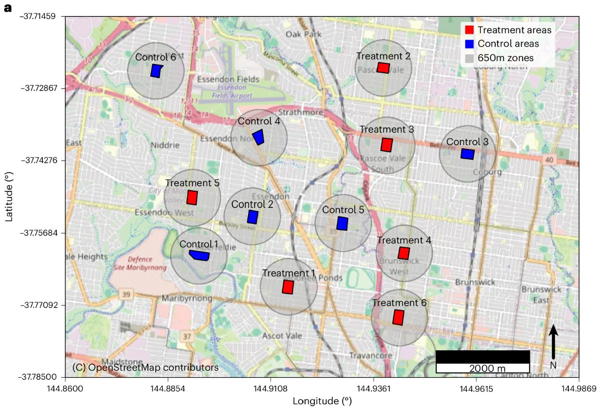
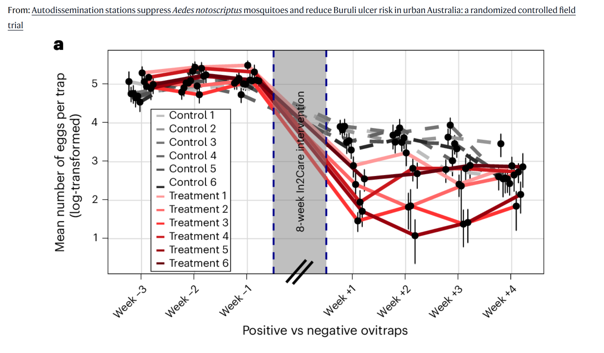

```{r}
#| label: load-packages
#| include: false
library(tidyverse)
library(ggthemes)
library(ggplot2)
library(randomcoloR)
library(patchwork)
library(emmeans)
library(performance)
library(stats)
library(knitr)
library(glmmTMB)
```
```{r}
#| echo: false

default_chunk_hook  <- knitr::knit_hooks$get("chunk")

latex_font_size <- c("Huge", "huge", "LARGE", "Large", 
                     "large", "normalsize", "small", 
                     "footnotesize", "scriptsize", "tiny")

knitr::knit_hooks$set(chunk = function(x, options) {
  x <- default_chunk_hook(x, options)
  if(options$size %in% latex_font_size) {
    paste0("\n \\", options$size, "\n\n", 
      x, 
      "\n\n \\normalsize"
    )
  } else {
    x
  }
})

```

# Background

## Understanding the Technique

### The Negative Binomial Distribution

Negative binomial regression extends the linear least-squares regression model to data that fits a negative binomial distribution. My wording there is careful, because most often the data doesn't fit what the negative binomial is actually modeled after. The negative binomial distribution measures the probability of $X$ failures occuring before the $n$-th success, where the probability of a success is $p$. For example, the probability of getting $X = 6$ tails before getting the $n = 3$ heads, where the the probability of getting a head or tail $p = 0.5$. 

\begin{align*}
P(X=x | n, p) = f_x(x,n,p) = \binom{x+n-1}{n-1} p^n (1-p)^x
\end{align*}


We can plot the probability mass function (PMF) to see the probability of $x$ failures occuring for every $X$, while changing the probability of success and keeping our number of success targets constant:

```{r}
#| echo: false
#| label: fig-nbinom_dist
#| fig-cap: "Negative Binomial Distribution Examples"
#| fig-width: 6
#| fig-height: 4


nbinom_dat <- tibble(p = rep(c(0.10, 0.25, 0.50, 0.75, 0.9, 0.95), each = 50), 
x = rep(1:50, 6)) |>
  mutate(prob = dnbinom(x = x, size = 5, prob = p))

ggplot(data = nbinom_dat, aes(x = x, y = prob, fill = as.character(p))) + 
facet_wrap(~ p, labeller = label_bquote(p == .(p))) + 
  geom_col(color = "black") + 
  theme_clean() + 
  xlab("# of Failures Occurring Before 5th Success") + 
  ylab("Probability") + 
  theme(legend.position = "none")
```

To set up the regression model, we need to work out the mean and variance of our distribution [@youtube].

Expected Value / Mean: 

\begin{align*}
E(X) =& \sum_{x=0}^{\infty} x \cdot f_x(x,n,p) \\ 
=& \sum_{x=0}^{\infty} x \cdot \binom{n+x-1}{n-1}\,p^n(1-p)^x \\ 
=& np^{-1}(1-p)\cdot \sum_{x=1}^{\infty}\frac{(n+x-1)}{n!(x-1)!} p^{n+1}(1-p)^{x-1} \\ 
(\text{Let} \, y = x-1) =& np^{-1}(1-p)\cdot \sum_{y=0}^{\infty}\frac{(n+y)!}{n!\,y!}p^{n+1}(1-p)^y \\
=& \frac{n(1-p)}{p}\cdot \sum_{y=0}^{\infty}\binom{(n+1)+y-1}{y}\,p^{n+1}(1-p)^y \\
=& \frac{n(1-p)}{p} 
\end{align*}

The second moment of the negative binomial distribution is given by:

\begin{align*}
E[X(X-1)] &= \sum_{x=0}^{\infty} x(x-1) f_x(x) = \sum_{x=0}^{\infty} x(x-1)\frac{(n+x-1)!}{(n-1 !x!}p^n(1-p)^x \\
&= \frac{n(n+1)(1-p)^2}{p^2}\cdot \sum_{x=2}^{\infty} \frac{[(n+2)+(x-2)-1]!}{(n+1)!(x-2)!}\, p^{n+2}(1-p)^{x-2} \\
(\text{Let }y = x-2) &= \frac{n(n+1)(1-p)^2}{p^2}\cdot \sum_{y=0}^{\infty}\binom{(n+2)+y-1}{y}\, p^{n+2}(1-p)^y \\
&= \frac{n(n+1)(1-p)^2}{p^2}
\end{align*}

To solve for the variance:

\begin{align*}
Var(x) &= E(x^2) - E(x)^2 = E(x^2)-E(x)+E(x)-E(x)^2 \\
&= E[x(x-1)]+E(x)-E(x)^2 \\
&= \frac{n(n+1)(1-p)^2}{p^2} + \frac{n(1-p)}{p} - \frac{n^2(1-p)^2}{p^2} \\ 
&= \frac{n^2(1-p)^2 + n(1-p)^2 + np(1-p) - n^2(1-p)^2}{p^2} \\
&= \frac{n(1-p)[(1-p)+p]}{p^2} \\
&= \frac{n(1-p)}{p^2}
\end{align*}

We can verify this numerically. Here I simulate 10,000 negative binomial distributed datasets with $n = 20$ successes waiting for, probability $p = 0.75$ and sample size $N=25$:

```{r}
set.seed(13)
sims = 10000 # Simulations
n = 20  # Successes
N = 25  # Sample Size
p = 0.75 # Probability

means <- rep(NA, sims) #Place to store means
vars <- rep(NA, sims)  #Place to store variances

for(i in 1:sims){
  nbinom_dat <- rnbinom(n = N, size = n, prob = p) #Simulate random data
  means[i] <- mean(nbinom_dat)   #Store the mean of the data
  vars[i] <- var(nbinom_dat)     #Store the variance of the data
}

```

Theoretically we'd expect our mean number of failures to be:
\begin{align*}
\frac{n(1-p)}{p} = \frac{20(1-0.75)}{0.75} = 6.6\bar{6}
\end{align*}

```{r}
#| echo: false
#| label: fig-means
#| fig-cap: "Negative Binomial Mean"
#| fig-width: 5
#| fig-height: 3

ggplot(data = tibble(means = means), aes(x = means)) +
  geom_boxplot() + 
  xlab("Mean of Negative Binomial Data") + 
  theme_clean() + 
  theme(
    axis.title.y = element_blank(),
    axis.text.y  = element_blank(),
    axis.ticks.y = element_blank()
  ) + 
    labs(colour = "", 
    title = paste("Mean of Means =", round(mean(means), 3)))

```

And our variance in the number of failures to be:

\begin{align*}
\frac{n(1-p)}{p^2} = \frac{20(1-0.75)}{(0.75)^2} = 8.8\bar{8}
\end{align*}

```{r}
#| echo: false
#| label: fig-vars
#| fig-cap: "Negative Binomial Variances"
#| fig-width: 5
#| fig-height: 3

ggplot(data = tibble(vars = vars), aes(x = vars)) +
  geom_boxplot() + 
  xlab("Variance of Negative Binomial Data") + 
  theme_clean() + 
  theme(
    axis.title.y = element_blank(),
    axis.text.y  = element_blank(),
    axis.ticks.y = element_blank()
  ) + 
    labs(colour = "", 
    title = paste("Mean of Variances =", round(mean(vars), 3)))

```

**Note that the boxplot shows the median of all the datasets.**

For some context, the variance of the negative binomial distribution approaches the variance of a poisson distribution as the number of failures increases while keeping the mean and successes the same: 

```{r}
#| echo: false
#| label: fig-nbinom_pois
#| fig-cap: "Negative Binomial and Poisson Variances"
#| fig-width: 6
#| fig-height: 4

sims = 25
n = 50
mu = 15

pois_vars <- rep(NA, sims)
nbinom_vars <- rep(NA, sims)

for (r in 1:sims){
  
  pois_vars[r] <- var(rpois(n = n, lambda = mu))
  
  nbinom_vars[r] <- var(rnbinom(n = n, mu = mu, size = r))
  
}


ggplot(data = tibble(p = pois_vars, 
                     nb = nbinom_vars, 
                     r = 1:sims), aes(x = r)) + 
  geom_line(aes(y = (pois_vars), color = "Poisson Sample")) + 
  geom_line(aes(y = (nbinom_vars), color = "Negative Binomial Sample")) + 
  geom_hline(yintercept = 15, linetype = "dotted", color = "red") + 
  ylab("Variance") +
  xlab(bquote(x)) + 
  theme_bw() + 
  ggtitle("", 
          subtitle = bquote(mu == .(mu) * "," ~ n == .(n))) + 
  labs(colour = "")

```

### Negative Binomial Regression

Where the typical linear regression goes as follows:
\begin{align*}
Y_i = \beta_0 + \beta_1 x_{1i} + \beta_2 x_{2i} + \cdots + \beta_{p-1} x_{(p-1)i} + \epsilon_i
\end{align*}

Since $Y_i$ is assumed to be continuous, both sides of the equation can range from $(-\infty, \infty)$. To model a variable that is based on counts, and therefore strictly $>0$, we have to transform the data to sit in the $(-\infty, \infty)$ range, and this can be achieved with a log transformation:

\begin{align*}
log(\mu_{Y_i|x_i}) = \beta_0 + \beta_1 x_{1i} + \cdots + \beta_{p-1} x_{(p-1)i}
\end{align*}
where $\mu_{Y_i|x_i}$ is the mean of the Negative Binomial distribution from which the $i\text{th}$ response is drawn. 

## The Study

{width=80%}

Everybody hates mosquitoes, especially Australians. *Aedes notoscriptus* mosquitoes, also known as the Australian backyard mosquito, are particularly harmful in any area where they're found. These mosquitoes have been found to spread *Mycobacterium ulcerans* in humans and other animals, resulting in a severe skin condition known as Buruli ulcer (no, I'm not showing a picture for that). In areas around Melbourne, cases of infection have been increasing in recent years, affecting potentially hundreds or thousands of people. People are often exposed in the warmer months where the mosquitoes are active, but because of a 3-6 month incubation period, can have symptoms much later.

{width=80%}

In2Care™ Mosquito Stations attempt to reduce adult populations and prevent the development of immature mosquitoes. Luring the adults in with scented water, the laid eggs and the adults are in contact with pyriproxyfen, which prevents the eggs' normal development and growth, and the adults spread to other areas. The adult mosquitoes are also infected with *Beauveria bassiana*, a fungus that is deadly to them eventually.

{width=80%}

So for this study, treatment and control sites were placed across a 50 km area in the suburbs of Melbourne, Australia, with each area having 80 partipating residential houses and 100 mosquito dissemination stations each. Baseline levels of mosquito populations were taken for 3 weeks prior to the intervention, with counts taken 6 weeks later for an additional 4 weeks [@paris2026].


## Goal of Statistical Analysis

Because I can't seem to escape mixed effect models, the negative binomial regression predicts mosquito eggs with factors: 

- Treatment Status
- Sampling
- Treatment Status x Sampling Interaction
- Trap Site (Random Intercept)

In *R*, our formula call looks like this: 

```{r}

formula <- eggs ~ group*week + (1|site)

```

# Reproduction of the Study
## Data Cleaning

Data is very nice! I removed the rows with NAs for egg counts as I'm assuming data is unavailable for those collections. 


```{r}

dat <- read_csv('mosquitos.csv')

dat$site <- factor(dat$site, levels = c("1", "2", "3", "4", "5", "6", "7", "8", "9", "10", "11", "12"))
dat$group <- factor(dat$group, levels = c("control", "treatment"))

dat <- dat |>
  drop_na()

```

## Data Summary

We can look at each study site's mosquito eggs over time:

```{r}
#| echo: false
#| label: fig-sum_treatment_site
#| fig-cap: "Treatment and Week Across Sites"
#| warning: false
#| message: false
#| fig-width: 10
#| fig-height: 6

ggplot(data = dat, aes(x = as.factor(week), y = log(eggs+1))) + 
  facet_wrap(vars(site)) +
  geom_boxplot() + 
  theme_bw() + 
  xlab("Sample Week") + 
  ylab("log(Mosquito Eggs + 1)") +
  labs(fill = "Site") + 
  geom_hline(yintercept = 0)


```

Let's take a quick summary of our mosquito egg counts by treatment group and week:

```{r}
#| echo: false
#| label: fig-sum_treatment
#| fig-cap: "Treatment and Week Summary"
#| warning: false
#| message: false
#| fig-width: 10
#| fig-height: 6

norm <- ggplot(data = dat, aes(x = as.factor(week), y = eggs, fill = group)) + 
  geom_boxplot(position = position_dodge(width = 0.8), 
               width = 0.6) + 
  theme_bw() + 
  xlab("Sample Week") + 
  ylab("Mosquito Eggs") +
  labs(fill = "Dissemination Treatment") + 
  geom_hline(yintercept = 0) + 
  labs(title = "Raw Counts")

log <- ggplot(data = dat, aes(x = as.factor(week), y = log(eggs+1), fill = group)) + 
  geom_boxplot(position = position_dodge(width = 0.8), 
               width = 0.6) + 
  theme_bw() + 
  xlab("Sample Week") + 
  ylab("log(Mosquito Eggs + 1)") +
  labs(fill = "Dissemination Treatment") + 
  geom_hline(yintercept = 0) +
  labs(title = "Log + 1 Transformed")

norm + log +
  plot_layout(guides = "collect") &
  theme(legend.position = "bottom")


```

This looks promising for the effectiveness of the treament! Interestingly, the egg counts for both the control and treatment sites drops sharply after the intervention, indicating that the effects of the intervention could be having a crossover effect into the control areas.

## Model Assumptions

### Gaussian Residuals

Since our model is a generalized linear mixed effect model, we need to check the assumption that our random intercepts for our sites are gaussian:


```{r}
#| echo: false
#| label: fig-intercepts
#| fig-cap: "Random intercepts of Sites"
#| warning: false
#| message: false
#| fig-width: 10
#| fig-height: 6

mod <- glmmTMB::glmmTMB(formula, data = dat, family = nbinom1())

random_intercepts <- unlist(ranef(mod)$cond)

p.hist <- ggplot(data=tibble(r=random_intercepts))+
geom_histogram(aes(x=r, y=after_stat(density)),
color="lightgrey", 
bins = 5)+
geom_hline(yintercept=0)+
theme_bw() +
xlab("Random Intercepts")+
ylab("Density")

p.qq <- ggplot(data=tibble(r=scale(random_intercepts))) +
stat_qq(aes(sample=r)) +
stat_qq_line(aes(sample=r))+
theme_bw() +
coord_flip() +
ylab("Observed Quantiles")+
xlab("Theoretical Quantile")

sw <- shapiro.test(random_intercepts)
sw_title <- bquote("Shapiro-Wilk: " * (italic(W) == .(round(unname(sw$statistic), 3))) *
                   ", " * (italic(p) == .(signif(sw$p.value, 3))))

p.hist + p.qq +
  plot_annotation(title = sw_title)


```

Even with a small sample ($n=12$ sites), our random intercepts look roughly gaussian and follow the qq-plot pretty well. 

### Dispersion

Dispertion ratios aren't quite as straightforward for mixed models, so we'll be using this approximation function provided by Dr. Ben Bolker, a mathematical statistician at McMaster University [@bolker_glmmfaq]. 

```{r}
#| echo: false
#| label: fig-residual_poisson
#| fig-cap: "Randomized Quantile Residuals of Negative Binomial Model"
#| warning: false
#| message: false
#| fig-width: 10
#| fig-height: 6

mus <- predict(mod, type = "response")
n <- nrow(dat)
rqr <- rep(NA, n)
ns <- MASS::fitdistr(dat$eggs, "negative binomial")[[1]][1]
y <- dat$eggs
for(i in 1:n){
  ai <- pnbinom(y[i]-1, size = ns, mu = mus[i])
  bi <- pnbinom(y[i], size = ns, mu = mus[i])
  ui <- runif(1, ai, bi)
  rqr[i] <- qnorm(ui)
}

overdisp_fun <- function(model) {
    rdf <- df.residual(model)
    rp <- residuals(model,type="pearson")
    Pearson.chisq <- sum(rp^2)
    prat <- Pearson.chisq/rdf
    pval <- pchisq(Pearson.chisq, df=rdf, lower.tail=FALSE)
    c(chisq=Pearson.chisq,ratio=prat,rdf=rdf,p=pval)
}

pearson.ratio <- overdisp_fun(mod)[2]

p1 <- ggplot(data=tibble(mu=mus,
                         e=rqr)) + 
      geom_hline(yintercept=0, linetype="dotted")+
      geom_point(aes(x=mu, y=e)) +
      theme_bw()+
      xlab(bquote(mu))+
      ylab("Randomized Quantile Residuals")
p2 <- ggplot(data=tibble(e=rqr)) +
  stat_qq(aes(sample=e)) +
  stat_qq_line(aes(sample=e)) +
  theme_bw() +
  ggtitle(paste("Dispersion Ratio =", round(pearson.ratio, 4)))

p1+p2

```

Our dispertion ratio here is **extremely** low. The randomized quantile residuals don't look terrible though. 

We can also check our predictions against the standardized Pearson residuals:

```{r}
#| echo: false
#| label: fig-predictions_residuals
#| fig-cap: "Predictions Against Pearson Residuals"
#| warning: false
#| message: false
#| fig-width: 10
#| fig-height: 6


ggdat <- tibble(r2= resid(mod, type = "pearson")^2,
                mus = fitted(mod))

ggplot(ggdat) + 
  geom_point(aes(x=mus, y=r2)) +
  geom_hline(yintercept = 1, linetype="dotted", color="red") +
  geom_smooth(aes(x=mus, y=r2)) +
  theme_clean() + 
  xlab(bquote(mu)) +
  ylab(bquote(r^2))


```

This is a better sign at least. We see a relatively flat line near 1 which is good. 

### Multicollinearity

```{r}
#| echo: false
#| label: tbl-model_vif

vif <- data.frame(check_collinearity(mod))

vif$Term <- c("Treatment", "Week", "Treatment : Week")
vif <- vif[, 1:4]
colnames(vif) <- c("Term", "VIF", "Lower CI", "Upper CI")

knitr::kable(vif, digits = 3, label = "model_vif", caption = "Model VIF", include.rownames = F)

```

The collinearity for the model looks good, with all the VIFs under 2. 

### Influential Observations

Testing influence through leverage, Cook's D, DFFITs, and studentized residuals is very difficult for glmer() models. Trust me. I tried. 

### Sufficient Sample Size for Predictors

Ideally we should have at least 10 events counted per predictor: 

\begin{align*}
\sum_{i=1}^{n = 3,213} \lambda_{i} = 253,237 \geq 10p = 10(3) = 30 \quad \checkmark
\end{align*}

## Model Fit

We can obtain an overall model fit:

```{r}
#| echo: false
#| label: tbl-model_performance

mod_performance <- data.frame(model_performance(mod))

knitr::kable(mod_performance, digits = 3, label = "model_fit", caption = "Model Fit", include.rownames = F)

```

Our fixed effects explain 93.7\% of the variance in mosquito eggs (extremely high). The total model including the random effects explains 97.4\% of the variance in mosquito eggs.


## Model Inference

Now to see if the treatment on the sites had an effect on the number of mosquito eggs, and if time had any additional effects:

A general summary our model gives us:

```{r}
#| echo: false
#| label: tbl-model_sum

sum <- data.frame((summary(mod)$coefficients)$cond)
rownames(sum) <- c("Intercept", "Group = Treatment", "Week", "Group = Treatment : Week")
colnames(sum) <- c("Estimate", "SE", "Z", "p")

sum$p <- ifelse(sum$p<0.001, "<0.001", round(sum$p, 3))
sum$SE <- ifelse(sum$SE<0.001, "<0.001", round(sum$SE, 3))

sum <- sum |>
  mutate(significance = case_when(p == "<0.001" ~ "***", 
                                  p < 0.01 ~ "**", 
                                  p < 0.05 ~ "*", 
                                  p < 0.1 ~ ".", 
                                  p >= 0.1 ~ ""), 
        `Percent Change` = (exp(Estimate)-1)*100)

sum$`Percent Change` <- round(sum$`Percent Change`, 1)
sum$`Percent Change`[1] <- ""

knitr::kable(sum, digits = 3, align = c("c", "r", "r", "r", "r"), label = "model_sum", caption = "Model Summary", include.rownames = F)

```

where the percent change $= (e^{\text{estimate}}-1) \times 100$. 

Because all of the terms are included in interactions, we'll skip the interpretations for now. 

For the intercept:

- Our model predicts that we'd see $e^{5.066} = 158.816$ eggs for a control site in week 0. 

Now let's try to untangle all those interactions [@emmeans].

## Model Interactions

### Effect of Mosquito Intervention

Testing the contrast of mosquito eggs by treatment group:

```{r}
#| echo: false
#| label: tbl-model_emm_treatment

mod_emm_treatment <- data.frame(pairs(emmeans(mod, ~ group)))

conf_emm_treatment <- confint(pairs(emmeans(mod, ~ group)))

mod_emm_treatment$percent_change <- (exp(mod_emm_treatment$estimate)-1)*100
mod_emm_treatment$percent_lower <- (exp(conf_emm_treatment$asymp.UCL)-1)*100
mod_emm_treatment$percent_upper <- (exp(conf_emm_treatment$asymp.LCL)-1)*100

colnames(mod_emm_treatment) <- c("Contrast", "Estimate", "SE", "df", "Z", "p", "Percent Change", "Upper CI", "Lower CI")

mod_emm_treatment$p <- ifelse(mod_emm_treatment$p < 0.001, "<0.001", mod_emm_treatment$p)

knitr::kable(mod_emm_treatment[,c(1,2,3,5,6,7,8,9)], digits = 3, label = "model_emm_treatment", caption = "Contrast of Treatment Groups", align = c("c", "c", "r", "r", "c", "c", "c", "c"), include.rownames = F)

```

Plotting the predicted number of mosquito eggs by treatment group: 

```{r}
#| echo: false
#| label: fig-emm_treatment
#| fig-cap: "Treatment Group Estimated Marginal Means"
#| warning: false
#| message: false
#| fig-width: 10
#| fig-height: 6


emm_grid_treatment <- data.frame(emmeans(mod, ~ group, type = "response"))

ggplot(dat = emm_grid_treatment, aes(x = group, y = response)) +
  geom_point() + 
  geom_errorbar(aes(ymin = asymp.LCL, ymax = asymp.UCL), width = 0.25) +
  theme_clean() + 
  xlab('Treatment Group') +
  ylab("Expected Mosquito Eggs") + 
  coord_flip()

```

Our model predicts that a control site will have 41.6\% more mosquito eggs than the treated site (95\% CI: [16.8, 71.7]). As we can see from the table and plot, the global effect of treatment group is statistically discernible ($Z = 3.540, p<0.001$).

### Effect of Time on Mosquito Intervention

To see if time affects the mosquito intervention's effect:

```{r}
#| echo: false
#| label: tbl-model_emt_treat_week

mod_emt_treat_week <- data.frame(test(emtrends(mod, "group", var = "week")))
mod_emt_treat_week_conf <- confint(emtrends(mod, "group", var = "week"))

mod_emt_treat_week$adjusted <- p.adjust(mod_emt_treat_week$p.value, method = "BH")
mod_emt_treat_week$percent_change <- (exp(mod_emt_treat_week$week.trend)-1)*100

mod_emt_treat_week$lower_ci <- (exp(mod_emt_treat_week_conf$asymp.LCL)-1)*100
mod_emt_treat_week$upper.ci <- (exp(mod_emt_treat_week_conf$asymp.UCL)-1)*100
colnames(mod_emt_treat_week) <- c("Treatment Group", "Week Trend", "SE", "df", "Z", "p", "adjusted-p", "Percent Change", "Lower CI", "Upper CI")
mod_emt_treat_week$p <- ifelse(mod_emt_treat_week$p<0.001, "<0.001", round(mod_emt_treat_week$p, 3))
mod_emt_treat_week$`adjusted-p` <- ifelse(mod_emt_treat_week$`adjusted-p`<0.001, "<0.001", round(mod_emt_treat_week$`adjusted-p`, 3))

knitr::kable(mod_emt_treat_week[,c(1, 2, 3, 5, 6, 7, 8, 9, 10)], digits = 3, label = "model_emt_pest_dens", caption = "Estimated Marginal Trend of Week by Treatment Group", align = c("c", "c", "r", "r", "r", "r", "r", "c"), include.rownames = F)

```

Both of the trends of week across groups are statistically discernible:

- Our model predicts that for every additional week, the number of mosquito eggs we'd see for the *control* group would decrease by 10.976\% (95\% CI: [9.805, 12.131]). This effect is statistically discernible ($Z = 17.443, p < 0.001$, adjusted-$p < 0.001$). 
- Our model predicts that for every additional week, the number of mosquito eggs we'd see for the *treatment* group would decrease by 18.913\% (95\% CI: [17.684, 20.123]). This effect is statistically discernible ($Z = 27.320, p < 0.001$, adjusted-$p <0.001$). 

Visualizing those trends: 

```{r}
#| echo: false
#| label: fig-emt
#| fig-cap: "Estimated Marginal Trends of Week by Treatment Group"
#| fig-width: 6
#| fig-height: 4


emm_data <- emmip(mod, group ~ week,
                   at = list(week = seq(min(dat$week), max(dat$week), length.out = 100)),
                   CIs = TRUE,
                   plotit = FALSE, 
                   type = "response")


ggplot(emm_data, aes(x = week, y = yvar, color = group, fill = group)) +
  geom_ribbon(aes(ymin = LCL, ymax = UCL), alpha = 0.2, color = NA) +
  geom_line(linewidth = 1) +
  ylab("Estimated Mosquito Eggs") +
  xlab("Week") +
  labs(color = "Treatment Group", fill = "Treatment Group") +
  theme_clean()

```


Testing the differences in those trends: 

```{r}
#| echo: false
#| label: tbl-emt_pairs

emt_pairs <- data.frame(pairs(emtrends(mod, "group", var = "week")))

emt_pairs_conf <- confint(pairs(emtrends(mod, "group", var = "week")))
emt_pairs$percent_change <- (exp(emt_pairs$estimate)-1)*100

emt_pairs$lower_ci <- (exp(emt_pairs_conf$asymp.LCL)-1)*100
emt_pairs$upper.ci <- (exp(emt_pairs_conf$asymp.UCL)-1)*100

colnames(emt_pairs) <- c("Contrast", "Estimate", "SE", "df", "Z", "p", "Percent Change", "Lower CI", "Upper CI")
emt_pairs$p <- ifelse(emt_pairs$p<0.001, "<0.001", round(emt_pairs_pest_dens$p, 3))

knitr::kable(emt_pairs[,c(1, 2, 3, 5, 6, 7, 8, 9)], digits = 3, label = "model_emt", caption = "Contrasts of Estimated Marginal Trend of Week by Treatment Group", align = c("c", "c", "r", "r", "r", "r", "r", "c"), include.rownames = F)


```

We can see:

- The trend for week is discernibly greater for the control versus the treatment group ($Z = 9.27, p<0.001$). Our model predicts that for additional week the percent change in mosquito eggs is 9.788 \% greater (95\% CI: [7.642, 11.977]) for the control group than the treament group.

## Conclusions

The results from our model are quite convincing. Before getting into those results, I should mention that the model is quite underdispersed, so perhaps another model would be better suited for this data. 

Aside from that though, the treatment has very solid evidence for reducing the number of mosquito eggs. Just looking at the overall effect, the number of expected mosquito eggs is firmly lower in the treatment group ([@fig-emm_treatment]). Often times, biological interventions can have quite small effects even when discernible, but an estimated 40\% reduction in mosquito egss is quite striking. 

The effect of time, specifically across treatment groups is also very interesting. When looking at the estimated marginal trends across treatment groups, the shapes of both curves appear to indicate an exponential decay in the expected mosquito eggs ([@fig-emt]), just with slightly greater decay in the treatment group. This lends to the idea that the treatment group helps reduce the number of mosquito eggs, but not only for those sites with the treatment, but also across the whole study area. It'd be interesting to see if this pattern would continue if they kept measuring the eggs across even more weeks.  

# Disagreements With the Article

## Results

Unfortunately, while the authors of this article and I come to similar conclusions about the effectiveness of the treatment, the way we went about assessing those differences were quite different, and make direct comparisons challenging. 

A direct comparison I do think I can make is against this sentence in their results:

> " We first fitted a generalized linear mixed model (GLMM) that indicated the number of eggs per trap was influenced by the sampling area as well as the sampling week (z = 78.05, P < 0.001)"

I think their wording here is a bit strange. I believe they're referring to the reaction term, but I wouldn't necessarily say that I would interpret the coefficient from an interaction term in that way. If they're referring to the individual terms, why give one Z-statistic and $p$-value? If we assume they're referring to the interaction term, their statistics are much much larger than my model came up with ([@tbl-model_sum]). When I went looking for answers in their code as to why this discrepancy is there, I noticed all of their code in their repository is in python, though they say in the article their analysis was done in *R*. 

The second large claim they make in the results is: 

> "Post hoc comparisons showed no significant differences in egg counts between the control and treatment areas in the 3 weeks of baseline egg counting undertaken before the intervention. The first sampling after the 8-week intervention was completed, showed significantly lower egg counts at all treatment areas compared with all control areas (Fig. 2a and Supplementary Table 3). This trend continued in the second week of egg counts after the intervention. Egg numbers at treatment areas started to merge with control area egg counts in weeks 3 and 4 after the cessation of the intervention (Supplementary Table 3, and Fig. 2a)."

This is a very different way than I analyzed their data. If I attempt to analyze the estimated marginal means at each of the weeks, instead of looking at the trend of weeks: 

```{r}
#| echo: false
#| label: tbl-emm_weeks_predict

emm_weeks_resp <- data.frame(emmeans(mod, ~ group | week, at = list(week = c(1, 2, 3, 9, 10, 11, 12)), type = "response"))

colnames(emm_weeks_resp) <- c("Group", "Week", "Estimate", "SE", "df", "Lower CI", "Upper CI")

knitr::kable(emm_weeks_resp[,c(1, 2, 3, 4, 6, 7)], digits = 3, label = "model_emm_pest_dens_post", caption = "Estimated Marginal Means of Treatment Group by Week (Post-hoc)", align = c("c", "c","c", "r", "c", "c"), include.rownames = F)


```

```{r}
#| echo: false
#| label: tbl-emm_weeks

emm_weeks <- data.frame(pairs(emmeans(mod, ~ group | week, at = list(week = c(1, 2, 3, 9, 10, 11, 12)))))
emm_weeks$adjusted <- p.adjust(emm_weeks$p.value, method = "BH")
emm_weeks$percent_change <- (exp(emm_weeks$estimate)-1)*100

emm_weeks_conf <- data.frame(confint(pairs(emmeans(mod, ~ group | week, at =list(week = c(1, 2, 3, 9, 10, 11, 12))))))

emm_weeks$lower_ci <- (exp(emm_weeks_conf$asymp.LCL)-1)*100
emm_weeks$upper_ci <- (exp(emm_weeks_conf$asymp.UCL)-1)*100

colnames(emm_weeks) <- c("Contrast", "Week", "Estimate", "SE", "df", "Z", "p", "adjusted-p", "Percent Change", "Lower CI", "Upper CI")

emm_weeks$p <- ifelse(emm_weeks$p<0.001, "<0.001", round(emm_weeks$p, 3))
emm_weeks$`adjusted-p` <- ifelse(emm_weeks$`adjusted-p`<0.001, "<0.001", round(emm_weeks$`adjusted-p`, 3))

knitr::kable(emm_weeks[,c(1, 2, 3, 4, 6, 7, 8, 9, 10,11)], digits = 3, label = "model_emm_pest_dens_post", caption = "Contrasts of Estimated Marginal Means of Treatment Gruop by Week (Post-hoc)", align = c("c", "c", "r", "r", "r", "r", "r", "c"), include.rownames = F)


```


Looking at it this way, we can see that their first sentence makes sense. There are no discernible differences between the control and the treatment groups in the three weeks before the intervention, which makes sense. For the first two weeks after the intervention, weeks 9 \& 10, we can now see that the difference between the two treatment groups is strongly discernible for both weeks. The part where I'm now confused, is when they say that the "Egg numbers at treatment areas started to merge with control area egg counts in weeks 3 and 4 after the cessation of the intervention." I'm not sure what led them to conclude that, given the estimated marginal means at weeks 3 \& 4 after the intervention (weeks 11 \& 12 in the model), are even more strongly different for the following weeks between the control and the treatment groups ([@tbl-emm_weeks]). If you're wondering if their reference to figure 2a and Supplementary Table 3 clear this up, this is Figure 2a:

{width=80%}

As you can see, not a figure which indicates statistics. Lastly, Supplementary Table 3 is simply the raw data for the study. 

Sadly, that's where the discussion of the results for this analysis ends in their results section, so we're left on a bit of a cliffhanger for a lot of these results. 

On one last interesting note from the results, the authors mention a period of low amounts of rain during the middle weeks of the study, which could explain a lot of the reduction in mosquito egg counts across both treatment groups. While this is helpful in adding context, I wonder why they didn't just include rainfall as a factor in the model if that data was available, instead of doing a separate analysis to test if rainfall alone was predictive of mosquito egg counts. The same could be said of temperature data. 

## Discussion

In the discussion, as well as the abstract, the authors bring up this statistic as a large piece of evidence for the effectiveness of the intervention:

> "The 70% reduction in egg counts in intervention areas compared to control areas we observed after the 8-week trial confirms the effectiveness of autodissemination systems for mosquito population reduction in urban settings."

I think the researchers might be slightly misinterpreting the data here. When they claim that there is a 70\% reduction in egg counts in the intervention areas compared to the control groups, I think they really mean that the control groups have about 70\% more mosquito eggs compared to the treatment groups, which is slightly different, and aligns with what my model predicts ([@tbl-emm_weeks]). Also, if they wanted to have a more convincing statistic, I don't understand why they wouldn't go with the larger difference, which is at week 12, when the control groups have 129\% more mosquito eggs than the treatment groups ([@tbl-emm_weeks]). 

So while the data is quite convincing for the efficacy of these interventions, these, what I would regard as misinterpretations or unclear results, unfortunatenly weaken their findings and message in my opinion. 

# Acknowledgement

I would like to thank the researchers who published this paper: Véronique Paris, Andrew H. Buultjens, Nicholas Bell, Thomas L. Schmidt, Wendy M. Bamberg, Michael T. Birrell, Finn Romanes, Catarina A. Antao, Maria Globan, Caroline Lavender, Katherine Bond, Sally Dougall, Jake A. Lacey, Yichen Zhai, Peihong Guo, Norelle L. Sherry, Katherine B. Gibney, Jue Tao Lim, Paul D. R. Johnson, Timothy P. Stinear & Ary A. Hoffmann. Transparency in data and code availability is hugely important for research ethics, and it makes my project possible. 

# AI Use

All of the guidance given by generative AI for this article can be found in [this conversation](https://claude.ai/share/3806fc57-e7ba-40a4-a521-58d4ec8b1126). 

# Statistical Packages Used

- *tidyverse* for... everything it's *tidyverse* [@tidyverse]
- *ggplot2* for plotting [@ggplot2]
- *ggthemes* for theme_clean() [@ggthemes]
- *patchwork* for combined plots [@patchwork]
- *glmmTMB* for inference of negative binomial GLMM model [@brooks2017glmmtmb]
- *performance* for model fit statistics [@performance]
- *emmeans* for interaction analysis [@emmeans]