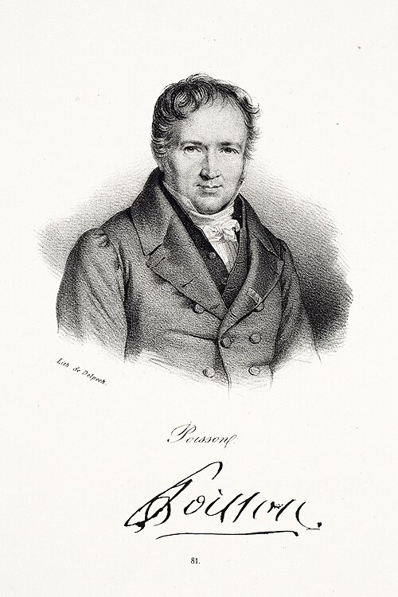
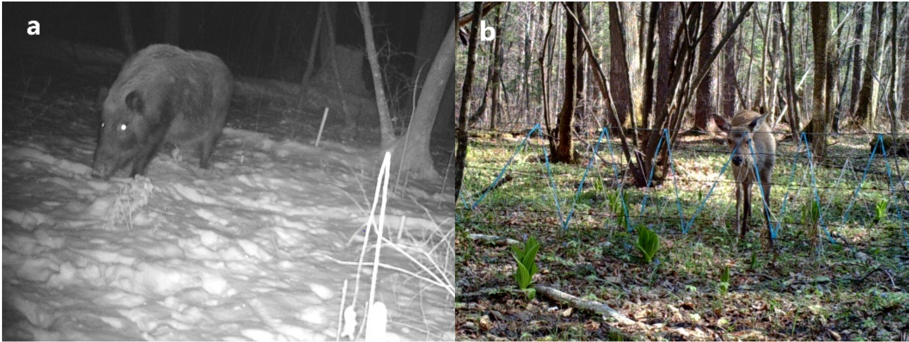
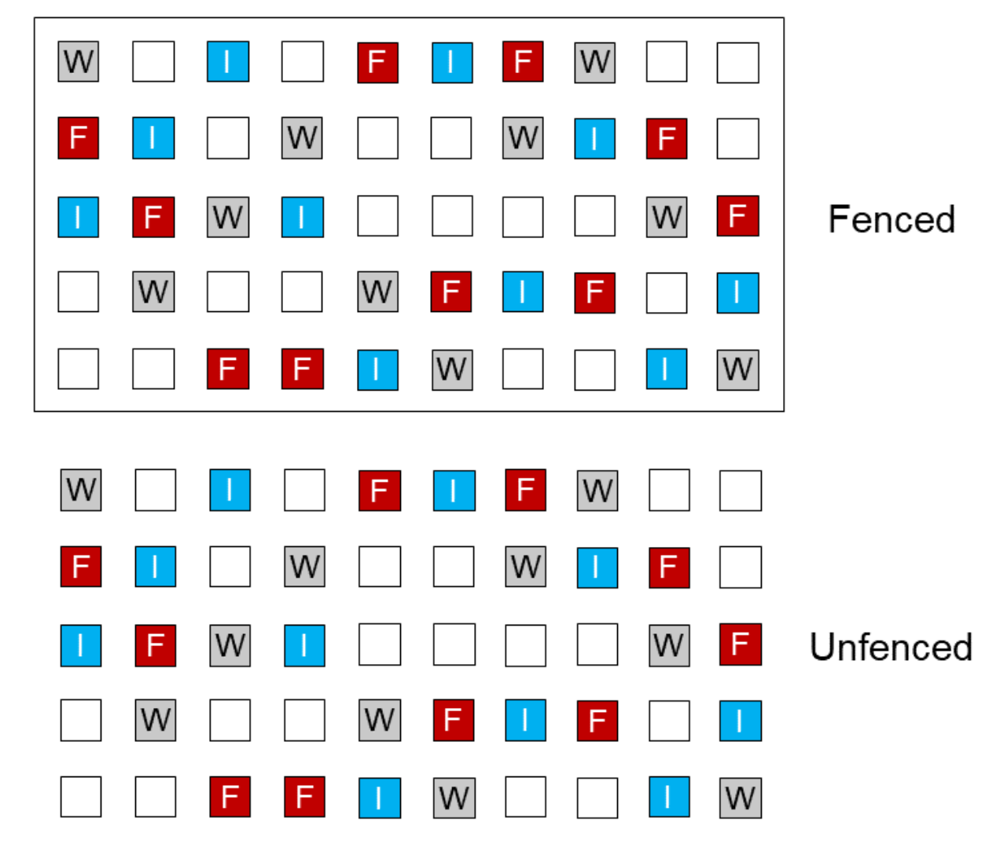
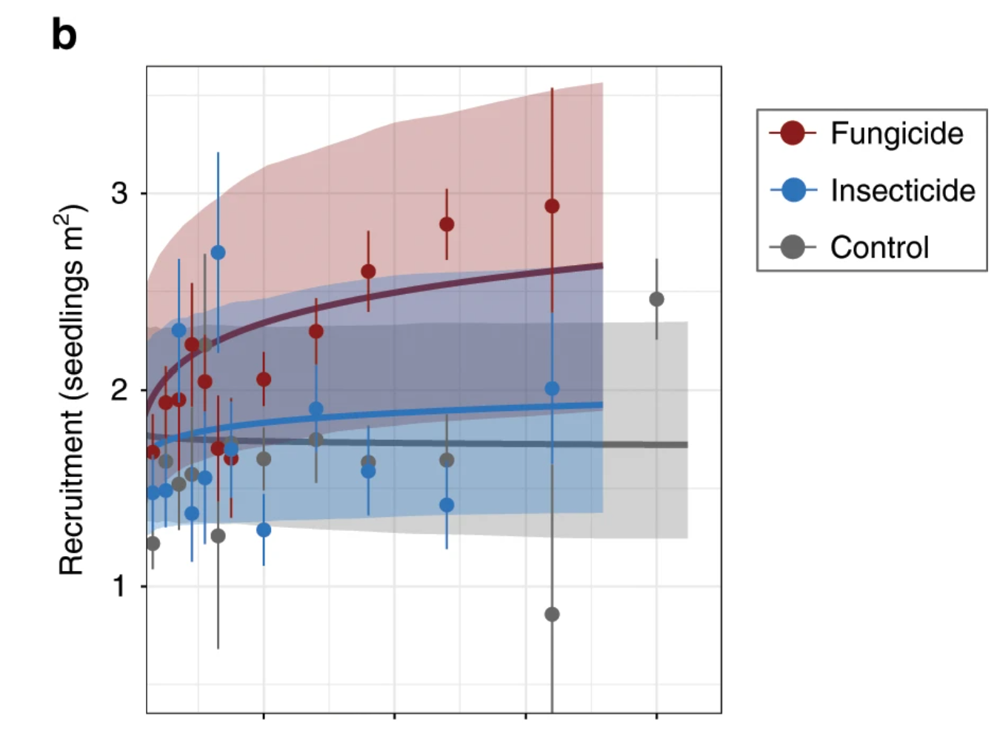
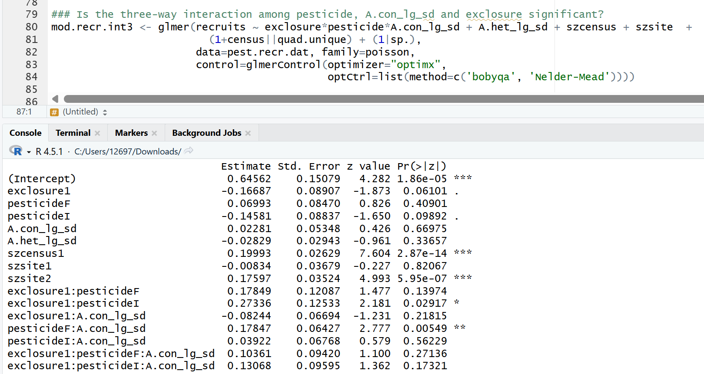
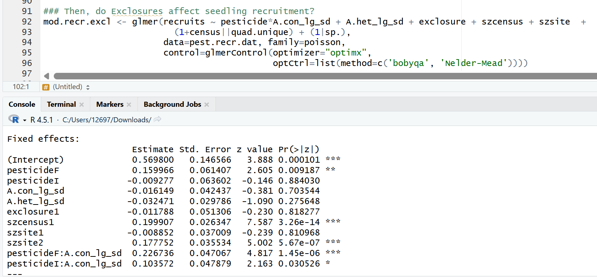
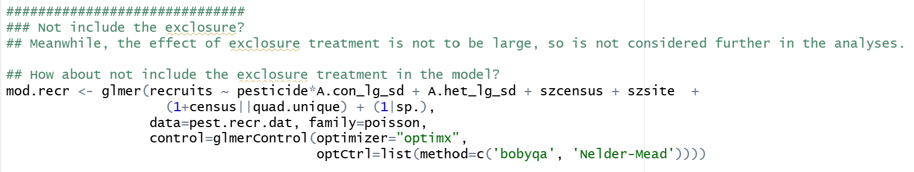

```{r}
#| label: load-packages
#| include: false
library(tidyverse)
library(ggthemes)
library(ggplot2)
library(randomcoloR)
library(lmerTest)
library(patchwork)
library(emmeans)
library(r2glmm)
library(performance)
library(stats)
library(knitr)
```
```{r}
#| echo: false

default_chunk_hook  <- knitr::knit_hooks$get("chunk")

latex_font_size <- c("Huge", "huge", "LARGE", "Large", 
                     "large", "normalsize", "small", 
                     "footnotesize", "scriptsize", "tiny")

knitr::knit_hooks$set(chunk = function(x, options) {
  x <- default_chunk_hook(x, options)
  if(options$size %in% latex_font_size) {
    paste0("\n \\", options$size, "\n\n", 
      x, 
      "\n\n \\normalsize"
    )
  } else {
    x
  }
})

```

# Background

 {width=30%}

## Understanding the Technique

### The Poisson Distribution

Poisson regression extends the linear least-squares regression model to poisson distributed data. Often used to represent physical events occurring, the poisson distribution measures the probability of $X$ events occuring over a given interval of time, and the average rate of those events occuring is $\lambda$. For example, the probability of $X = 6$ hurricanes happening over a year, when the historic average is $\lambda = \frac{4\, \text{hurricanes}}{\text{year}}$. 

The poisson distribution can be viewed as a special case of the binomial distribution, which models the number of successes in a fixed number of trials [@OxfordMathCenter]:

\begin{align*}
P(X=x) = f_x(x) = {}_{n}C_xp^xq^{n-x}
\end{align*}

Where $n$ is the number of trials, and $x$ is the number of successes. 

For the binomial distribution, the mean/expected value is $np$, which we'll call $\lambda$. So, 

\begin{align*}
p = \frac{\lambda}{n}
\end{align*}

If $q$ is the probability of a failure, $q = 1-p$, or

\begin{align*}
q = 1 - \frac{\lambda}{n}
\end{align*}

Plugging back into our original equation:

\begin{align*}
P(X = x) &= f_x(x) = {}_nC_x(\frac{\lambda}{n})^x(1-\frac{\lambda}{n})^{n-x} \\ 
&= \frac{n(n-1)(n-2)\cdots(n - x + 1)}{x!}\cdot \frac{\lambda^x}{n^x}(1 - \frac{\lambda}{n})^{n-x} \\
&= \frac{n}{n}\cdot\frac{n-1}{n}\cdots \frac{n-x+1}{n}\cdot \frac{\lambda^x}{x!}(1-\frac{\lambda}{n})^{n-x} \\
&= \frac{n}{n}\cdot \frac{n-1}{n}\cdots \frac{n-x+1}{n}\cdot \frac{\lambda^x}{x!}(1-\frac{\lambda}{n})^n(1-\frac{\lambda}{n})^{-x}
\end{align*}

Note that the second to last expression is an expression for $e^{-\lambda}$. 

If we take the limit as our number of trials $n$ approaches infinity while keeping $x$ and $\lambda$ fixed, all the terms except the second and third to last trend approach 1: 

\begin{align*}
\lim_{n \to \infty}P(X=x) = f_x(x) = \frac{e^{-\lambda}\lambda^x}{x!}
\end{align*}

This is the exact probability of $x$ events occuring over $\lambda$ time.

We can plot the probability mass function (PMF) to see the probability of $x$ events occuring for every $X$, noting how different $\lambda$ values change that distribution: 

```{r}
#| echo: false
#| label: fig-poisson_dist
#| fig-cap: "Poisson Distribution Examples"
#| fig-width: 6
#| fig-height: 4


poisson_dat <- tibble(lambda = rep(c(1, 5, 10), each = 20), 
x = rep(1:20, 3)) |>
  mutate(prob = dpois(x, lambda))

ggplot(data = poisson_dat, aes(x = x, y = prob, fill = as.character(lambda))) + 
facet_wrap(~ lambda, labeller = label_bquote(lambda == .(lambda))) + 
  geom_col(color = "black") + 
  theme_clean() + 
  xlab("# of Events Occurring") + 
  ylab("Probability") + 
  theme(legend.position = "none")
```

**remark: notice how as $\lambda$ increases the distribution is more bell curved shaped.**


The poisson distribution is particularly well behaved because of it's distributions properties. It's first two moments are given [@soch_statproofbook]: 

Expected Value / Mean: 

\begin{align*}
E(x) =& \sum_{x\in \mathcal{X}}^{} x \cdot f_X(x) \\ 
=& \sum_{x = 0}^{\infty} x \cdot \frac{\lambda^xe^{-\lambda}}{x!} \\
=& \sum_{x = 1}^{\infty} x \cdot \frac{\lambda^xe^{-\lambda}}{x!} \\ 
= & e^{-\lambda} \cdot \sum_{x = 1}^{\infty} \frac{x}{x!}\lambda^x \\
= & \lambda e^{-\lambda} \cdot \sum_{x = 1}^{\infty} \frac{\lambda^{x-1}}{(x-1)!} \\
\end{align*}

Let $z = x-1 \implies x = z+1$: 

\begin{align*}
E(X) =& \lambda e^{-\lambda} \cdot \sum_{z = 0}^{\infty}\frac{\lambda^z}{z!}
\end{align*}

Remember that the power series expansion of $e^x = \sum_{n=0}^{\infty}\frac{x^n}{n!}$.

Finally, 
\begin{align*}
E(X) =& \lambda e^{-\lambda} \cdot e^{\lambda} \\
=& \lambda
\end{align*}

Variance: 

\begin{align*}
Var(X) =& E(X^2) - E(X)^2
\end{align*}

If we look at the expectation of $X(X-1)$:

\begin{align*}
E[X(X-1)] &= \sum_{x\in \mathcal{X}} x (x-1) \cdot f_X(x) \\
&= \sum_{x=0}^{\infty}x (x-1) \cdot \frac{\lambda^xe^{-\lambda}}{x!} \\ 
&= \sum_{x=2}^{\infty}x(x-1)\cdot \frac{\lambda^xe^{-\lambda}}{x!} \\ 
&= e^{-\lambda}\cdot \sum_{x=2}^{\infty}x(x-1)\cdot \frac{\lambda^x}{x\cdot(x-1)\cdot(x-2)!} \\ 
&= \lambda^2 \cdot e^{-\lambda}\cdot \sum_{x=2}^{\infty}\frac{\lambda^{x-2}}{(x-2)!} \cdot
\end{align*}

let $z=x-2 \implies x=z+2$, hence:
\begin{align*}
E[X(X-1)] &= \lambda^2\cdot e^{-\lambda} \cdot \sum_{z=0}^{\infty}\frac{\lambda^z}{z!}
\end{align*}

recall the power series expansion of $e^x = \sum_{n=0}^{\infty}\frac{x^n}{n!}$:

\begin{align*}
E[X(X-1)] = \lambda^2 \cdot e^{-\lambda} \cdot e^{\lambda} = \lambda^2
\end{align*}

Since,
\begin{align*}
E[X(X-1)] = E(X^2-X) = E(X^2) - E(X)
\end{align*} 
now:
\begin{align*}
E(X^2) - E(X) = \lambda^2 \implies E(X^2) = \lambda^2 + \lambda 
\end{align*}

Finally, by plugging in:
\begin{align*}
Var(X) =& E(X^2) - E(X)^2 \\
=& \lambda^2 + \lambda - \lambda^2 \\
=& \lambda
\end{align*}

We can verify this numerically. Here I simulate 10,000 poisson distributed datasets with $\lambda = 1$ and sample size $n=25$:

```{r}
set.seed(13)
sims = 10000 #Simulations
lambda = 1  #Frequency Parameter
n = 25      #Sample Size

means <- rep(NA, sims) #Place to store means
vars <- rep(NA, sims)  #Place to store variances

for(i in 1:sims){
  poisson_dat <- rpois(n, lambda) #Simulate random data
  means[i] <- mean(poisson_dat)   #Store the mean of the data
  vars[i] <- var(poisson_dat)     #Store the variance of the data
}

```

The means and variances should both be centered around 1:

```{r}
#| echo: false
#| label: fig-means_vars
#| fig-cap: "Poisson Means and Variances"
#| fig-width: 6
#| fig-height: 4

means_plot <- ggplot(data = tibble(means = means), aes(x = means)) +
  geom_boxplot() + 
  xlab("Mean of Poisson Data") + 
  theme_clean() + 
  theme(
    axis.title.y = element_blank(),
    axis.text.y  = element_blank(),
    axis.ticks.y = element_blank()
  ) + 
    xlim(0,2)

  vars_plot <- ggplot(data = tibble(vars = vars), aes(x = vars)) +
  geom_boxplot() + 
  xlab("Variance of Poisson Data") + 
  theme_clean() + 
  theme(
    axis.title.y = element_blank(),
    axis.text.y  = element_blank(),
    axis.ticks.y = element_blank()
  ) + 
    xlim(0,2)

  means_plot / vars_plot

```

Even with some outliers here and there, it checks out. 

### Poisson Regression

Where the typical linear regression goes as follows:
\begin{align*}
Y_i = \beta_0 + \beta_1 x_{1i} + \beta_2 x_{2i} + \cdots + \beta_{p-1} x_{(p-1)i} + \epsilon_i
\end{align*}

Since $Y_i$ is assumed to be continuous, both sides of the equation can range from $(-\infty, \infty)$. To model a variable that is based on counts, and therefore strictly $>0$, we have to transform the data to sit in the $(-\infty, \infty)$ range, and this can be achieved with a log transformation:

\begin{align*}
log(\lambda_i) = \beta_0 + \beta_1 x_{1i} + \cdots + \beta_{p-1} x_{(p-1)i}
\end{align*}
where $\lambda_i$ is the parameter for the Poisson distribution from which the $i$th response is drawn.

If all of the data is not measured over the same unit of time, an offset variable is added to the equation: 
\begin{align*}
\log(\lambda_i) = \left(\log(T_i) + \beta_0\right) + \beta_1 x_{1i} + \cdots + \beta_{p-1} x_{(p-1)i}
\end{align*}

Lastly, a critical assumption of poisson regression is that the data behaves like it's poisson distributed, with equal mean and variance ([@fig-means_vars]). Otherwise, another type of regression (negative binomial, quasi-poisson, etc.) should be used. 


## The Study

{width=80%}

Jie et al. look to further investigate the Janzen-Connell effect, which looks to explain the mechanism behind biodiversity, or why a single tree or plant species doesn't just dominate a forest. In order for a plant to survive, it needs to not be eaten or destroyed by natural enemies (insects, animals, fungi, etc.). A common explanation behind biodiversity says that natural enemies specialize in eating/killing a specific plant over time, and those natural enemies accumulate in areas where there's high densities of those specific plants. Because of this, a new seedling might actually have an easier time in an area without a lot of members of its own species because those natural enemies have not accumulated so heavily. Essentially, there's always a push-and-pull between the plants and enemies in an area, and they balance each other out. [@Jia2020]. 

For one of their analyses, the researchers here look to test factors that can affect a seedlings ability to survive around a lot of members of its own species (a.k.a recruitment):

- How does the density of a plant's own species affect its seedlings' recruitment?
- Which natural enemies drive seedling recruitment?

To control which natural enemies are present, a fence was used to keep out herbivores, and insecticides/fungicides were used to discourage insects/fungus. 

 {width=70%}

To set up the experiment the researchers took 3 plots from a forest in China and divided them up into subplots:

 {width=70%}

 Within each plot, half was fenced, and within each half, 10 squares were control, 10 had insecticide, and 10 had fungicide. 

## Goal of Statistical Analysis

For their regression equation, they regress seedling recruitment with fixed factors:

- Pesticide treatment
- Fencing exclosure
- Density of adult plants (same species)
- Density of adult plants (different species)
- Plot
- Census Date

Including a three-way interaction and pairwise two-way interactions between the first three. 

And random factors:

- Subplot (random intercept)
- Species (random intercept)
- Effect of census on subplots (random effect)

**Also, same species density has been log transformed and Z-scored**

In *R*, our formula call looks like this: 

```{r}

formula <- recruits ~ pesticide*exclosure*con_crowding + het_crowding + plot + census  + (1| subplot) + (1| species) + (0+census | subplot)

```

# Reproduction of the Study
## Data Cleaning

I did some renaming of variables to fit my personal liking and some decoding for interpretation ease.

```{r}

dat <- read_csv('seeds.csv')

dat$plot <- as.character(dat$plot)
dat$exclosure <- ifelse(dat$exclosure == 1, "Fenced", "Open")
dat$exclosure <- factor(dat$exclosure, levels = c("Open", "Fenced"))

dat <- dat |>
  mutate(pesticide = case_when(pesticide == "W" ~ "Control", 
                               pesticide == "I" ~ "Insecticide", 
                               pesticide == "F" ~ "Fungicide"))


```

## Data Summary

Let's take a quick summary of our recruitment levels across treatment and exclosure:

```{r}
#| echo: false
#| label: fig-sum_treat_exclosure
#| fig-cap: "Treatment and Exclosure Summary"
#| warning: false
#| message: false
#| fig-width: 10
#| fig-height: 6

ggplot(data = dat, aes(x = exclosure, y = recruits, fill = pesticide)) + 
  geom_boxplot(position = position_dodge(width = 0.8), 
               width = 0.6) + 
  theme_bw() + 
  xlab("Exclosure Type") + 
  ylab("Seedling Recruits") +
  labs(fill = "Pesticide Treatment") + 
  geom_hline(yintercept = 0) 


```

Not a whole lot we can tell from this so far. 

Here's how our recruitment levels differ by same species density: 

```{r}
#| echo: false
#| label: fig-sum_density
#| fig-cap: "Density Summary"
#| warning: false
#| message: false
#| fig-width: 10
#| fig-height: 6

ggplot(data = dat, aes(x = con_crowding, y = recruits)) + 
  geom_point() + 
  geom_smooth(method = "lm") + 
  theme_clean() + 
  xlab("Same Species Density (Z)") + 
  ylab("Seedling Recruits") +
  labs(fill = "Pesticide Treatment") + 
  geom_hline(yintercept = 0) 


```

Not really any conclusive evidence for how same species density affects seedling recruitment based on this alone. 

For a frankenstein plot combining all of these:

```{r}
#| echo: false
#| label: fig-sum_combined
#| fig-cap: "Combined Summary"
#| warning: false
#| message: false
#| fig-width: 10
#| fig-height: 6

ggplot(data = dat, aes(x = con_crowding, y = recruits, color = pesticide)) +
  facet_wrap(vars(exclosure)) +  
  geom_point() + 
  geom_smooth(method = "lm") + 
  theme_clean() + 
  xlab("Same Species Density (Z)") + 
  ylab("Seedling Recruits") +
  labs(color = "Pesticide Treatment") + 
  geom_hline(yintercept = 0) 


```

Fun, but not super helpful. 

As an aside, we can see how our data maps onto a poisson distribution:

```{r}
#| echo: false
#| label: fig-data_poisson
#| fig-cap: "Poisson Distribution Mapped Onto Data"
#| warning: false
#| message: false
#| fig-width: 10
#| fig-height: 6

lambda_hat <- mean(dat$recruits)
k <- 0:max(dat$recruits)
pois_dat <- data.frame(k = k, p = dpois(k, lambda_hat))
pois_dat$p_data <- c(0, table(dat$recruits)/nrow(dat))

pois_dat <- pois_dat |>
  pivot_longer(cols = c("p", "p_data"), 
               names_to = "data_source", 
               values_to = "prob")

pois_dat$data_source <- ifelse(pois_dat$data_source == "p", "Poisson Distribution", "Data")


ggplot(pois_dat, aes(x = k, ymin = 0, ymax = prob, color = data_source)) + 
  geom_linerange(position = position_dodge2(width = 0.5), linewidth = 2) + 
  theme_clean() + 
  ggtitle(bquote("Data Mapped onto Poisson Distribution (" * lambda == .(round(lambda_hat,1)) * ")")) + 
  labs(x = "Seedling Recruits", y = "Probability", 
  colour = "") + 
  theme(legend.title = element_blank()) + 
  geom_hline(yintercept = 0) & 
  theme(legend.position = "bottom", 
  plot.title = element_text(hjust = 0.5))

```

Our data appears more right-skewed and more weighted towards \$\lambda = 1$ than an assumed poisson distribution with mean recruits $\lambda = 3.6$. Let's see if this affects the assumptions of our model. 

## Model Assumptions

### Gaussian Residuals

Since our model is a generalized linear mixed effect model, we need to check the assumption that our random effects are (multivariate) gaussian.

First we'll check the random intercepts for species:

```{r}
#| echo: false
#| label: fig-residual_species
#| fig-cap: "Random intercepts of Species"
#| warning: false
#| message: false
#| fig-width: 10
#| fig-height: 6

mod <- glmer(formula, data = dat, family = poisson)

random_intercepts_species <- ranef(mod)$species[[1]]

p.hist <- ggplot(data=tibble(r=random_intercepts_species))+
geom_histogram(aes(x=r, y=after_stat(density)),
color="lightgrey", 
bins = 5)+
geom_hline(yintercept=0)+
theme_bw() +
xlab("Random Intercepts")+
ylab("Density")

p.qq <- ggplot(data=tibble(r=scale(random_intercepts_species))) +
stat_qq(aes(sample=r)) +
stat_qq_line(aes(sample=r))+
theme_bw() +
coord_flip() +
ylab("Observed Quantiles")+
xlab("Theoretical Quantile")

sw_species <- shapiro.test(random_intercepts_species)
sw_species_title <- bquote("Shapiro-Wilk: " * (italic(W) == .(round(unname(sw_species$statistic), 3))) *
                   ", " * (italic(p) == .(signif(sw_species$p.value, 3))))

p.hist + p.qq +
  plot_annotation(title = sw_species_title)


```

Even with a small sample ($n=16$ species), our random intercepts look roughly gaussian and follow the qq-plot pretty well. 

Next, the random intercepts for subplots:

```{r}
#| echo: false
#| label: fig-residual_subplot_intercepts
#| fig-cap: "Random intercepts of Subplots"
#| warning: false
#| message: false
#| fig-width: 10
#| fig-height: 6


random_intercepts_subplots <- ranef(mod)$subplot[[1]]

p.hist <- ggplot(data=tibble(r=random_intercepts_subplots))+
geom_histogram(aes(x=r, y=after_stat(density)),
color="lightgrey", 
bins = 10)+
geom_hline(yintercept=0)+
theme_bw() +
xlab("Random Intercepts")+
ylab("Density")

p.qq <- ggplot(data=tibble(r=scale(random_intercepts_subplots))) +
stat_qq(aes(sample=r)) +
stat_qq_line(aes(sample=r))+
theme_bw() +
coord_flip() +
ylab("Observed Quantiles")+
xlab("Theoretical Quantile")

sw_subplots <- shapiro.test(random_intercepts_subplots)
sw_subplots_title <- bquote("Shapiro-Wilk: " * (italic(W) == .(round(unname(sw_subplots$statistic), 3))) *
                   ", " * (italic(p) == .(signif(sw_subplots$p.value, 3))))

p.hist + p.qq +
  plot_annotation(title = sw_subplots_title)


```


Even though the shapiro-wilks test indicates a deviation from normality, the histogram shows a roughly gaussian shape of our random intercepts for subplot centered at zero. The qq-plot looks a little wonky towards the right tail, but I don't think it's a huge problem.

Lastly, we check the multivariate normality of the effect of census on subplots:

```{r}
#| echo: false
#| label: fig-distances
#| fig-cap: "Mahalanobis Distances of Census Effects on Subplots"
#| warning: false
#| message: false
#| fig-width: 10
#| fig-height: 6


subplots <- unique(dat$subplot)

random.effects <- as.matrix(ranef(mod)$subplot)[, 1:2]

Sigma.gamma <- as.matrix(VarCorr(mod)$subplot) # estimated covariance

raneffs <- tibble(subplot = subplots,
MD = NA)
for(i in 1:length(subplots)) {
# Compute Distance
curr.raneffs <- random.effects[i, ]
raneffs$MD[i] = t(curr.raneffs) %*% solve(Sigma.gamma) %*% curr.raneffs
}

ggplot(data = raneffs) +
stat_qq(aes(sample=MD),
distribution = qchisq, dparams = (list(df=2))) +
stat_qq_line(aes(sample=MD),
distribution = qchisq, dparams = (list(df=2)))+
theme_bw() +
coord_flip() +
ylab("Mahalanobis Distance")+
xlab("Theoretical Quantile")


```

The multivariate normality of the effects of census on subplots follows closely to a $\chi^2$ distribution by fitting the qq-plot closely. 

### Dispersion

Dispertion ratios aren't quite as straightforward for mixed models, so we'll be using this approximation function provided by Dr. Ben Bolker, a mathematical statistician at McMaster University [@bolker_glmmfaq]. 

```{r}
#| echo: false
#| label: fig-residual_poisson
#| fig-cap: "Randomized Quantile Residuals of Poisson Model"
#| warning: false
#| message: false
#| fig-width: 10
#| fig-height: 6

lambdas <- predict(mod, type = "response")
n = nrow(dat)
y = dat$recruits
rqr <- rep(NA, n)
for(i in 1:n){
  ai <- ppois(y[i]-1, lambda=lambdas[i])
  bi <- ppois(y[i], lambda=lambdas[i])
  ui <- runif(1, ai, bi)
  rqr[i] <- qnorm(ui)
}

overdisp_fun <- function(model) {
    rdf <- df.residual(model)
    rp <- residuals(model,type="pearson")
    Pearson.chisq <- sum(rp^2)
    prat <- Pearson.chisq/rdf
    pval <- pchisq(Pearson.chisq, df=rdf, lower.tail=FALSE)
    c(chisq=Pearson.chisq,ratio=prat,rdf=rdf,p=pval)
}

pearson.ratio <- overdisp_fun(mod)[2]

p1 <- ggplot(data=tibble(lambda=lambdas,
                         e=rqr)) + 
      geom_hline(yintercept=0, linetype="dotted")+
      geom_point(aes(x=lambda, y=e)) +
      theme_bw()+
      xlab(bquote(lambda))+
      ylab("Randomized Quantile Residuals")
p2 <- ggplot(data=tibble(e=rqr)) +
  stat_qq(aes(sample=e)) +
  stat_qq_line(aes(sample=e)) +
  theme_bw() +
  ggtitle(paste("Dispersion Ratio =", round(pearson.ratio, 4)))
p1+p2

```

Our dispersion ratio here is very good. The bottom left of the cluster of points highlights the high amount of 1's observed in the recruit measurement. Still, this is promising for our model. 

We can also check our predictions against the standardized Pearson residuals:

```{r}
#| echo: false
#| label: fig-predictions_residuals
#| fig-cap: "Predictions Against Pearson Residuals"
#| warning: false
#| message: false
#| fig-width: 10
#| fig-height: 6


ggdat <- tibble(r2= resid(mod, type = "pearson")^2,
                lambdas = fitted(mod))

ggplot(ggdat) + 
  geom_point(aes(x=lambdas, y=r2)) +
  geom_hline(yintercept = 1, linetype="dotted", color="red") +
  geom_smooth(aes(x=lambdas, y=r2)) +
  theme_clean() + 
  xlab(bquote(lambda)) +
  ylab(bquote(r^2))


```

This is a good sign, as there's a nice relatively flat line near 1.

### Multicollinearity

```{r}
#| echo: false
#| label: tbl-model_vif

vif <- data.frame(check_collinearity(mod))

vif$Term <- c("Pesticide Treatment", "Exclosure", "Same Species Density", "Different Species Density", "Plot", "Census Date", "Pesticide Treatment: Exclosure", "Pesticide Treatment: Same Species Density", "Exclosure : Same Species Crowding", "Pesticide Treatment : Exclosure : Same Species Crowding")
vif <- vif[, 1:4]
colnames(vif) <- c("Term", "VIF", "Lower CI", "Upper CI")

knitr::kable(vif, digits = 3, label = "model_vif", caption = "Model VIF", include.rownames = F)

```

The collinearity for the model looks good, with only some slight colinearity for pesticide treatment, exclosure, and same species density. VIF values for interaction terms are usually high, so there's not really anything to worry about here. 

### Influential Observations

Testing influence through leverage, Cook's D, DFFITs, and studentized residuals is very difficult for glmer() models. Trust me. I tried. 

### Sufficient Sample Size for Predictors

Ideally we should have at least 10 events counted per predictor: 

\begin{align*}
\sum_{i=1}^{n = 1019} \lambda_{i} = 3666 \geq 10p = 10(10) = 100 \quad \checkmark
\end{align*}

## Model Fit

We can obtain an overall model fit:

```{r}
#| echo: false
#| label: tbl-model_performance

mod_performance <- data.frame(model_performance(mod))

knitr::kable(mod_performance, digits = 3, label = "model_fit", caption = "Model Fit", include.rownames = F)

```

Our fixed effects explain 10.8\% of the variance in seedling recruitment. The total model including the random effects explains 46.8\% of the variance in seedling recruitment. With our ICC, our random effects explain 40.4% of the variance in seedling recruitment. 


The researchers mention testing the model fit when they drop some of the interaction terms. Since a three-way interaction can be very tricky to interpret, I wanted to test the fit between our normal model and a model with the three-way interaction term dropped in favor of just the pairwise two-way interactions. 


```{r}
#| echo: false
#| label: tbl-model_comparison

dropped_mod <- glmer(recruits ~ pesticide*exclosure + pesticide*con_crowding + exclosure*con_crowding + het_crowding + plot + census + (1 | subplot) + (1 | species) + (census | subplot), data = dat, family = poisson)

compare <- data.frame(anova(mod, dropped_mod))
colnames(compare) <- c("# Parameters", "AIC", "BIC", "log Likelihood", "Deviance", "Chi-Sq", "df", "p")
rownames(compare) <- c("Dropped Interaction Model", "Original Model")

knitr::kable(compare, digits = 3, label = "model_comparison", caption = "Model Comparison", include.rownames = T)


```

Really not much difference between the two models, so begrudgingly, we'll move forward with the three-way interaction.

## Model Inference

Now to the heart of the analysis: 

- Do the fenced in plots have more seedlings?
- Does the pesticide treatment affect the number of seedlings?
- Is there an interactive effect between pesticide, exclosure, and same species crowding?

A general summary our model gives us:

```{r}
#| echo: false
#| label: tbl-model_sum

sum <- data.frame(summary(mod)$coefficients)
rownames(sum) <- c("Intercept", "Pesticide = Fungicide", "Pesticide = Insecticide", "Fenced", "Same Species Density", "Different Species Density", "Plot 2", "Plot 3", "Census Date = 2017 Spring", "Pesticide = Fungicide : Fenced", "Pesticide = Insecticide : Fenced", "Pesticide = Fungicide : Same Species Density", "Pesticide = Insecticide : Same Species Density", "Fenced : Same Species Density", "Pesticide = Fungicide : Fenced : Same Species Density", "Pesticide = Insecticide : Fenced : Same Species Crowding")
colnames(sum) <- c("Estimate", "SE", "Z", "p")

sum$p <- ifelse(sum$p<0.001, "<0.001", round(sum$p, 3))
sum$SE <- ifelse(sum$SE<0.001, "<0.001", round(sum$SE, 3))

sum <- sum |>
  mutate(significance = case_when(p == "<0.001" ~ "***", 
                                  p < 0.01 ~ "**", 
                                  p < 0.05 ~ "*", 
                                  p < 0.1 ~ ".", 
                                  p >= 0.1 ~ ""), 
        `Percent Change` = (exp(Estimate)-1)*100)

sum$`Percent Change` <- round(sum$`Percent Change`, 1)
sum$`Percent Change`[1] <- ""

knitr::kable(sum, digits = 3, align = c("c", "r", "r", "r", "r"), label = "model_sum", caption = "Model Summary", include.rownames = F)

```

where the percent change $= (e^{\text{estimate}}-1) \times 100$. 

Our model says, for the non-interaction fixed effects (deep breath):

- For the intercept, we'd expect to find $e^{0.837} = 3.598$ seedlings on a control subplot, that's open, has a same species \& different species density of 0, on plot 1, and in the spring of 2016. 
- For every standard deviation increase in different species density, we'd expect to see 2.8\% fewer seedlings
- We'd expect to see 20.2\% more seedlings on plot 2 than plot 1. 
- We'd expect to 14.7\% fewer seedlings on plot 3 than plot 1. 
- We'd expect to see 33\% fewer seedlings in the spring of 2017 compared to the spring of 2016

For the statistical discernability of our terms: 

- There are marginally fewer seedlings in the fenced plots than the non-fenced plots ($Z = -1.879, p = 0.06$)
- There are discernibly more seedlings on plot 2 than plot 1 ($Z = 2.924, p = 0.003$)
- There are discernibly fewer seedlings on plot 3 than plot 1 ($Z = -2.376, p = 0.018$)
- There are discernibly fewer seedslings in the spring of 2017 than the spring of 2016 ($Z = -7.501, p <0.001$)
- The two-way interaction between insecticide and fenced plots is statistically discernible ($Z = 2.182, p = 0.029$)
- The two-way interaction between fungicide and same species density is statistically discernible ($Z = 2.804, p = 0.005$)

Testing the effect sizes of our fixed effects [@r2glmm]: 

```{r}
#| echo: false
#| label: tbl-model_eff

model_eff <- data.frame(r2beta(mod, method = "nsj", partial = T))[, c(1,6,8,7)]
model_eff$Rsq <- ifelse(model_eff$Rsq < 0.001, "<0.001", round(model_eff$Rsq,3))
model_eff$upper.CL <- ifelse(model_eff$upper.CL < 0.001, "<0.001", round(model_eff$upper.CL,3))
model_eff$lower.CL <- ifelse(model_eff$lower.CL < 0.001, "<0.001", round(model_eff$lower.CL,3))

model_eff$Effect <- c("Model", "Census", "Plot", "Pesticide : Same Species Density", "Pesticide : Exclosure", "Pesticide", "Exclosure", "Pesticide : Exclosure : Same Species Density", "Exclosure : Same Species Density", "Same Species Density", "Different Species Density")
colnames(model_eff) <- c("Effect", "R-Squared", "Lower CI", "Upper CI")


knitr::kable(model_eff[c(1, 6, 7, 2, 3, 10, 11, 5, 4, 9, 8),], digits = 3, label = "model_eff", caption = "Model Effect Sizes", align = c("c", "r", "r", "r"), row.names = FALSE)

```

The largest effect of any term, besides the model, is the census term, which explains 4\% of the variance in seed recruitments.

Now let's try to untangle all those interactions [@emmeans].

## Model Interactions

### Same Species Density Trend

First, we'll see if the density of a plant's own species affects its seedlings' recruitment through estimated marginal trends:

```{r}
#| echo: false
#| label: tbl-model_emt_density

mod_emt <- data.frame(test(emtrends(mod, ~ 1,  var = "con_crowding")))

conf_emt <- confint(emtrends(mod, ~ 1,  var = "con_crowding"))

mod_emt$percent_change <- (exp(mod_emt$con_crowding.trend)-1)*100
mod_emt$percent_lower <- (exp(conf_emt$asymp.LCL)-1)*100
mod_emt$percent_upper <- (exp(conf_emt$asymp.UCL)-1)*100

colnames(mod_emt) <- c("X1", "Same Species Density Trend", "SE", "df", "Z", "p", "Percent Change", "Lower CI", "Upper CI")

knitr::kable(mod_emt[,c(2,3,5,6,7,8,9)], digits = 3, label = "model_emt", caption = "Same Species Density Estimated Marginal Trend", align = c("c", "c", "r", "r", "c", "c", "c", "c"), include.rownames = F)

```

Let's see the predicted number of seedlings across the same species density:

```{r}
#| echo: false
#| label: fig-emtrend_density
#| fig-cap: "Same Species Estimated Marginal Trend"
#| warning: false
#| message: false
#| fig-width: 10
#| fig-height: 6


crowdings <- seq(min(dat$con_crowding), max(dat$con_crowding), length.out = 50)

emt_grid <- data.frame(emmeans(mod, ~ con_crowding, at = list(con_crowding = crowdings), type = "response"))

ggplot(dat = emt_grid, aes(x = con_crowding, y = rate,)) +
  geom_ribbon(aes(ymin = asymp.LCL, ymax = asymp.UCL), alpha = 0.2, color = NA) +
  geom_line(linewidth = 1) +
  theme_clean() + 
  xlab('Same Species Density (Z)') +
  ylab("Expected Seedling Recruits")

```

Interestingly, the overall effect of same species density is to positively affect the number of seedling recruits expected. Our model predicts that for every standard deviation increase in same species density, the number of seedling recruits increases by 9.8\% (95\% CI: [3.0, 17.0]). This trend is statistically disernible ($Z = 2.85, p = 0.004$).

### Effect of Fencing in Plots

Next, we'll see if fencing off the plots from herbivores increases the number of seedlings:

Averaging across other variables, we see a contrast between the fenced-in and non-fenced-in plots:

```{r}
#| echo: false
#| label: tbl-model_emm_exclosure

mod_emm_ex <- data.frame(pairs(emmeans(mod, ~ exclosure)))

conf_emm_ex <- confint(pairs(emmeans(mod, ~ exclosure)))

mod_emm_ex$percent_change <- (exp(mod_emm_ex$estimate)-1)*100
mod_emm_ex$percent_lower <- (exp(conf_emm_ex$asymp.UCL)-1)*100
mod_emm_ex$percent_upper <- (exp(conf_emm_ex$asymp.LCL)-1)*100

colnames(mod_emm_ex) <- c("Contrast", "Estimate", "SE", "df", "Z", "p", "Percent Change", "Upper CI", "Lower CI")

knitr::kable(mod_emm_ex[,c(1,2,3,5,6,7,8,9)], digits = 3, label = "model_emm_ex", caption = "Contrast of Exclosure Types", align = c("c", "c", "r", "r", "c", "c", "c", "c"), include.rownames = F)

```

Plotting the predicted number of seedlings by exclosure type: 

```{r}
#| echo: false
#| label: fig-emm_ex
#| fig-cap: "Exclosure Type Estimated Marginal Means"
#| warning: false
#| message: false
#| fig-width: 10
#| fig-height: 6


emm_grid_ex <- data.frame(emmeans(mod, ~ exclosure, type = "response"))

ggplot(dat = emm_grid_ex, aes(x = exclosure, y = rate)) +
  geom_point() + 
  geom_errorbar(aes(ymin = asymp.LCL, ymax = asymp.UCL), width = 0.25) +
  theme_clean() + 
  xlab('Exclosure Type') +
  ylab("Expected Seedling Recruits") + 
  coord_flip()

```

Our model predicts that an open plot will have 1.6\% more seedlings than a fenced in plot (95\% CI: [-8.2, 8.2]). As we can see from the table and plot, the global effect of exclosure type is not statistically discernible ($Z = 0.313, p = 0.754$).

### Effect of Pesticides

We've tried to see the effects of one kind of natural threat to seedlings, herbivores, now we'll see if pesticides, thought to discourage insects and fungi, affects the number of seedlings:

```{r}
#| echo: false
#| label: tbl-model_pairs_pest

mod_emm_pest <- data.frame(pairs(emmeans(mod, ~ pesticide)))

conf_emm_pest <- confint(pairs(emmeans(mod, ~ pesticide)))

mod_emm_pest$adjusted <- p.adjust(mod_emm_pest$p.value, method = "BH")
mod_emm_pest$percent_change <- (exp(mod_emm_pest$estimate)-1)*100
mod_emm_pest$percent_lower <- (exp(conf_emm_pest$asymp.LCL)-1)*100
mod_emm_pest$percent_upper <- (exp(conf_emm_pest$asymp.UCL)-1)*100

colnames(mod_emm_pest) <- c("Contrast", "Estimate", "SE", "df", "Z", "p", "Adjusted-p", "Percent Change", "Lower CI", "Upper CI")

knitr::kable(mod_emm_pest[,c(1,2,3,5,6,7,8,9, 10)], digits = 3, label = "model_emm_ex", caption = "Contrast of Pesticide Types", align = c("c", "c", "r", "r", "c", "c", "c", "c", "c"), include.rownames = F)

```

Plotting the predicted number of seedlings by pesticide type: 

```{r}
#| echo: false
#| label: fig-emm_pest
#| fig-cap: "Pesticide Type Estimated Marginal Means"
#| warning: false
#| message: false
#| fig-width: 10
#| fig-height: 6


emm_grid_pest <- data.frame(emmeans(mod, ~ pesticide, type = "response"))

ggplot(dat = emm_grid_pest, aes(x = pesticide, y = rate)) +
  geom_point() + 
  geom_errorbar(aes(ymin = asymp.LCL, ymax = asymp.UCL), width = 0.25) +
  theme_clean() + 
  xlab('Pesticide Type') +
  ylab("Expected Seedling Recruits") + 
  coord_flip()

```

The global effect of fungicide is statistically more favorable to seedlings than insecticide ($Z = -2.634, p = 0.023$, adjusted-$p = 0.034$) and the control ($Z = 2.766, p = 0.016$, adjusted-$p = 0.034$). Our model predicts that the fungicide plots will have 14.7\% more seedlings (95\% CI: [1.7, 26.0]) than the control plots, and 18.3\% more seedlings (95\% CI: [2.6, 36.5]) than the insecticide plots. 

### Pesticide Type and Exclosure Type Interaction

Based on a significant interaction term between fungicide and the fenced plots, we'll probe into that interaction here:

```{r}
#| echo: false
#| label: tbl-model_emm_pest_ex

mod_emm_pest_ex <- data.frame(pairs(emmeans(mod, ~ pesticide | exclosure)))

conf_emm_pest_ex <- data.frame(confint(pairs(emmeans(mod, ~ pesticide | exclosure))))

mod_emm_pest_ex$adjusted <- p.adjust(mod_emm_pest_ex$p.value, method = "BH")
mod_emm_pest_ex$percent_change <- (exp(mod_emm_pest_ex$estimate)-1)*100
mod_emm_pest_ex$percent_lower <- (exp(conf_emm_pest_ex$asymp.LCL)-1)*100
mod_emm_pest_ex$percent_upper <- (exp(conf_emm_pest_ex$asymp.UCL)-1)*100

colnames(mod_emm_pest_ex) <- c("Contrast", "Exclosure Type", "Estimate", "SE", "df", "Z", "p", "Adjusted-p", "Percent Change", "Lower CI", "Upper CI")

knitr::kable(mod_emm_pest_ex[,c(1,2,3,4,6,7,8,9,10)], digits = 3, label = "model_emm_pest_ex", caption = "Contrast of Insecticide Types by Exclosure Types", align = c("c", "c", "c", "r", "r", "c", "c", "c", "c", "c"), include.rownames = F)

```

Plotting the predicted number of seedlings by exclosure and pesticide type: 

```{r}
#| echo: false
#| label: fig-emm_pest_ex
#| fig-cap: "Pesticide Type by Exclosure Type Estimated Marginal Means"
#| warning: false
#| message: false
#| fig-width: 10
#| fig-height: 6


emm_grid_pest_ex <- data.frame(emmeans(mod, ~ pesticide | exclosure, type = "response"))

ggplot(dat = emm_grid_pest_ex, aes(x = exclosure, y = rate, color = pesticide)) +
  geom_point(position = position_dodge(width = 0.4)) + 
  geom_errorbar(aes(ymin = asymp.LCL, ymax = asymp.UCL), width = 0.25, position = position_dodge(width = 0.4)) +
  theme_clean() + 
  xlab('Pesticide Type') +
  ylab("Expected Seedling Recruits") + 
  labs(color = "Pesticide Type") + 
  coord_flip()

```

Even though the interaction term in the overall model is significant, none of the contrasts remain statistically discernible after adjustment. It's interesting to see how the relationship between each pesticide type changes between fenced and non-fenced in plots. 

### Pesticide Type and Same Species Density Interaction

For our last interaction, we'll see if the effect of the same species density changes depending on the pesticide type used:

```{r}
#| echo: false
#| label: tbl-model_emt_pest_density

mod_emt_pest_dens <- data.frame(test(emtrends(mod, "pesticide", var = "con_crowding")))
conf_emt_pest_dent <- confint(emtrends(mod, "pesticide", var = "con_crowding"))

mod_emt_pest_dens$adjusted <- p.adjust(mod_emt_pest_dens$p.value, method = "BH")
mod_emt_pest_dens$percent_change <- (exp(mod_emt_pest_dens$con_crowding.trend)-1)*100

mod_emt_pest_dens$lower_ci <- (exp(conf_emt_pest_dent$asymp.LCL)-1)*100
mod_emt_pest_dens$upper.ci <- (exp(conf_emt_pest_dent$asymp.UCL)-1)*100
colnames(mod_emt_pest_dens) <- c("Pesticide Type", "Same Species Density Trend", "SE", "df", "Z", "p", "adjusted-p", "Percent Change", "Lower CI", "Upper CI")
mod_emt_pest_dens$p <- ifelse(mod_emt_pest_dens$p<0.001, "<0.001", round(mod_emt_pest_dens$p, 3))
mod_emt_pest_dens$`adjusted-p` <- ifelse(mod_emt_pest_dens$`adjusted-p`<0.001, "<0.001", round(mod_emt_pest_dens$`adjusted-p`, 3))

knitr::kable(mod_emt_pest_dens[,c(1, 2, 3, 5, 6, 7, 8, 9, 10)], digits = 3, label = "model_emt_pest_dens", caption = "Estimated Marginal Trend of Same Species Density by Pesticide Type", align = c("c", "c", "r", "r", "r", "r", "r", "c"), include.rownames = F)

```


Visualizing those trends: 

```{r}
#| echo: false
#| label: fig-emt_pest_dens
#| fig-cap: "Estimated Marginal Trends of Same Species Density by Pesticide Type"
#| fig-width: 6
#| fig-height: 4


emm_data <- emmip(mod, pesticide ~ con_crowding,
                   at = list(con_crowding = seq(min(dat$con_crowding), max(dat$con_crowding), length.out = 100)),
                   CIs = TRUE,
                   plotit = FALSE, 
                   type = "response")


ggplot(emm_data, aes(x = con_crowding, y = yvar, color = pesticide, fill = pesticide)) +
  geom_ribbon(aes(ymin = LCL, ymax = UCL), alpha = 0.2, color = NA) +
  geom_line(linewidth = 1) +
  ylab("Estimated Marginal Mean Seedlings") +
  xlab("Same Species Density (Z)") +
  labs(color = "Pesticide", fill = "Pesticide") +
  theme_clean()

```


Testing the differences in those trends: 

```{r}
#| echo: false
#| label: tbl-emt_pairs_pest_dens

emt_pairs_pest_dens <- data.frame(pairs(emtrends(mod, "pesticide", var = "con_crowding")))
emt_pairs_pest_dens$adjusted_p <- p.adjust(emt_pairs_pest_dens$p.value, method = "BH")

conf_emt_pairs_pest_dent <- confint(pairs(emtrends(mod, "pesticide", var = "con_crowding")))
emt_pairs_pest_dens$percent_change <- (exp(emt_pairs_pest_dens$estimate)-1)*100

emt_pairs_pest_dens$lower_ci <- (exp(conf_emt_pairs_pest_dent$asymp.LCL)-1)*100
emt_pairs_pest_dens$upper.ci <- (exp(conf_emt_pairs_pest_dent$asymp.UCL)-1)*100

colnames(emt_pairs_pest_dens) <- c("Contrast", "Estimate", "SE", "df", "Z", "p", "adjusted-p", "Percent Change", "Lower CI", "Upper CI")
emt_pairs_pest_dens$p <- ifelse(emt_pairs_pest_dens$p<0.001, "<0.001", round(emt_pairs_pest_dens$p, 3))
emt_pairs_pest_dens$`adjusted-p` <- ifelse(emt_pairs_pest_dens$`adjusted-p`<0.001, "<0.001", round(emt_pairs_pest_dens$`adjusted-p`, 3))

knitr::kable(emt_pairs_pest_dens[,c(1, 2, 3, 5, 6, 7, 8, 9, 10)], digits = 3, label = "model_emt_pest_dens", caption = "Contrasts of Estimated Marginal Trend of Same Species Density by Pesticide Type", align = c("c", "c", "r", "r", "r", "r", "r", "c"), include.rownames = F)


```

We can see:

- The trend for same species density is discernibly greater for the fungicide treatment versus the control ($Z = 4.937, p<0.001$, adjusted-$p < 0.001$). Our model predicts that for every standard deviation increase in same species density, the percent increase in seedlings is 20.572 greater (95\% CI: [11.394, 28.800]) for the fungicide group than the control group.
- The trend for same species density is marginally greater for the insecticide treatment versus the control ($Z = 2.203, p=0.071$, adjusted-$p = 0.071$). Our model predicts that for every standard deviation increase in same species density, the percent increase in seedlings is 9.928 greater (95\% CI: [-0.670, 19.410]) for the fungicide group than the control group.
- Lastly, the trend for same species density is discernibly greater for the fungicide treatment versus the insecticide treatment ($Z = 2.639, p=0.023$, adjusted-$p = 0.034$). Our model predicts that for every standard deviation increase in same species density, the percent increase in seedlings is 13.401 greater (95\% CI: [1.417, 26.801]) for the fungicide group than the insecticide group.

## Conclusions

If we harken back to the study background, the Janzen-Connell effect tells us that we should expect new seedlings to struggle propagating in an area that is already densely populated with its own species, as there is a higher chance that natural enemies have begun to accumulate there. What we found through our data doesn't necessarily support this in every case however. Looking at the global trend of same species density, seedlings tends to be better off when there is a higher density of their own species ([@fig-emtrend_density]), though this is only true for groups with insecticide and fungicide ([@tbl-model_emt_pest_density]). The trend for the control group isn't statistically discernible from zero, so we can't say for sure which direction this trend goes ([@tbl-model_emt_pest_density]). However, if we look at the hypothesis generously, we might say that the groups being treated with pesticides, especially fungicide ([@tbl-emt_pairs_pest_dens]) would have fewer natural enemies to fight off, and in that case a higher same species density would likely just indicate that that species happens to do well there, and it makes sense for more seedlings to appear. Lastly when discussing the same species trend, the three-way interaction between exclosure type, pesticide, and same species density did not indicate that any of those trends differed by whether they were enclosed or not ([@tbl-model_sum]). 

When investigating which natural enemies have the strongest effect on seedling recruitment, the global trend indicates that the fungicide had the most noticeable effect on recruitment, being noticeably greater than the control and insecticide groups ([@tbl-model_pairs_pest]). Across exclosure types, the effect of pesticides and being in the control groups shifted heavily ([@tbl-model_emm_pest_ex]). While little change was noticed in the fungicide group, being fenced in helped the insecticide group but  hurt the control group ([@fig-emm_pest_ex]). The fungicide group was only better off compared to the insecticide group when the exclosure was open, but that effect reversed compared to the control when the exclosure was fenced ([@tbl-model_emm_pest_ex]). For the global effect of exclosure type, there was no statistically discernible difference between the open and fenced groups ([@tbl-model_emm_exclosure]). 

# Disagreements With the Article

## Results

### Pesticide and Same Species Density Interaction

For the interaction between fungicide and same species density, I agree partially with the article when they say:

> "Protection from fungi increased ... recruitment ... of seedlings when conspecific adult densities were high (Fungicide × conspecific adult density interactions, recruitment: Poisson GLMM, $z = 4.87, P < 0.001$...)"

The interaction in my model summary wasn't quite as strong as there's though I still found it statistically discernible ([@tbl-model_sum]). Their wording makes me think they looked at the effect of the pesticides and varying levels of same species density, which I reversed, looking at the effect of same species density on the pesticides. Still, I'm assuming this value comes from their model summary, which should be the same as mine. Also, I've only heard of staggering levels of a continuous variable in an estimated marginal means/trends setting, not for a standard GLMM summary, but they don't mention either technique in the manuscript or supplemental materials.

For the interaction between insecticide and same species density, I don't get the same result as the article when they say: 

> "Suppression of insects also increased seedling recruitment at high conspecific adult densities (Poisson GLMM: Insecticide × conspecific adult density interaction, $z = 2.19, P = 0.029$)..."


In my model summary, the interaction between same species density and the insecticide treatment was not statistically discernible from zero, and it wasn't particularly close ([@tbl-model_sum]). 

If we compare their figure looking at the interaction between same species density and pesticide to mine ([@fig-emt_pest_dens]):

 {width=60%}

 So while the authors use the GLMM predictions and each dot is the mean and SE of the observed values at that density level, I opted for the estimated marginal trends, as I think that does a nicer job of untangling those interactions while making the trends visually understandable. Their plot also has a much narrower range of x values compared to mine, so you're seeing a much more truncated effect. I notice that their trends for the insecticide and fungicide groups have a logarithmic shape, whereas mine look more linear and quadratic for both groups respectively. 

I'll try to recreate what I believe their analysis is doing: 

```{r}
#| echo: false
#| label: tbl-emm_pairs_pest_dens

emm_pest_dens <- data.frame(pairs(emmeans(mod, ~ pesticide | con_crowding, at = list(con_crowding = c(-1, 0, 1)))))
emm_pest_dens$adjusted <- p.adjust(emm_pest_dens$p.value, method = "BH")
emm_pest_dens$percent_change <- (exp(emm_pest_dens$estimate)-1)*100

emm_pest_dens_conf <- data.frame(confint(pairs(emmeans(mod, ~ pesticide | con_crowding, at = list(con_crowding = c(-1, 0, 1))))))

emm_pest_dens$lower_ci <- (exp(emm_pest_dens_conf$asymp.LCL)-1)*100
emm_pest_dens$upper_ci <- (exp(emm_pest_dens_conf$asymp.UCL)-1)*100

colnames(emm_pest_dens) <- c("Contrast", "Same Species Density (Z)", "Estimate", "SE", "df", "Z", "p", "adjusted-p", "Percent Change", "Lower CI", "Upper CI")

emm_pest_dens$p <- ifelse(emm_pest_dens$p<0.001, "<0.001", round(emm_pest_dens$p, 3))
emm_pest_dens$`adjusted-p` <- ifelse(emm_pest_dens$`adjusted-p`<0.001, "<0.001", round(emm_pest_dens$`adjusted-p`, 3))

knitr::kable(emm_pest_dens[,c(1, 2, 3, 4, 6, 7, 8, 9, 10,11)], digits = 3, label = "model_emm_pest_dens_post", caption = "Contrasts of Estimated Marginal Means of Pesticide Type by Same Species Density (Post-hoc)", align = c("c", "c", "r", "r", "r", "r", "r", "c"), include.rownames = F)


```


This clears a few things up. I should mention however, I don't see in the article or the supplementary materials where they specify how they're doing this calculation, so I don't know for sure they're using the same cutoffs for low, medium, and high levels of same species density. We do see now that there are discernibly more seedlings in the fungicide group compared to the control at 1 standard deviation above average for same species density ($Z = 5.674, p<0.001$, adjusted-$p<0.001$). We'd expect to see 32.272\% more seedlings in the fungicide group compared to the control group (95\% CI: [20.445, 42.341]) ([@tbl-emm_pairs_pest_dens]). 

To their second claim, there is a clear disagreement with the article. At one standard deviation above average for same species density, there is no discernible difference between the control group and the insecticide group ($Z = 1.323, p = 0.382$, adjusted-$p = 0.573$). We'd expect to see the insecticide group have 9.112\% more seedlings than the control group (95\% CI: [-7.647, 23.261])([@tbl-emm_pairs_pest_dens]). 

### Effect of Fencing in Plots

For the effect of fencing in the plots, I come to a similar conclusion but obtained different numbers: 

> "The effect of large vertebrates was not estimated to be large in any of the models (Recruitment: Poisson GLMM, $z = −0.23, P = 818$...)"


I'm assuming that $P = 818$ is a typo. Either way, in my model summary, the coefficient estimate for fencing in the enclosures was marginally discernible, with very different statistics ([@tbl-model_sum]). If we assume they're talking about the estimated marginal means effect that isolates that variable, my methods also found a non-discernible effect of the enclosures, but with different statistics once again ([@tbl-model_emm_exclosure]). 

## Discussion

The first sentence of the discussion reads:

> "The deleterious effects of natural enemies on seedling recruitment and survival, assessed at the community scale, increase with the local density of conspecific adults."

I'd say this is only true for fungicide. Insecticide is not discernibly better than the control for seedlings at any level of same species density ([@tbl-model_emm_exclosure]). They seem to change their wording slightly later in the paragraph, so I'm not sure why they it isn't consistent with the first sentence: 

> "Thus, our results suggest that plant-associated fungi suppress the recruitment of tree species dominating the nearby canopy, which will increase turnover of tree species and could increase diversity."

Once again, they repeat:

> "While the evidence that natural enemies reduce seedling performance at high conspecific density in our system is in line with previous pesticide application experiments..."

This is only true of the fungicide group. I also tested the effect of the exclosure at different levels of same species density: 

```{r}
#| echo: false
#| label: tbl-emm_pairs_ex_dens

emm_ex_dens <- data.frame(pairs(emmeans(mod, ~ exclosure | con_crowding, at = list(con_crowding = c(-1, 0, 1)))))
emm_ex_dens$adjusted <- p.adjust(emm_ex_dens$p.value, method = "BH")
emm_ex_dens$percent_change <- (exp(emm_ex_dens$estimate)-1)*100

emm_ex_dens_conf <- data.frame(confint(pairs(emmeans(mod, ~ exclosure | con_crowding, at = list(con_crowding = c(-1, 0, 1))))))

emm_ex_dens$lower_ci <- (exp(emm_ex_dens_conf$asymp.LCL)-1)*100
emm_ex_dens$upper_ci <- (exp(emm_ex_dens_conf$asymp.UCL)-1)*100

colnames(emm_ex_dens) <- c("Contrast", "Same Species Density (Z)", "Estimate", "SE", "df", "Z", "p", "adjusted-p", "Percent Change", "Lower CI", "Upper CI")

emm_ex_dens$p <- ifelse(emm_ex_dens$p<0.001, "<0.001", round(emm_ex_dens$p, 3))
emm_ex_dens$`adjusted-p` <- ifelse(emm_ex_dens$`adjusted-p`<0.001, "<0.001", round(emm_ex_dens$`adjusted-p`, 3))

knitr::kable(emm_ex_dens[,c(1, 2, 3, 4, 6, 7, 8, 9, 10,11)], digits = 3, label = "model_emm_ex_dens_post", caption = "Contrasts of Estimated Marginal Means of Exclosure Type by Same Species Density (Post-hoc)", align = c("c", "c", "r", "r", "r", "r", "r", "c"), include.rownames = F)


```

As we can see, the effect of exclosure type, ostensibly meant to correspond with natural herbivores, is not discernible from zero at any level of same species density ([@tbl-emm_pairs_ex_dens]). 

They repeat the same claim I think is too broad later on as well:

> "Instead, our results suggest that density of adult conspecifics is a better predictor of natural enemy impacts on recruitment and survival of seedlings."


### Effect of Same Species Density on Unmanipulated Plots

Later in the discussion, they make the claim: 

> "These natural enemy impacts appear to be important, even though the net effect of conspecific density is only weakly negative in plots when natural enemies are unmanipulated."

I calculated the effects of same species density at various groups of pesticide and exclosure types: 

```{r}
#| echo: false
#| label: tbl-emt_ex_pest_dens

emt_ex_pest_dens <- data.frame(test(emtrends(mod, c("pesticide", "exclosure"), var = "con_crowding")))

emt_ex_pest_dens$adjusted <- p.adjust(emt_ex_pest_dens$p.value, method = "BH")
emt_ex_pest_dens$percent_change <- (exp(emt_ex_pest_dens$con_crowding.trend)-1)*100

emt_ex_pest_dens_conf <- data.frame(confint(emtrends(mod, c("pesticide", "exclosure"), var = "con_crowding")))

emt_ex_pest_dens$lower_ci <- (exp(emt_ex_pest_dens_conf$asymp.LCL)-1)*100
emt_ex_pest_dens$upper_ci <- (exp(emt_ex_pest_dens_conf$asymp.UCL)-1)*100

colnames(emt_ex_pest_dens) <- c("Pesticide", "Exclosure", "Same Species Density Trend", "SE", "df", "Z", "p", "adjusted-p", "Percent Change", "Lower CI", "Upper CI")

emt_ex_pest_dens$p <- ifelse(emt_ex_pest_dens$p<0.001, "<0.001", round(emt_ex_pest_dens$p, 3))
emt_ex_pest_dens$`adjusted-p` <- ifelse(emt_ex_pest_dens$`adjusted-p`<0.001, "<0.001", round(emt_ex_pest_dens$`adjusted-p`, 3))

knitr::kable(emt_ex_pest_dens[,c(1, 2, 3, 4, 6, 7, 8, 9, 10,11)], digits = 3, label = "model_emm_ex_dens_post", caption = "Estimated Marginal Trends of Same Species Density by Pesticide and Exclosure (Post-hoc)", align = c("c", "c", "r", "r", "r", "r", "r", "c"), include.rownames = F)

```

Contrary to their claim, the effect of same species density on the unmanipulated plots, a.k.a., the open exclosure and control pesticide group, is not discernibly different than zero ($Z = 0.429, p = 0.668$, adjusted-$p = 0.668$). Important to their claim however, the esimated trend is actually slightly *positive*, as we'd expect for an unmanipulated plot, for every standard deviation increase in same species density would result in 2.305\% *more* seedlings (95\% CI: [-7.806, 13.524]) ([@tbl-emt_ex_pest_dens]).

When the authors claim, 

> "Our results extend the experimental evidence that seedling performance is suppressed by adult conspecifics to a community scale."

This is simply not true for seedling recruitment. None of the groups across pesticide and exclosure types had a  statistically discernible negative trend of same species density on seedling recruitment([@tbl-emt_ex_pest_dens]).

Later on the authors again claim: 

> "...on the basis of the evidence presented here, insects and plant-associated fungi appear to play a greater role in mediating conspecific density dependence than large herbivores."

I don't see how they can claim this when the effect of insecticide on seedling recruitment is not discernible at any level of same species density ([@tbl-emm_pairs_pest_dens]). 

### Diagnosing the Differences

To try and understand how these differences arose, I checked to see if their were any differences in our code, and I think I understand some of them. As for the first difference in the interaction between fungicide and same species density, the authors of the paper changed the glm() formula once they found out that the three-way interaction between pesticide, exclosure, and same species density was not significant. After changing the model to only a two-way interaction between pesticide and same species density, that interaction between fungicide and same species density was a lot stronger. 

Here's their first model with very similar estimates to mine ([@tbl-model_sum]):

 {width=100%}

 Here's the second that now makes the interaction appear more significant. Note they have another type, where their $Z=4.817$ and in the paper they say $Z=4.87$: 

{width=100%}


Later on, because the effect of exclosure is not statistically significant, the authors recode the model to exclude that term: 

{width=100%}

These kind of post-hoc statistical adjustments, I believe, are very antithetical to what statisticians are telling us about responsible research ethics. There's a reason that high standard journals, like Nature, are starting to require pre-approved methods before running any analysis on an experiment. Picking and choosing variables like this by testing different models is certain to bias the experiment. At least with an algorithmic selection approach like Lasso, the decisions are not being made subjectively by humans. I would at least expect the researchers to provide $p$-value adjustments to their coefficients given they've created several models. Not as important, but also frustrating is the fact that their code doesn't run cleanly from start to finish, and different scripts require objects defined in the other (or not at all), indicating that nobody thought to check that they run on a new session in *R*.

# Acknowledgement

I would like to thank the researchers who published this paper: Shihong Jia, Xugao Wang, Zuoqiang Yuan, Fei Lin, Ji Ye, Guigang Lin, Zhanqing Hao & Robert Bagchi. Transparency in data and code availability is hugely important for research ethics, and it makes my project possible. 

# AI Use

All of the guidance given by generative AI for this article can be found in [this conversation](https://claude.ai/share/6299e41e-dcf8-43a5-ab13-27a29c77ddf3). 

# Statistical Packages Used

- *tidyverse* for... everything it's *tidyverse* [@tidyverse]
- *ggplot2* for plotting [@ggplot2]
- *ggthemes* for theme_clean() [@ggthemes]
- *patchwork* for combined plots [@patchwork]
- *lmerTest* for inference of GLMER model [@lmerTest]
- *r2glmm* for effect sizes [@r2glmm]
- *performance* for model fit statistics [@performance]
- *emmeans* for interaction analysis [@emmeans]