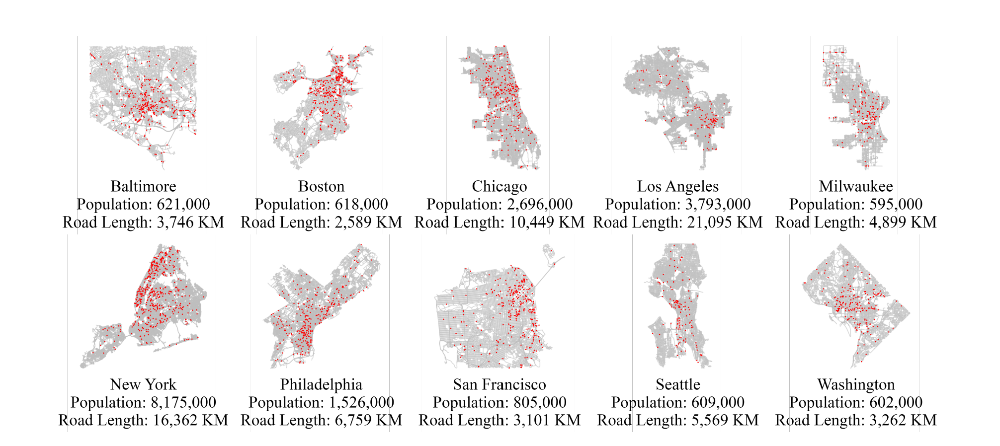
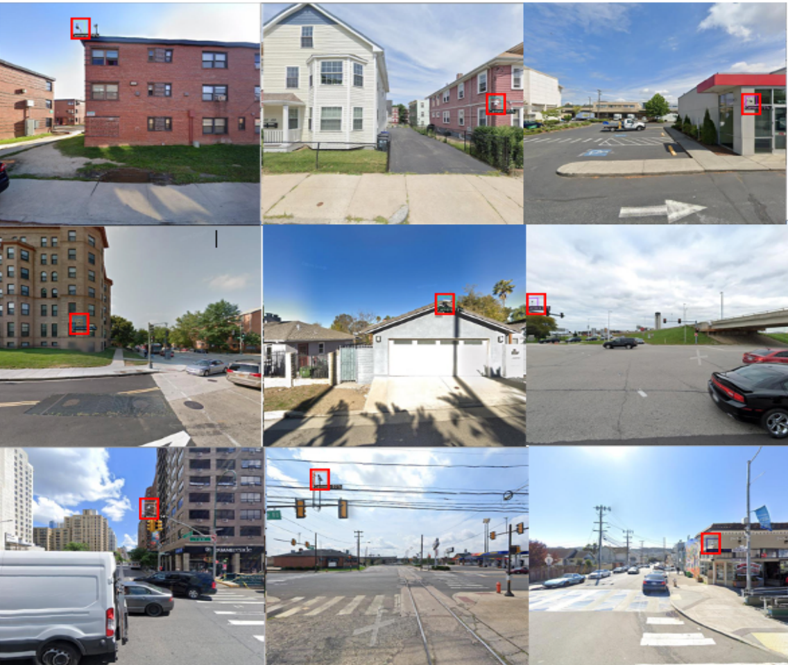
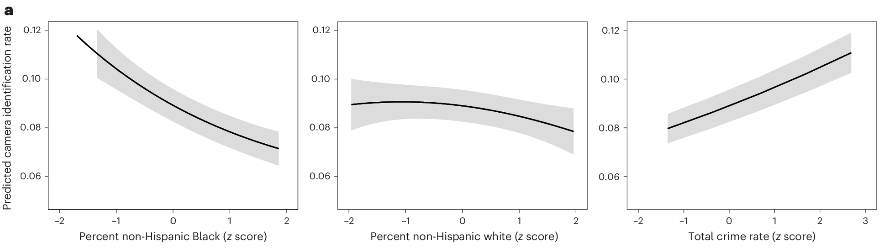
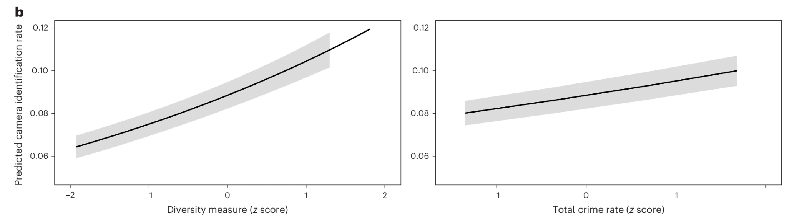
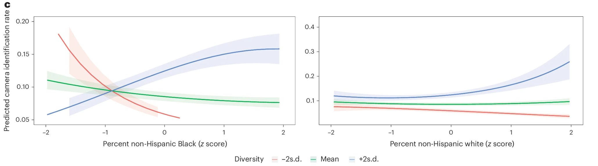

```{r}
#| label: load-packages
#| include: false
library(tidyverse)
library(ggthemes)
library(ggplot2)
library(patchwork)
library(emmeans)
library(performance)
library(stats)
library(knitr)
library(pscl)
library(GGally)
```
```{r}
#| echo: false

default_chunk_hook  <- knitr::knit_hooks$get("chunk")

latex_font_size <- c("Huge", "huge", "LARGE", "Large", 
                     "large", "normalsize", "small", 
                     "footnotesize", "scriptsize", "tiny")

knitr::knit_hooks$set(chunk = function(x, options) {
  x <- default_chunk_hook(x, options)
  if(options$size %in% latex_font_size) {
    paste0("\n \\", options$size, "\n\n", 
      x, 
      "\n\n \\normalsize"
    )
  } else {
    x
  }
})

```

# Background

## Zero Inflated Count Regression

Zero inflated count regression is a modification of a generalized linear model following a count distribution, like [Poisson](..\poisson\WriteUp.qmd) or [Negative Binomial](..\negative_binomial\WriteUp.qmd). When our data has more counted zeros than the model would predict, this usually causes the model to be overdispersed, and the effects of terms in the model to be *overestimated*. To adjust for this, we treat the zeros as being predicted by a logistic regression model, while all the points greater than zero are predicted by the specified count regression model. 

Where a typical negative binomial regression has the form:

\begin{align*}
log(\mu_{Y_i|x_i}) = \beta_0 + \beta_1 x_{1i} + \cdots + \beta_{p-1} x_{(p-1)i}
\end{align*}
where $\mu_{Y_i|x_i}$ is the mean of the Negative Binomial distribution from which the $i\text{th}$ response is drawn. 

A zero inflated negative binomial model predicts the zeros from a logistic model: 

$$log\left(\frac{\pi_i}{1-\pi_i}\right) = \alpha_0 + \alpha_1 x_{1i} + ... + \alpha_{p-1} x_{(p-1)i}$$
where $log\left(\frac{\pi_i}{1-\pi_i}\right)$ is the log odds of a structural 0.

Also, two models don't need to have the same set of predictor $x_i$'s.

**Note: The same transformation can be applied to poisson models as well as models with an offset.**

We usually care about interpreting the negative binomial model more than the logistic model, but what causes zeros can also be interesting. 

## The Study

{width=80%}

Surveillance, in any form, has long been controversial and politicized. Foucalt used the example of the panopticon to illustrate the way constant surveillance suffocates freedom and assures the maintenance of power [@foucault]. 25 Years ago, the war on terror in the United States served as the pretense for the passing of the Patriot Act, allowing the U.S. government greater access to personal digital information for the ostensible cause of anti-terrorism [@patriot]. 

{width=80%}

Where surveillance in previous decades was limited by an understanding that the guard in the panopticon tower could not be constantly watching every person, and a government official could not sift through every possible online document, the ability of large language models to scrape information from massive databases in real time has pushed the envelope for surveillance. 

{width=80%}

Surveillance camera adoption has exploded in recent years, as algorithmic video detection models, like those used in cameras manufactured by Flock Safety, has led to data collection and surveillance on an unparalleled level [@flock].

```{r}
#| echo: false
#| label: fig-flock_time
#| fig-cap: "Google Trends of Flock Cameras"
#| fig-width: 6
#| fig-height: 4

flock <- read_csv('flock.csv')

ggplot(data = flock, aes(x = Time, y = `flock cameras`)) + 
  geom_col() + 
  ylab("Search Interest for 'flock cameras'") +
  xlab("Date") + 
  theme_clean()

```


The article by Dahir et al. titled, "Surveillance camera prevalence and racial diversity in ten US cities", published in 2025, looks to see how the prevalence and density of surveillance cameras in major U.S. cities differs by demographic and socioeconomic characteristics of the areas they're in. They look to investigate if surveillance cameras are highest in homogeneous black neighbrhoods, as that would confirm the historical theory that black people often live in neighborhoods with characteristics resembling the carceral system. Another hypothesis says that surveillance cameras might be highest in more diverse neighborhoods where white residents might be more inclined to use the cameras for perceived safety and control. For example, white people who might be perceived as 'gentrifiers' in historically diverse neighborhoods might take pride in heterogeneous demographics while still feeling a sense of comfort with the added surveillance of a camera [@dahir]. 

To collect their count of surveillance cameras, the authors first trained a machine learning image detection model on confirmed camera locations the ten most dense populated cities in the United States:

{width=100%}

After model training, they randomly selected 100,000 points within each city, went to each of those points with Google Street View, and captured a 360° photo of the surroundings. They they ran all those photos through the camera detection models, and had humans validate the existence of cameras in photos flagged by the model (those poor undergrads). The researchers estimate that around 60\% of cameras in the photos were detected by the model, so the magnitude of the data is likely undercounted. The count of the cameras was then combined with publicly available demographic data from where each photo was taken to create a combined dataset. 

{width=60%}

## Goal of Statistical Analysis

Because of the countable nature of the data, the researchers propose using a generalized linear model with a poisson distribution. Because of a large amount of images with no cameras taken, it makes sense to include the zeros in the model structurally with a logistic component. 

I think their main analysis points are seeing how camera amounts change with regards to the white \%, black\%, and overall diversity of the areas, while accounting for other socioeconomic and strucutural confounding variables like income levels, crime rate, zoning, etc. 

### Formula Antics

I had a somewhat hard time determining the correct formula and terms for the regression equation. Below I'll illustrate several reasons why:

In the methods, the authors say:

> " We also expect excess zeros to be generated by a separate process from counts."

I didn't immediately know what this meant without looking at the code. After finding the equation I assume they used by looking in the code, I found this quote which is, in a choice I find puzzling, separate from the quote above: 

> "The zero component accounts for the city and road length in all models."

Which, by confirming with their code, means the logistic element of their zero-inflated model is only regressed on the city with the road length as an offset. However, I don't understand why the other metrics in the model wouldn't also contribute to the detection of zero cameras, so I think it makes sense to leave them in both sides of the model.

They mention the inclusion of quadratic terms for the racial demographic variables (in the results but not the methods):

> "Given the parabolic relationships observed in the bivariate models, this model includes quadratic terms for both Black and white residents."

I take this to mean they adjusted the model after seeing a quadratic looking relationship in some of their effects in a "bivariate model". I can only assume this because there's no mention of a "bivariate model" in their methods, so the reader is left to wonder if that was the original hypothesis, a planned arm of their analysis, or something else. Still, the inclusion of the quadratic terms makes sense as the demographic variables are percentages and not truly continuous, however I'm not sure why they don't mention this explicitly in the methods. However, if these terms were only added because of a noticed trend in their data, this is basically 'HARKing', or "hypothesizing after the results are known, " which is generally frowned upon in research [@harking]. 

Lastly, the authors mention the use of images taken as a weight component in the model:

> "We include ... a weight for the image count."

This weights the data points with more images taken more heavily in the model. I think this highlights a potential issue with the data collection, and regardless of the choice of including or not including the weights, each has its own issues. If we don't include the images taken as a weight, a single image taken for one observation is weighted the same as an observation with over a hundred images taken; clearly one of those is more comprehensive. However, not all images are created equal, and images taken in close proximity to each other don't necessarily add importance to that observation. Because of this, I'll go forward with both options, seeing if the weights significantly alter the model. 

With all that being said here's the regression equation I personally think makes sense:

Predictors (Poisson Counts and Logistic Zeros): 

- \% White (quadratic and linear)
- \% Black (quadratic and linear)
- Overall Racial Diversity
- Crime Rate
- Population
- Median Household Income (in thousands)
- Home Vacancy Rate
- Median Home Value (in thousands)
- Neighborhood Designation (residential, public, commercial, industrial, roads, or mixed)
- City (Baltimore, Boston, Chicago, Los Angeles, Milwaukee, New York City, Philadelphia, San Francisco, Seattle, or Washington D.C.)

Offset:

- Road length (km)

Weights (potentially):

- log(images taken)

In *R*, our formula call looks like this: 

```{r}

formula <- cameras ~ white + I(white^2) + black + I(black^2) + diversity + crime + 
    pop + income + vacancy + home_value + zone + city

```

# Reproduction of the Study

## Data Cleaning

I mainly renamed the variables to my liking, as well as scaling the continous metrics because that made the model behave better later on (not shown). 

```{r}

dat <- read_csv('cameras.csv')

dat <- dat |>
  rename(cameras = cam_count,
         images = image_count,
         white = pnhwht, 
         black = pnhblk, 
         diversity = entropy, 
         crime = total_crime_rate, 
         income = hinc, 
         vacancy = pvac, 
         home_value = mhmval, 
         zone = modal_zone, 
         road_length = road_length_km)

dat$diversity <- as.vector(scale(dat$diversity))


```

## Data Summary

Let's see how the data is split up by city:

```{r}
#| echo: false
#| label: fig-cities_sum
#| fig-cap: "Pairwise Summary of Data"
#| warning: false
#| message: false
#| fig-width: 10
#| fig-height: 16

city_count <- ggplot(data = dat, aes(x = fct_infreq(city))) +
  geom_bar(color = "black") + 
  theme_bw() + 
  xlab("Cities (Ordered)") +
  ylab("Observations") +
  geom_label(aes(label = after_stat(count)), stat = "count", vjust = -0.2) + 
  geom_hline(yintercept = 0) + 
  ggtitle("Observations") + 
  theme(plot.title = element_text(hjust = 0.5, face = "bold")) + 
  ylim(0, 4500)

city_white <- ggplot(data = dat, aes(x = fct_reorder(city, white), y = white)) + 
  geom_boxplot() + 
  xlab("Cities (Ordered)") +
  ylab("White %") + 
  theme_bw() + 
  ggtitle("White %") + 
  theme(plot.title = element_text(hjust = 0.5, face = "bold"))

city_black <- ggplot(data = dat, aes(x = fct_reorder(city, black), y = black)) + 
  geom_boxplot() + 
  xlab("Cities (Ordered)") +
  ylab("Black %") + 
  theme_bw() + 
  ggtitle("Black %") + 
  theme(plot.title = element_text(hjust = 0.5, face = "bold"))

city_diversity <- ggplot(data = dat, aes(x = fct_reorder(city, diversity), y = diversity)) + 
  geom_boxplot() + 
  xlab("Cities (Ordered)") +
  ylab("Diversity (Z)") + 
  theme_bw() + 
  ggtitle("Diversity") + 
  theme(plot.title = element_text(hjust = 0.5, face = "bold"))

city_cameras <- ggplot(data = dat, aes(x = fct_reorder(city, cameras), y = cameras)) + 
  geom_boxplot() + 
  xlab("Cities (Ordered)") +
  ylab("Cameras") + 
  theme_bw() + 
  ggtitle("Cameras") + 
  theme(plot.title = element_text(hjust = 0.5, face = "bold"))

city_count / city_cameras / city_white / city_black / city_diversity & 
  theme(plot.margin = margin(t = 15, b = 15, unit = "pt"))

```

Our dataset is heavily influenced by New York City. We also see that most of the cities are relatively close in diversity, even with large differences in percentage of white and black populations. Lastly, there's not much we can get from the cameras because there's so many zeros. 

Here's a rough correlation analysis between white\%, black\%, diversity\% and cameras:

```{r}
#| echo: false
#| label: fig-cors
#| fig-cap: "Correlation Analysis"
#| warning: false
#| message: false
#| fig-width: 10
#| fig-height: 6


ggpairs(dat[, c(5, 6, 9, 3)]) + 
  theme_bw()


```

Hard to see any pattern in the demographic factors against the camera counts.


## Model Assumptions

### Zero Inflation

First let's see, how is zero inflated is the model compared to what we'd expect under a standard poisson regression: 

```{r}
#| echo: false
#| label: fig-residual_poisson
#| fig-cap: "Zero Inflation Testing of the Standard Poisson Model"
#| warning: false
#| message: false
#| fig-width: 8
#| fig-height: 4

mod_pois_unw <- glm(formula, 
               family = poisson, 
               offset = log(road_length),
               data = dat)

obsZeros <- sum(mod_pois_unw$model$cameras==0)

numZeros <- rep(NA, 1000)
for(i in 1:1000){
  numZeros[i] <- sum(simulate(mod_pois_unw)==0)
}


pois_unw <- ggplot(tibble(x=numZeros)) +
  geom_histogram(aes(x=x, y=after_stat(density)),
                 bins=30, color="black") +
  geom_hline(yintercept=0)+
  geom_vline(xintercept=obsZeros,
             color="red", linetype="dotted")+
  theme_bw()+
  xlab("Observed Zeros")+
  ylab("Density") + 
  ggtitle("Unweighted Poisson Model")


mod_pois_w <- glm(formula, 
               family = poisson, 
               offset = log(road_length),
               data = dat, 
               weights = log(images))

obsZeros <- sum(mod_pois_w$model$cameras==0)

numZeros <- rep(NA, 1000)
for(i in 1:1000){
  numZeros[i] <- sum(simulate(mod_pois_w)==0)
}


pois_w <- ggplot(tibble(x=numZeros)) +
  geom_histogram(aes(x=x, y=after_stat(density)),
                 bins=30, color="black") +
  geom_hline(yintercept=0)+
  geom_vline(xintercept=obsZeros,
             color="red", linetype="dotted")+
  theme_bw()+
  xlab("Observed Zeros")+
  ylab("Density") + 
  ggtitle("Weighted Poisson Model")

pois_unw + pois_w

```

We never even come close to simulating as many zeros as there are observed. This definitely warrants a zero inflated model. 

### Dispersion

Here we'll test the randomized quantile residuals of the zero inflated model and the dispersion ratio. First, the unweighted model: 

```{r}
#| echo: false
#| label: fig-residuals_unweighted
#| fig-cap: "Randomized Quantile Residuals (Unweighted Model)"
#| warning: false
#| message: false
#| fig-width: 8
#| fig-height: 4

dat$white <- as.vector(scale(dat$white))
dat$black <- as.vector(scale(dat$black))
dat$crime <- as.vector(scale(dat$crime))
dat$pop <- as.vector(scale(dat$pop))
dat$income <- as.vector(scale(dat$income))
dat$vacancy <- as.vector(scale(dat$vacancy))
dat$home_value <- as.vector(scale(dat$home_value))


mod_unw <- zeroinfl(formula, data = dat, offset = log(road_length), dist = "poisson")

n = nrow(dat)
y = dat$cameras

lambdas <- predict(mod_unw, type = "count")
pis <- predict(mod_unw, type = "zero")

rqr <- rep(NA, n)
for(i in 1:n){
  ai <- ifelse(y[i] == 0, 0, pis[i] + (1 - pis[i]) *ppois(y[i]-1, lambda=lambdas[i]))
  bi <- pis[i] + (1 - pis[i]) * ppois(y[i], lambda=lambdas[i])
  ui <- runif(1, ai, bi)
  rqr[i] <- qnorm(ui)
}

pearson.ratio <- sum(residuals(mod_unw, type = "pearson")^2) /mod_unw$df.residual

p1 <- ggplot(data=tibble(lambda=lambdas,
                         e=rqr)) + 
      geom_hline(yintercept=0, linetype="dotted")+
      geom_point(aes(x=lambda, y=e)) +
      theme_bw()+
      xlab(bquote(lambda))+
      ylab("Randomized Quantile Residuals")
p2 <- ggplot(data=tibble(e=rqr)) +
  stat_qq(aes(sample=e)) +
  stat_qq_line(aes(sample=e)) +
  theme_bw() +
  ggtitle(paste("Dispersion Ratio =", round(pearson.ratio, 4)))

p1+p2

```

The randomized quantile residuals look pretty good, as there's a relatively even band of points. The dispersion ratio is a tad high but still not bad. There's a few outliers but that's to be expected with a very large sample size. 

Next, the weighted model: 

```{r}
#| echo: false
#| label: fig-residuals_weighted
#| fig-cap: "Randomized Quantile Residuals (Weighted Model)"
#| warning: false
#| message: false
#| fig-width: 8
#| fig-height: 4


mod_w <- zeroinfl(formula, data = dat, offset = log(road_length), dist = "poisson", weights = log(images))

lambdas <- predict(mod_w, type = "count")
pis <- predict(mod_w, type = "zero")

rqr <- rep(NA, n)
for(i in 1:n){
  ai <- ifelse(y[i] == 0, 0, pis[i] + (1 - pis[i]) *ppois(y[i]-1, lambda=lambdas[i]))
  bi <- pis[i] + (1 - pis[i]) * ppois(y[i], lambda=lambdas[i])
  ui <- runif(1, ai, bi)
  rqr[i] <- qnorm(ui)
}

w  <- mod_w$weights

r2 <- (y - (1 - pis) * lambdas)^2 / ((1 - pis) * lambdas * (1 + pis * lambdas))

pearson.ratio <- sum(w * r2) / (sum(w > 0) - length(coef(mod_w)))

p1 <- ggplot(data=tibble(lambda=lambdas,
                         e=rqr)) + 
      geom_hline(yintercept=0, linetype="dotted")+
      geom_point(aes(x=lambda, y=e)) +
      theme_bw()+
      xlab(bquote(lambda))+
      ylab("Randomized Quantile Residuals")
p2 <- ggplot(data=tibble(e=rqr)) +
  stat_qq(aes(sample=e)) +
  stat_qq_line(aes(sample=e)) +
  theme_bw() +
  ggtitle(paste("Dispersion Ratio =", round(pearson.ratio, 4)))

p1+p2

```

Adding the weights significantly increases the overdispersion of the model. 


We can also check our predictions against the standardized Pearson residuals:

```{r}
#| echo: false
#| label: fig-predictions_residuals_unw
#| fig-cap: "Predictions Against Pearson Residuals (Unweighted Model)"
#| warning: false
#| message: false
#| fig-width: 8
#| fig-height: 4


ggdat <- tibble(r2= resid(mod_unw, type = "pearson")^2,
                lambdas = fitted(mod_unw))

p1 <- ggplot(ggdat) + 
  geom_point(aes(x=lambdas, y=r2)) +
  geom_hline(yintercept = 1, linetype="dotted", color="red") +
  geom_smooth(aes(x=lambdas, y=r2)) +
  theme_bw() + 
  xlab(bquote(lambda)) +
  ylab(bquote(r^2))

p2 <- ggplot(ggdat) + 
  geom_point(aes(x=lambdas, y=r2)) +
  geom_hline(yintercept = 1, linetype="dotted", color="red") +
  geom_smooth(aes(x=lambdas, y=r2)) +
  theme_bw() + 
  xlab(bquote(lambda)) +
  ylab(bquote(r^2)) + 
  ylim(0,25) + 
  labs(caption = "Y-Axis Truncated")

p1 + p2


```

Looking more closely around 1, we see an increasing curved pattern as $\lambda$ increases. This might suggest that a negative binomial might be better suited, but combined with the dispersion ratio and randomized quantile residuals, I think a poisson model is pretty well justified here. 

```{r}
#| echo: false
#| label: fig-predictions_residuals_w
#| fig-cap: "Predictions Against Pearson Residuals (Weighted Model)"
#| warning: false
#| message: false
#| fig-width: 8
#| fig-height: 4


ggdat <- tibble(r2= resid(mod_w, type = "pearson")^2,
                lambdas = fitted(mod_w))

p1 <- ggplot(ggdat) + 
  geom_point(aes(x=lambdas, y=r2)) +
  geom_hline(yintercept = 1, linetype="dotted", color="red") +
  geom_smooth(aes(x=lambdas, y=r2)) +
  theme_bw() + 
  xlab(bquote(lambda)) +
  ylab(bquote(r^2))

p2 <- ggplot(ggdat) + 
  geom_point(aes(x=lambdas, y=r2)) +
  geom_hline(yintercept = 1, linetype="dotted", color="red") +
  geom_smooth(aes(x=lambdas, y=r2)) +
  theme_bw() + 
  xlab(bquote(lambda)) +
  ylab(bquote(r^2)) + 
  ylim(0,25) + 
  labs(caption = "Y-Axis Truncated")

p1 + p2


```

The curved pattern seen before appears worse for the weighted model, but the points don't really show a clear trend, so this could be an artifact of random noise. 


### Multicollinearity

Because the design matrix is the same for both models, the VIF for both models is: 

```{r}
#| echo: false
#| label: tbl-model_vif

vif <- data.frame(check_collinearity(mod_unw)) |>
  filter(Component == "conditional")

vif$Term <- c("White %", "(White %)^2", "Black %", "(Black %)^2", "Diversity", "Crime Rate", "Population", "Median Income", "Vacancy Rate", "Median Home Value", "Zoning", "City")
vif <- vif[, c(1:4)]
colnames(vif) <- c("Term", "VIF", "Lower CI", "Upper CI")

knitr::kable(vif, digits = 3, label = "model_vif_unw", caption = "Model VIF", include.rownames = F)

```

To be expected, a lot of the variables have very high correlations with other variables, especially the demographic characteristics of each city. While I'll keep the city term in the model to compare with the paper's analysis, I do think it's probably not providing much necessary information that's not contained in other variables. 

### Sufficient Sample Size for Predictors

Ideally we should have at least 10 events counted per predictor: 

\begin{align*}
\sum_{i=1}^{n = 11,620} \lambda_{i} = 2524 \geq 10p = 10(25) = 250 \quad \checkmark
\end{align*}

## Model Fit

We can obtain an overall model fit of both models. First, the unweighted model:

```{r}
#| echo: false
#| label: tbl-model_performance_unw

mod_performance_unw <- data.frame(model_performance(mod_unw))

knitr::kable(mod_performance_unw, digits = 3, label = "model_fit", caption = "Model Fit", include.rownames = F)

```

Our unweighted model explains 18.4% of the variance in surveillance cameras.

Now the weighted model:

```{r}
#| echo: false
#| label: tbl-model_performance_w

mod_performance_w <- data.frame(model_performance(mod_w))

knitr::kable(mod_performance_w, digits = 3, label = "model_fit", caption = "Model Fit", include.rownames = F)

```

Our weighted model explains 6% of the variance in surveillance cameras.

**Remember that some of the model fit statistics are non-comparable because they're calculated differently for weighted and non-weighted models.**

We can directly compare the model fits with the cross-validated root mean square error:

```{r}
#| echo: false
#| label: tbl-model_crossv

set.seed(13)

folds <- sample(rep(seq_len(10), length.out = n))

RMSEs <- tibble(k = 1:10, 
                unweighted = rep(NA, 10), 
                weighted = rep(NA, 10))

for (f in seq_len(10)) {
  train <- dat[folds != f, ]
  test  <- dat[folds == f, ]
  test_y <- test$cameras

  mod_unw_k <- zeroinfl(formula, data = train, offset = log(road_length), dist = "poisson")
  mod_w_k <- zeroinfl(formula, data = train, offset = log(road_length), dist = "poisson", weights = log(images))

  mod_unw_preds <- predict(mod_unw_k, newdata = test)
  RMSEs$unweighted[f] <- sqrt(mean((test_y- mod_unw_preds)^2))

  mod_w_preds <- predict(mod_w_k, newdata = test)
  RMSEs$weighted[f] <- sqrt(mean((test_y- mod_w_preds)^2))

}

RMSEs$k <- as.character(RMSEs$k)

RMSEs <- RMSEs |>
  add_row(k = "Mean", unweighted = mean(RMSEs$unweighted), weighted = mean(RMSEs$weighted))

colnames(RMSEs)[1] <- "Fold"

knitr::kable(RMSEs, digits = 3, label = "mods_cv", caption = "Cross Validated RMSEs of Both Models", include.rownames = F)


```

This tells us, that by their ability to predict, the models are almost identical.


## Model Inference

Now to the heart of the analysis: 

- How many surveillance cameras are in highly white or highly black neighborhoods?
- How many surveilance cameras are in more diverse neighborhoods?
- Are there other confounding factors that affect surveillance cameras?

**Spoiler: The effect of certain factors is dependent on the weighting of the model. As annoying as this is, it means I have to show a unweighted and weighted version of each analysis.**

A general summary our unweighted model gives us:

```{r}
#| echo: false
#| label: tbl-model_sum_unw_log

sum_unw_log <- data.frame(summary(mod_unw)$coefficients$zero)
rownames(sum_unw_log) <- c("Intercept", "White %", "(White %)^2", "Black %", "(Black %)^2", "Diversity", "Crime Rate", "Population", "Median Income", "Vacancy Rate", "Median Home Value", "Zone = Industrial", "Zone = Mixed", "Zone = Public", "Zone = Residential", "Zone = Roads", "City = Boston", "City = Chicago", "City = Los Angeles", "City = Milwaukee", "City = New York", "City = Philadelphia", "City = San Francisco", "City = Seattle", "City = Washington")
colnames(sum_unw_log) <- c("Estimate", "SE", "Z", "p")

sum_unw_log$p <- ifelse(sum_unw_log$p<0.001, "<0.001", round(sum_unw_log$p, 3))
sum_unw_log$SE <- ifelse(sum_unw_log$SE<0.001, "<0.001", round(sum_unw_log$SE, 3))

sum_unw_log <- sum_unw_log |>
  mutate(significance = case_when(p == "<0.001" ~ "***", 
                                  p < 0.01 ~ "**", 
                                  p < 0.05 ~ "*", 
                                  p < 0.1 ~ ".", 
                                  p >= 0.1 ~ ""), 
        `Percent Change` = (exp(Estimate)-1)*100)

sum_unw_log$`Percent Change` <- round(sum_unw_log$`Percent Change`, 1)
sum_unw_log$`Percent Change`[1] <- ""

knitr::kable(sum_unw_log, digits = 3, align = c("c", "r", "r", "r", "r"), label = "model_sum_unw_log", caption = "Unweighted Logistic Model Summary", include.rownames = F)

```

where the percent change $= (e^{\text{estimate}}-1) \times 100$. 

Based on the summary of the unweighted logistic model, there's a:

- 15.7\% greater chance of a surveillance camera as the diversity of the area increases by 1 standard deviation (non-statistically significant). 
- 83.4\% lesser chance of a surveillance camera as the crime rate of an area increases by 1 standard deviation ($Z = -8.329, p < 0.001$). 
- 27.4\% lesser chance of a surveillance camera as the population of an area increases by 1 standard deviation ($Z = -6.123, p <0.001$). 
- 33.7\% greater chance of a surveillance camera as the median income of an area increases by 1 standard deviation ($Z = -3.390, p <0.001$).
- 15.3\% lesser chance of a surveillance camera as the vacancy rate of an area increases by 1 standard deviation ($Z = -2.491, p = 0.013$).
- 36.2\% lesser chance of a surveillance camera as the median home value of an area increases by 1 standard deviation ($Z = -3.933, p <0.001$).

We'll get into the other terms later on. 

```{r}
#| echo: false
#| label: tbl-model_sum_unw_count

sum_unw_count <- data.frame(summary(mod_unw)$coefficients$count)
rownames(sum_unw_count) <- c("Intercept", "White %", "(White %)^2", "Black %", "(Black %)^2", "Diversity", "Crime Rate", "Population", "Median Income", "Vacancy Rate", "Median Home Value", "Zone = Industrial", "Zone = Mixed", "Zone = Public", "Zone = Residential", "Zone = Roads", "City = Boston", "City = Chicago", "City = Los Angeles", "City = Milwaukee", "City = New York", "City = Philadelphia", "City = San Francisco", "City = Seattle", "City = Washington")
colnames(sum_unw_count) <- c("Estimate", "SE", "Z", "p")

sum_unw_count$p <- ifelse(sum_unw_count$p<0.001, "<0.001", round(sum_unw_count$p, 3))
sum_unw_count$SE <- ifelse(sum_unw_count$SE<0.001, "<0.001", round(sum_unw_count$SE, 3))

sum_unw_count <- sum_unw_count |>
  mutate(significance = case_when(p == "<0.001" ~ "***", 
                                  p < 0.01 ~ "**", 
                                  p < 0.05 ~ "*", 
                                  p < 0.1 ~ ".", 
                                  p >= 0.1 ~ ""), 
        `Percent Change` = (exp(Estimate)-1)*100)

sum_unw_count$`Percent Change` <- round(sum_unw_count$`Percent Change`, 1)
sum_unw_count$`Percent Change`[1] <- ""

knitr::kable(sum_unw_count, digits = 3, align = c("c", "r", "r", "r", "r"), label = "model_sum_unw_count", caption = "Unweighted Count Model Summary", include.rownames = F)

```

Based on the summary of the unweighted count model, we'd expect to see:

- 11.2\% more surveillance cameras as the diversity of the area increases by 1 standard deviation (non-statistically significant). 
- 3.6\% more surveillance cameras as the crime rate of an area increases by 1 standard deviation ($Z = 4.682, p < 0.001$). 
- 5.8\% more surveillance cameras as the population of an area increases by 1 standard deviation ($Z = 4.615, p <0.001$). 
- 8.2\% fewer surveillance cameras as the median income of an area increases by 1 standard deviation ($Z = -2.095, p = 0.036$).
- 4.4\% more surveillance cameras as the vacancy rate of an area increases by 1 standard deviation (non-statistically significant).
- 2.9\% fewer surveillance cameras as the median home value of an area increases by 1 standard deviation (non-statistically significant).

**Note that the effect of the linear black \% term is only marginally discernible, and the quadratic effect is non statistically discernible.**

```{r}
#| echo: false
#| label: tbl-model_sum_w_log

sum_w_log <- data.frame(summary(mod_w)$coefficients$zero)
rownames(sum_w_log) <- c("Intercept", "White %", "(White %)^2", "Black %", "(Black %)^2", "Diversity", "Crime Rate", "Population", "Median Income", "Vacancy Rate", "Median Home Value", "Zone = Industrial", "Zone = Mixed", "Zone = Public", "Zone = Residential", "Zone = Roads", "City = Boston", "City = Chicago", "City = Los Angeles", "City = Milwaukee", "City = New York", "City = Philadelphia", "City = San Francisco", "City = Seattle", "City = Washington")
colnames(sum_w_log) <- c("Estimate", "SE", "Z", "p")

sum_w_log$p <- ifelse(sum_w_log$p<0.001, "<0.001", round(sum_w_log$p, 3))
sum_w_log$SE <- ifelse(sum_w_log$SE<0.001, "<0.001", round(sum_w_log$SE, 3))

sum_w_log <- sum_w_log |>
  mutate(significance = case_when(p == "<0.001" ~ "***", 
                                  p < 0.01 ~ "**", 
                                  p < 0.05 ~ "*", 
                                  p < 0.1 ~ ".", 
                                  p >= 0.1 ~ ""), 
        `Percent Change` = (exp(Estimate)-1)*100)

sum_w_log$`Percent Change` <- round(sum_w_log$`Percent Change`, 1)
sum_w_log$`Percent Change`[1] <- ""

knitr::kable(sum_w_log, digits = 3, align = c("c", "r", "r", "r", "r"), label = "model_sum_w_zero", caption = "Weighted Logistic Model Summary", include.rownames = F)

```

Based on a summary of the weighted logistic model, there's a: 

- 13.5\% greater chance of a surveillance camera as the diversity of the area increases by 1 standard deviation (non-statistically significant). 
- 86.6\% lesser chance of a surveillance camera as the crime rate of an area increases by 1 standard deviation ($Z = -19.023, p < 0.001$). 
- 29.3\% lesser chance of a surveillance camera as the population of an area increases by 1 standard deviation ($Z = -13.438, p <0.001$). 
- 41.7\% greater chance of a surveillance camera as the median income of an area increases by 1 standard deviation ($Z = 8.389, p <0.001$).
- 12.1\% lesser chance of a surveillance camera as the vacancy rate of an area increases by 1 standard deviation ($Z = -4.205, p = 0.013$).
- 41\% lesser chance of a surveillance camera as the median home value of an area increases by 1 standard deviation ($Z = -8.389, p <0.001$).

```{r}
#| echo: false
#| label: tbl-model_sum_w_count

sum_w_count <- data.frame(summary(mod_w)$coefficients$count)
rownames(sum_w_count) <- c("Intercept", "White %", "(White %)^2", "Black %", "(Black %)^2", "Diversity", "Crime Rate", "Population", "Median Income", "Vacancy Rate", "Median Home Value", "Zone = Industrial", "Zone = Mixed", "Zone = Public", "Zone = Residential", "Zone = Roads", "City = Boston", "City = Chicago", "City = Los Angeles", "City = Milwaukee", "City = New York", "City = Philadelphia", "City = San Francisco", "City = Seattle", "City = Washington")
colnames(sum_w_count) <- c("Estimate", "SE", "Z", "p")

sum_w_count$p <- ifelse(sum_w_count$p<0.001, "<0.001", round(sum_w_count$p, 3))
sum_w_count$SE <- ifelse(sum_w_count$SE<0.001, "<0.001", round(sum_w_count$SE, 3))

sum_w_count <- sum_w_count |>
  mutate(significance = case_when(p == "<0.001" ~ "***", 
                                  p < 0.01 ~ "**", 
                                  p < 0.05 ~ "*", 
                                  p < 0.1 ~ ".", 
                                  p >= 0.1 ~ ""), 
        `Percent Change` = (exp(Estimate)-1)*100)

sum_w_count$`Percent Change` <- round(sum_w_count$`Percent Change`, 1)
sum_w_count$`Percent Change`[1] <- ""

knitr::kable(sum_w_count, digits = 3, align = c("c", "r", "r", "r", "r"), label = "model_sum_w_count", caption = "Weighted Count Model Summary", include.rownames = F)

```

Based on the summary of the unweighted count model, we'd expect to see:

- 13.6\% more surveillance cameras as the diversity of the area increases by 1 standard deviation ($Z = 3.778, p<0.001$). 
- 3.9\% more surveillance cameras as the crime rate of an area increases by 1 standard deviation ($Z = 11.802, p < 0.001$). 
- 6\% more surveillance cameras as the population of an area increases by 1 standard deviation ($Z = 11.711, p <0.001$). 
- 6.8\% fewer surveillance cameras as the median income of an area increases by 1 standard deviation ($Z = -3.962, p < 0.001$).
- 7.5\% more surveillance cameras as the vacancy rate of an area increases by 1 standard deviation ($Z = 6.123, p < 0.001$).
- 5\% fewer surveillance cameras as the median home value of an area increases by 1 standard deviation ($Z = -2.047, p = 0.041$).

**Note that the quadratic effect of black \% is not discernible on the model.**

From now on, because we really care about the counts of the cameras, not as much the binary of no cameras versus cameras, we'll focus on the count regression factors going forward. 

Because the other terms are either tangled in polynomial interactions or way too long to list out, we'll look at terms individually now:

## Percentage of Black Residents

```{r}
#| echo: false
#| label: tbl-model_unw_emt_black

mod_unw_emt <- data.frame(test(emtrends(mod_unw, ~ 1,  var = "black")))

conf_unw_emt <- confint(emtrends(mod_unw, ~ 1,  var = "black"))

mod_unw_emt$percent_change <- (exp(mod_unw_emt$black.trend)-1)*100
mod_unw_emt$percent_lower <- (exp(conf_unw_emt$asymp.LCL)-1)*100
mod_unw_emt$percent_upper <- (exp(conf_unw_emt$asymp.UCL)-1)*100

colnames(mod_unw_emt) <- c("X1", "Black % (Z) Trend", "SE", "df", "Z", "p", "Percent Change", "Lower CI", "Upper CI")

knitr::kable(mod_unw_emt[,c(2,3,5,6,7,8,9)], digits = 3, label = "model_emt_unw_black", caption = "Black % Estimated Marginal Trend (Unweighted)", align = c("c", "c", "r", "r", "c", "c", "c", "c"), include.rownames = F)

```


```{r}
#| echo: false
#| label: fig-emtrend_unw_black
#| fig-cap: "Black % Estimated Marginal Trend (Unweighted)"
#| warning: false
#| message: false
#| fig-width: 8
#| fig-height: 4


percents <- seq(min(dat$black), max(dat$black), length.out = 50)

emt_grid_unw <- data.frame(emmeans(mod_unw, ~ black, at = list(black = percents), type = "response"))

ggplot(dat = emt_grid_unw, aes(x = black, y = emmean,)) +
  geom_ribbon(aes(ymin = asymp.LCL, ymax = asymp.UCL), alpha = 0.2, color = NA) +
  geom_line(linewidth = 1) +
  theme_clean() + 
  xlab('Black % (Z)') +
  ylab("Expected Surveillance Cameras (per km)")

```


```{r}
#| echo: false
#| label: tbl-model_w_emt_black

mod_w_emt <- data.frame(test(emtrends(mod_w, ~ 1,  var = "black")))

conf_w_emt <- confint(emtrends(mod_w, ~ 1,  var = "black"))

mod_w_emt$percent_change <- (exp(mod_w_emt$black.trend)-1)*100
mod_w_emt$percent_lower <- (exp(conf_w_emt$asymp.LCL)-1)*100
mod_w_emt$percent_upper <- (exp(conf_w_emt$asymp.UCL)-1)*100

colnames(mod_w_emt) <- c("X1", "Black % (Z) Trend", "SE", "df", "Z", "p", "Percent Change", "Lower CI", "Upper CI")

mod_w_emt$p <- ifelse(mod_w_emt$p < 0.001, "<0.001", mod_w_emt$p)

knitr::kable(mod_w_emt[,c(2,3,5,6,7,8,9)], digits = 3, label = "model_emt_w_black", caption = "Black % Estimated Marginal Trend (Weighted)", align = c("c", "c", "r", "r", "c", "c", "c", "c"), include.rownames = F)

```


```{r}
#| echo: false
#| label: fig-emtrend_w_black
#| fig-cap: "Black % Estimated Marginal Trend (Weighted)"
#| warning: false
#| message: false
#| fig-width: 8
#| fig-height: 4

emt_grid_w <- data.frame(emmeans(mod_w, ~ black, at = list(black = percents), type = "response"))

ggplot(dat = emt_grid_w, aes(x = black, y = emmean,)) +
  geom_ribbon(aes(ymin = asymp.LCL, ymax = asymp.UCL), alpha = 0.2, color = NA) +
  geom_line(linewidth = 1) +
  theme_clean() + 
  xlab('Black % (Z)') +
  ylab("Expected Surveillance Cameras (per km)")

```


Notice that the trend of the factor is the same, it's just that the weighted models are have much tighter standard errors, and therefore greater appearing statistical significance. For the effect of the percentage of black residents in an area, the effect is still seen significantly across both models, but that won't always be the case as we'll see later. 

## Diversity of Residents


```{r}
#| echo: false
#| label: tbl-model_unw_emt_div

mod_unw_emt <- data.frame(test(emtrends(mod_unw, ~ 1,  var = "diversity")))

conf_unw_emt <- confint(emtrends(mod_unw, ~ 1,  var = "diversity"))

mod_unw_emt$percent_change <- (exp(mod_unw_emt$diversity.trend)-1)*100
mod_unw_emt$percent_lower <- (exp(conf_unw_emt$asymp.LCL)-1)*100
mod_unw_emt$percent_upper <- (exp(conf_unw_emt$asymp.UCL)-1)*100

colnames(mod_unw_emt) <- c("X1", "Diversity (Z) Trend", "SE", "df", "Z", "p", "Percent Change", "Lower CI", "Upper CI")

knitr::kable(mod_unw_emt[,c(2,3,5,6,7,8,9)], digits = 3, label = "model_emt_unw_div", caption = "Diversity Estimated Marginal Trend (Unweighted)", align = c("c", "c", "r", "r", "c", "c", "c", "c"), include.rownames = F)

```


```{r}
#| echo: false
#| label: fig-emtrend_unw_div
#| fig-cap: "Diversity Estimated Marginal Trend (Unweighted)"
#| warning: false
#| message: false
#| fig-width: 8
#| fig-height: 4


divs <- seq(min(dat$diversity), max(dat$diversity), length.out = 50)

emt_grid_unw <- data.frame(emmeans(mod_unw, ~ diversity, at = list(diversity = divs), type = "response"))

ggplot(dat = emt_grid_unw, aes(x = diversity, y = emmean,)) +
  geom_ribbon(aes(ymin = asymp.LCL, ymax = asymp.UCL), alpha = 0.2, color = NA) +
  geom_line(linewidth = 1) +
  theme_clean() + 
  xlab('Diversity (Z)') +
  ylab("Expected Surveillance Cameras (per km)")

```


```{r}
#| echo: false
#| label: tbl-model_w_emt_div

mod_w_emt <- data.frame(test(emtrends(mod_w, ~ 1,  var = "diversity")))

conf_w_emt <- confint(emtrends(mod_w, ~ 1,  var = "diversity"))

mod_w_emt$percent_change <- (exp(mod_w_emt$diversity.trend)-1)*100
mod_w_emt$percent_lower <- (exp(conf_w_emt$asymp.LCL)-1)*100
mod_w_emt$percent_upper <- (exp(conf_w_emt$asymp.UCL)-1)*100

colnames(mod_w_emt) <- c("X1", "Diversity (Z) Trend", "SE", "df", "Z", "p", "Percent Change", "Lower CI", "Upper CI")

mod_w_emt$p <- ifelse(mod_w_emt$p < 0.001, "<0.001", mod_w_emt$p)

knitr::kable(mod_w_emt[,c(2,3,5,6,7,8,9)], digits = 3, label = "model_emt_w_div", caption = "Diversity Estimated Marginal Trend (Weighted)", align = c("c", "c", "r", "r", "c", "c", "c", "c"), include.rownames = F)

```


```{r}
#| echo: false
#| label: fig-emtrend_w_div
#| fig-cap: "Diversity Estimated Marginal Trend (Weighted)"
#| warning: false
#| message: false
#| fig-width: 8
#| fig-height: 4

emt_grid_w <- data.frame(emmeans(mod_w, ~ diversity, at = list(diversity = divs), type = "response"))

ggplot(dat = emt_grid_w, aes(x = diversity, y = emmean,)) +
  geom_ribbon(aes(ymin = asymp.LCL, ymax = asymp.UCL), alpha = 0.2, color = NA) +
  geom_line(linewidth = 1) +
  theme_clean() + 
  xlab('Diversity (Z)') +
  ylab("Expected Surveillance Cameras (per km)")

```


In the case of the diversity of the residents, the weighted model is much more confident about the effect compared to the uncertainty in the unweighted model. This leaves us in a tricky spot, where your choice of how to view these results depends on how much you agree with the researchers decision to weight the model. 

## Crime Rate

```{r}
#| echo: false
#| label: tbl-model_unw_emt_crime

mod_unw_emt <- data.frame(test(emtrends(mod_unw, ~ 1,  var = "crime")))

conf_unw_emt <- confint(emtrends(mod_unw, ~ 1,  var = "crime"))

mod_unw_emt$percent_change <- (exp(mod_unw_emt$crime.trend)-1)*100
mod_unw_emt$percent_lower <- (exp(conf_unw_emt$asymp.LCL)-1)*100
mod_unw_emt$percent_upper <- (exp(conf_unw_emt$asymp.UCL)-1)*100

colnames(mod_unw_emt) <- c("X1", "Crime Rate (Z) Trend", "SE", "df", "Z", "p", "Percent Change", "Lower CI", "Upper CI")

mod_unw_emt$p <- ifelse(mod_unw_emt$p < 0.001, "<0.001", mod_unw_emt$p)

knitr::kable(mod_unw_emt[,c(2,3,5,6,7,8,9)], digits = 3, label = "model_emt_unw_crime", caption = "Crime Rate Estimated Marginal Trend (Unweighted)", align = c("c", "c", "r", "r", "c", "c", "c", "c"), include.rownames = F)

```


```{r}
#| echo: false
#| label: fig-emtrend_unw_crime
#| fig-cap: "Crime Rate Estimated Marginal Trend (Unweighted)"
#| warning: false
#| message: false
#| fig-width: 8
#| fig-height: 4


crimes <- seq(min(dat$crime), max(dat$crime), length.out = 50)

emt_grid_unw <- data.frame(emmeans(mod_unw, ~ crime, at = list(crime = crimes), type = "response"))

ggplot(dat = emt_grid_unw, aes(x = crime, y = emmean,)) +
  geom_ribbon(aes(ymin = asymp.LCL, ymax = asymp.UCL), alpha = 0.2, color = NA) +
  geom_line(linewidth = 1) +
  theme_clean() + 
  xlab('Crime Rate (Z)') +
  ylab("Expected Surveillance Cameras (per km)")

```


```{r}
#| echo: false
#| label: tbl-model_w_emt_crime

mod_w_emt <- data.frame(test(emtrends(mod_w, ~ 1,  var = "crime")))

conf_w_emt <- confint(emtrends(mod_w, ~ 1,  var = "crime"))

mod_w_emt$percent_change <- (exp(mod_w_emt$crime.trend)-1)*100
mod_w_emt$percent_lower <- (exp(conf_w_emt$asymp.LCL)-1)*100
mod_w_emt$percent_upper <- (exp(conf_w_emt$asymp.UCL)-1)*100

colnames(mod_w_emt) <- c("X1", "Crime Rate (Z) Trend", "SE", "df", "Z", "p", "Percent Change", "Lower CI", "Upper CI")

mod_w_emt$p <- ifelse(mod_w_emt$p < 0.001, "<0.001", mod_w_emt$p)

knitr::kable(mod_w_emt[,c(2,3,5,6,7,8,9)], digits = 3, label = "model_emt_w_crime", caption = "Crime Rate Estimated Marginal Trend (Weighted)", align = c("c", "c", "r", "r", "c", "c", "c", "c"), include.rownames = F)

```


```{r}
#| echo: false
#| label: fig-emtrend_w_crime
#| fig-cap: "Crime Rate Estimated Marginal Trend (Weighted)"
#| warning: false
#| message: false
#| fig-width: 8
#| fig-height: 4

emt_grid_w <- data.frame(emmeans(mod_w, ~ crime, at = list(crime = crimes), type = "response"))

ggplot(dat = emt_grid_w, aes(x = crime, y = emmean,)) +
  geom_ribbon(aes(ymin = asymp.LCL, ymax = asymp.UCL), alpha = 0.2, color = NA) +
  geom_line(linewidth = 1) +
  theme_clean() + 
  xlab('Crime Rate (Z)') +
  ylab("Expected Surveillance Cameras (per km)")

```

The effect of crime rate is pretty consistently positive on the amount of surveillance cameras. Because there are some crazy high outliers, both models are more uncertain towards the right tail of the data. 


## Population

```{r}
#| echo: false
#| label: tbl-model_unw_emt_pop

mod_unw_emt <- data.frame(test(emtrends(mod_unw, ~ 1,  var = "pop")))

conf_unw_emt <- confint(emtrends(mod_unw, ~ 1,  var = "pop"))

mod_unw_emt$percent_change <- (exp(mod_unw_emt$pop.trend)-1)*100
mod_unw_emt$percent_lower <- (exp(conf_unw_emt$asymp.LCL)-1)*100
mod_unw_emt$percent_upper <- (exp(conf_unw_emt$asymp.UCL)-1)*100

colnames(mod_unw_emt) <- c("X1", "Population (Z) Trend", "SE", "df", "Z", "p", "Percent Change", "Lower CI", "Upper CI")

mod_unw_emt$p <- ifelse(mod_unw_emt$p < 0.001, "<0.001", mod_unw_emt$p)

knitr::kable(mod_unw_emt[,c(2,3,5,6,7,8,9)], digits = 3, label = "model_emt_unw_pop", caption = "Population Estimated Marginal Trend (Unweighted)", align = c("c", "c", "r", "r", "c", "c", "c", "c"), include.rownames = F)

```


```{r}
#| echo: false
#| label: fig-emtrend_unw_pop
#| fig-cap: "Population Estimated Marginal Trend (Unweighted)"
#| warning: false
#| message: false
#| fig-width: 8
#| fig-height: 4


pops <- seq(min(dat$pop), max(dat$pop), length.out = 50)

emt_grid_unw <- data.frame(emmeans(mod_unw, ~ pop, at = list(pop = pops), type = "response"))

ggplot(dat = emt_grid_unw, aes(x = pop, y = emmean,)) +
  geom_ribbon(aes(ymin = asymp.LCL, ymax = asymp.UCL), alpha = 0.2, color = NA) +
  geom_line(linewidth = 1) +
  theme_clean() + 
  xlab('Population (Z)') +
  ylab("Expected Surveillance Cameras (per km)")

```


```{r}
#| echo: false
#| label: tbl-model_w_emt_pop

mod_w_emt <- data.frame(test(emtrends(mod_w, ~ 1,  var = "pop")))

conf_w_emt <- confint(emtrends(mod_w, ~ 1,  var = "pop"))

mod_w_emt$percent_change <- (exp(mod_w_emt$pop.trend)-1)*100
mod_w_emt$percent_lower <- (exp(conf_w_emt$asymp.LCL)-1)*100
mod_w_emt$percent_upper <- (exp(conf_w_emt$asymp.UCL)-1)*100

colnames(mod_w_emt) <- c("X1", "Population (Z) Trend", "SE", "df", "Z", "p", "Percent Change", "Lower CI", "Upper CI")

mod_w_emt$p <- ifelse(mod_w_emt$p < 0.001, "<0.001", mod_w_emt$p)

knitr::kable(mod_w_emt[,c(2,3,5,6,7,8,9)], digits = 3, label = "model_emt_w_pop", caption = "Population Estimated Marginal Trend (Weighted)", align = c("c", "c", "r", "r", "c", "c", "c", "c"), include.rownames = F)

```


```{r}
#| echo: false
#| label: fig-emtrend_w_pop
#| fig-cap: "Population Estimated Marginal Trend (Weighted)"
#| warning: false
#| message: false
#| fig-width: 8
#| fig-height: 4

emt_grid_w <- data.frame(emmeans(mod_w, ~ pop, at = list(pop = pops), type = "response"))

ggplot(dat = emt_grid_w, aes(x = pop, y = emmean,)) +
  geom_ribbon(aes(ymin = asymp.LCL, ymax = asymp.UCL), alpha = 0.2, color = NA) +
  geom_line(linewidth = 1) +
  theme_clean() + 
  xlab('Population (Z)') +
  ylab("Expected Surveillance Cameras (per km)")

```

Both models are in agreement about the increasing number of surveillance cameras in areas with higher and higher populations. 

## Median Income

```{r}
#| echo: false
#| label: tbl-model_unw_emt_inc

mod_unw_emt <- data.frame(test(emtrends(mod_unw, ~ 1,  var = "income")))

conf_unw_emt <- confint(emtrends(mod_unw, ~ 1,  var = "income"))

mod_unw_emt$percent_change <- (exp(mod_unw_emt$income.trend)-1)*100
mod_unw_emt$percent_lower <- (exp(conf_unw_emt$asymp.LCL)-1)*100
mod_unw_emt$percent_upper <- (exp(conf_unw_emt$asymp.UCL)-1)*100

colnames(mod_unw_emt) <- c("X1", "Median Income (Z) Trend", "SE", "df", "Z", "p", "Percent Change", "Lower CI", "Upper CI")

mod_unw_emt$p <- ifelse(mod_unw_emt$p < 0.001, "<0.001", mod_unw_emt$p)

knitr::kable(mod_unw_emt[,c(2,3,5,6,7,8,9)], digits = 3, label = "model_emt_unw_inc", caption = "Median Income Estimated Marginal Trend (Unweighted)", align = c("c", "c", "r", "r", "c", "c", "c", "c"), include.rownames = F)

```


```{r}
#| echo: false
#| label: fig-emtrend_unw_inc
#| fig-cap: "Median Income Estimated Marginal Trend (Unweighted)"
#| warning: false
#| message: false
#| fig-width: 10
#| fig-height: 6


incomes <- seq(min(dat$income), max(dat$income), length.out = 50)

emt_grid_unw <- data.frame(emmeans(mod_unw, ~ income, at = list(income = incomes), type = "response"))

ggplot(dat = emt_grid_unw, aes(x = income, y = emmean,)) +
  geom_ribbon(aes(ymin = asymp.LCL, ymax = asymp.UCL), alpha = 0.2, color = NA) +
  geom_line(linewidth = 1) +
  theme_clean() + 
  xlab('Median Income (Z)') +
  ylab("Expected Surveillance Cameras (per km)")

```


```{r}
#| echo: false
#| label: tbl-model_w_emt_inc

mod_w_emt <- data.frame(test(emtrends(mod_w, ~ 1,  var = "income")))

conf_w_emt <- confint(emtrends(mod_w, ~ 1,  var = "income"))

mod_w_emt$percent_change <- (exp(mod_w_emt$income.trend)-1)*100
mod_w_emt$percent_lower <- (exp(conf_w_emt$asymp.LCL)-1)*100
mod_w_emt$percent_upper <- (exp(conf_w_emt$asymp.UCL)-1)*100

colnames(mod_w_emt) <- c("X1", "Median Income (Z) Trend", "SE", "df", "Z", "p", "Percent Change", "Lower CI", "Upper CI")

mod_w_emt$p <- ifelse(mod_w_emt$p < 0.001, "<0.001", mod_w_emt$p)

knitr::kable(mod_w_emt[,c(2,3,5,6,7,8,9)], digits = 3, label = "model_emt_w_inc", caption = "Median Estimated Marginal Trend (Weighted)", align = c("c", "c", "r", "r", "c", "c", "c", "c"), include.rownames = F)

```


```{r}
#| echo: false
#| label: fig-emtrend_w_inc
#| fig-cap: "Median Income Estimated Marginal Trend (Weighted)"
#| warning: false
#| message: false
#| fig-width: 8
#| fig-height: 4

emt_grid_w <- data.frame(emmeans(mod_w, ~ income, at = list(income = incomes), type = "response"))

ggplot(dat = emt_grid_w, aes(x = income, y = emmean,)) +
  geom_ribbon(aes(ymin = asymp.LCL, ymax = asymp.UCL), alpha = 0.2, color = NA) +
  geom_line(linewidth = 1) +
  theme_clean() + 
  xlab('Median Income (Z)') +
  ylab("Expected Surveillance Cameras (per km)")

```

As the wealth of an area increases, there are fewer surveillance cameras. 


## Zoning

::: {.callout-note collapse="true" title="Show Contrasts Table"}

```{r}
#| echo: false
#| label: tbl-model_emm_unw_zone

mod_emm_unw_zone <- data.frame(pairs(emmeans(mod_unw, ~ zone)))

conf_emm_unw_zone <- confint(pairs(emmeans(mod_unw, ~ zone)))

mod_emm_unw_zone$adjusted <- p.adjust(mod_emm_unw_zone$p.value, method = "BH")

mod_emm_unw_zone$percent_change <- (exp(mod_emm_unw_zone$estimate)-1)*100

mod_emm_unw_zone$percent_lower <- (exp(conf_emm_unw_zone$asymp.UCL)-1)*100
mod_emm_unw_zone$percent_upper <- (exp(conf_emm_unw_zone$asymp.LCL)-1)*100

mod_emm_unw_zone <- mod_emm_unw_zone |>
  mutate(p.value = case_when(p.value > 0.999 ~ ">0.999", 
                             p.value < 0.001 ~ "<0.001", 
                             .default = as.character(round(p.value, 3))), 
        adjusted = case_when(adjusted > 0.999 ~ ">0.999", 
                             adjusted < 0.001 ~ "<0.001", 
                             .default = as.character(round(adjusted, 3))), 
        estimate = ifelse(estimate < 0.001, "0.001", round(estimate, 3)))


colnames(mod_emm_unw_zone) <- c("Contrast", "Estimate", "SE", "df", "Z", "p", "Adjusted p", "Percent Change", "Upper CI", "Lower CI")


knitr::kable(mod_emm_unw_zone[,c(1,2,3,5,6,7,8,9,10)], digits = 3, label = "model_emm_unw_zone", caption = "Contrast of Zone Types (Unweighted)", align = c("c", "c", "r", "r", "c", "c", "c", "c", "c"), include.rownames = F)

```

:::

```{r}
#| echo: false
#| label: fig-emm_unw_zone
#| fig-cap: "Zone Type Estimated Marginal Means (Unweighted)"
#| warning: false
#| message: false
#| fig-width: 8
#| fig-height: 4


emm_grid_unw_zone <- data.frame(emmeans(mod_unw, ~ zone, type = "response"))

ggplot(dat = emm_grid_unw_zone, aes(x = fct_reorder(zone, emmean), y = emmean)) +
  geom_point() + 
  geom_errorbar(aes(ymin = asymp.LCL, ymax = asymp.UCL), width = 0.25) +
  theme_clean() + 
  xlab('Zone Type') +
  ylab("Expected Surveillance Cameras (per km)") + 
  coord_flip()

```

::: {.callout-note collapse="true" title="Show Contrasts table"}

```{r}
#| echo: false
#| label: tbl-model_emm_w_zone

mod_emm_w_zone <- data.frame(pairs(emmeans(mod_w, ~ zone)))

conf_emm_w_zone <- confint(pairs(emmeans(mod_w, ~ zone)))

mod_emm_w_zone$adjusted <- p.adjust(mod_emm_w_zone$p.value, method = "BH")

mod_emm_w_zone$percent_change <- (exp(mod_emm_w_zone$estimate)-1)*100

mod_emm_w_zone$percent_lower <- (exp(conf_emm_w_zone$asymp.UCL)-1)*100
mod_emm_w_zone$percent_upper <- (exp(conf_emm_w_zone$asymp.LCL)-1)*100

mod_emm_w_zone <- mod_emm_w_zone |>
  mutate(p.value = case_when(p.value > 0.999 ~ ">0.999", 
                             p.value < 0.001 ~ "<0.001", 
                             .default = as.character(round(p.value, 3))), 
        adjusted = case_when(adjusted > 0.999 ~ ">0.999", 
                             adjusted < 0.001 ~ "<0.001", 
                             .default = as.character(round(adjusted, 3))), 
        estimate = ifelse(estimate < 0.001, "0.001", round(estimate, 3)))

colnames(mod_emm_w_zone) <- c("Contrast", "Estimate", "SE", "df", "Z", "p", "Adjusted p", "Percent Change", "Upper CI", "Lower CI")


knitr::kable(mod_emm_w_zone[,c(1,2,3,5,6,7,8,9,10)], digits = 3, label = "model_emm_unw_zone", caption = "Contrast of Zone Types (Weighted)", align = c("c", "c", "r", "r", "c", "c", "c", "c", "c"), include.rownames = F)

```


:::

```{r}
#| echo: false
#| label: fig-emm_w_zone
#| fig-cap: "Zone Type Estimated Marginal Means (Weighted)"
#| warning: false
#| message: false
#| fig-width: 8
#| fig-height: 4


emm_grid_w_zone <- data.frame(emmeans(mod_w, ~ zone, type = "response"))

ggplot(dat = emm_grid_w_zone, aes(x = fct_reorder(zone, emmean), y = emmean)) +
  geom_point() + 
  geom_errorbar(aes(ymin = asymp.LCL, ymax = asymp.UCL), width = 0.25) +
  theme_clean() + 
  xlab('Zone Type') +
  ylab("Expected Surveillance Cameras (per km)") + 
  coord_flip()

```

This is where the uncertainty differences between the models really start to be noticeable. In the weighted model, there's two clusters that are different in the number of surveilance cameras in them: Higher in the mixed, industrial, and commercial areas, and lower in the roads, public, and residential areas. However, in the unweighted model, those two groups aren't as separated, as the roads especially are harder to tell apart from the other zones. 


## City


::: {.callout-note collapse="true" title="Show Contrasts table"}

```{r}
#| echo: false
#| label: tbl-model_emm_unw_city

mod_emm_unw_city <- data.frame(pairs(emmeans(mod_unw, ~ city)))

conf_emm_unw_city <- confint(pairs(emmeans(mod_unw, ~ city)))

mod_emm_unw_city$adjusted <- p.adjust(mod_emm_unw_city$p.value, method = "BH")

mod_emm_unw_city$percent_change <- (exp(mod_emm_unw_city$estimate)-1)*100

mod_emm_unw_city$percent_lower <- (exp(conf_emm_unw_city$asymp.UCL)-1)*100
mod_emm_unw_city$percent_upper <- (exp(conf_emm_unw_city$asymp.LCL)-1)*100

mod_emm_unw_city <- mod_emm_unw_city |>
  mutate(p.value = case_when(p.value > 0.999 ~ ">0.999", 
                             p.value < 0.001 ~ "<0.001", 
                             .default = as.character(round(p.value, 3))), 
        adjusted = case_when(adjusted > 0.999 ~ ">0.999", 
                             adjusted < 0.001 ~ "<0.001", 
                             .default = as.character(round(adjusted, 3))), 
        estimate = ifelse(estimate < 0.001, "0.001", round(estimate, 3)))

colnames(mod_emm_unw_city) <- c("Contrast", "Estimate", "SE", "df", "Z", "p", "Adjusted p", "Percent Change", "Upper CI", "Lower CI")

knitr::kable(mod_emm_unw_city[,c(1,2,3,5,6,7,8,9,10)], digits = 3, label = "model_emm_unw_city", caption = "Contrast of Cities (Unweighted)", align = c("c", "c", "r", "r", "c", "c", "c", "c", "c"), include.rownames = F)

```


:::


```{r}
#| echo: false
#| label: fig-emm_unw_city
#| fig-cap: "City Estimated Marginal Means (Unweighted)"
#| warning: false
#| message: false
#| fig-width: 8
#| fig-height: 4


emm_grid_unw_city <- data.frame(emmeans(mod_unw, ~ city, type = "response"))

ggplot(dat = emm_grid_unw_city, aes(x = fct_reorder(city, emmean), y = emmean)) +
  geom_point() + 
  geom_errorbar(aes(ymin = asymp.LCL, ymax = asymp.UCL), width = 0.25) +
  theme_clean() + 
  xlab('City') +
  ylab("Expected Surveillance Cameras (per km)") + 
  coord_flip()

```


::: {.callout-note collapse="true" title="Show Contrasts table"}

```{r}
#| echo: false
#| label: tbl-model_emm_w_city

mod_emm_w_city <- data.frame(pairs(emmeans(mod_w, ~ city)))

conf_emm_w_city <- confint(pairs(emmeans(mod_w, ~ city)))

mod_emm_w_city$adjusted <- p.adjust(mod_emm_w_city$p.value, method = "BH")

mod_emm_w_city$percent_change <- (exp(mod_emm_w_city$estimate)-1)*100

mod_emm_w_city$percent_lower <- (exp(conf_emm_w_city$asymp.UCL)-1)*100
mod_emm_w_city$percent_upper <- (exp(conf_emm_w_city$asymp.LCL)-1)*100

mod_emm_w_city <- mod_emm_w_city |>
  mutate(p.value = case_when(p.value > 0.999 ~ ">0.999", 
                             p.value < 0.001 ~ "<0.001", 
                             .default = as.character(round(p.value, 3))), 
        adjusted = case_when(adjusted > 0.999 ~ ">0.999", 
                             adjusted < 0.001 ~ "<0.001", 
                             .default = as.character(round(adjusted, 3))), 
        estimate = ifelse(estimate < 0.001, "0.001", round(estimate, 3)))

colnames(mod_emm_w_city) <- c("Contrast", "Estimate", "SE", "df", "Z", "p", "Adjusted p", "Percent Change", "Upper CI", "Lower CI")

knitr::kable(mod_emm_w_city[,c(1,2,3,5,6,7,8,9,10)], digits = 3, label = "model_emm_unw_zone", caption = "Contrast of Cities (Weighted)", align = c("c", "c", "r", "r", "c", "c", "c", "c", "c"), include.rownames = F)

```


:::

```{r}
#| echo: false
#| label: fig-emm_w_city
#| fig-cap: "Cities Estimated Marginal Means (Weighted)"
#| warning: false
#| message: false
#| fig-width: 8
#| fig-height: 4


emm_grid_w_city <- data.frame(emmeans(mod_w, ~ city, type = "response"))

ggplot(dat = emm_grid_w_city, aes(x = fct_reorder(city, emmean), y = emmean)) +
  geom_point() + 
  geom_errorbar(aes(ymin = asymp.LCL, ymax = asymp.UCL), width = 0.25) +
  theme_clean() + 
  xlab('City') +
  ylab("Expected Surveillance Cameras (per km)") + 
  coord_flip()

```

Differences in individual cities are much less obvious in the unweighted model. In both models, Baltimore, Boston, and Washington D.C. are on the higher end of the scale for surveillance cameras. San Francisco, Milwaukee, and Philadelphia are all very similar to each other. Lastly, Los Angeles clearly has the least amount of the surveillance cameras. 

## Conclusions

We have strong evidence that the more heavily an area is made up of black residents, there are fewer surveillance cameras ([@fig-emtrend_unw_black]; [@fig-emtrend_w_black]). If we could connect this with strong evidence that racial diversity affects the prevalence of surveillance cameras, we could start getting at the researcher's hypothesis, but I hesitate to make that claim. Because of the differences in the weighted and unweighted model, we see that those observations that are weighted higher are entirely driving the effect of diversity ([@fig-emtrend_unw_div]; [@fig-emtrend_w_div]). 

Somewhat expectedly, areas that have high rates of crime also have high numbers of surveillance cameras ([@fig-emtrend_unw_crime]; [@fig-emtrend_w_crime]), though there's a very high range of uncertainty as crime rates become higher. 

Going along with crime rate, higher population areas have higher numbers of surveillance cameras ([@fig-emtrend_unw_crime]; [@fig-emtrend_w_crime]), most likely for the reasons that more people means more crime and other things to surveill.

Inversely to crime rate, wealthier areas tend to have lower numbers of surveillance cameras ([@fig-emtrend_unw_inc]; [@fig-emtrend_w_inc]), probably for similar reasons.

The zone of the road makes a difference to the number of surveillance cameras  ([@fig-emm_unw_zone]; [@fig-emm_w_zone]). Even though we're hearing about the increasing prevalence of surveillance cameras in residential neighborhoods, the data still suggests that those zones have the fewest amount of cameras. 

Lastly, individual cities have quite large differences in the number of surveillance cameras ([@fig-emm_unw_city]; [@fig-emm_w_city]). This shouldn't be surprising. As we saw in the VIF table ([@tbl-model_vif]), the cities are highly correlated with the other factors, so we can almost view each city as just the products of demographic and socioeconomic features that could be hard to separate from individual political or geographic effects. 

We should probably talk about the weights. Usually, in the case of a meta-analysis, the sample size of each study being the weights directly corresponds to reliability in a statistical sense, but that's just not the case in this study. The randomly sampled nature of the street view images mean there is no way to know if 10 images are twice as reliable as 5. Based on where those images were taken, they could give the exact same amount of information, but not the same power over the model. 

My gut tells me to go with the results that hold between the two models, so that includes the effects of Black \%  ([@fig-emtrend_unw_black]; [@fig-emtrend_w_black]), crime rate (at high levels)  ([@fig-emtrend_unw_crime]; [@fig-emtrend_w_crime]), population  ([@fig-emtrend_unw_pop]; [@fig-emtrend_w_pop]), median income  ([@fig-emtrend_unw_inc]; [@fig-emtrend_w_inc]), zoning  ([@fig-emm_unw_zone]; [@fig-emm_w_zone]), and cities ([@fig-emm_unw_city]; [@fig-emm_w_city]). 


# Comparisons With the Article

The main figure we can compare our results to in the paper is Figure 2, which I'll split up by section. A difference that may or may not be visible is the fact that they authors actually have two separate models models, one with diversity, and one with individual black \% white \% variables.

{width=100%}

The models shown in Figure 2a only use diversity, and not black or white \% variables. 

Compared to our model, which includes the individual black and white \% terms and diversity, their figure shows more of a quadratic shape, whereas ours is more linear appearing ([@fig-emtrend_unw_black]; [@fig-emtrend_w_black]). Still, our conclusion is the same. 

Because the only indication of the white \% having an effect was a marginal effect in our weighted model ([@tbl-model_sum_w_count]), I didn't see a need to further analyze it. So while the authors claim: 

> "Fig. 2a (middle) reveals a nonlinear relationship between the percentage of non-Hispanic white residents and the estimated camera identification rate: the camera identification rate is constant with the percentage of non-Hispanic white residents up to a certain point (around the city mean) after which it starts to decline, although estimates are noisy. Thus, neighborhoods with low-to-moderate proportions of white residents appear to have higher camera detection rates than those with very high proportions of white residents." 

Because they don't give any statistical evidence for this claim, like a discernible effect of the coefficient, I wonder if they're just interpreting the shape of the graph. Even then, the graph seems relatively flat which I would interpret as showing little to no effect. 

Lastly, for the crime rate graph, they severly truncate their graph to only show a maximum of 2.5 standard deviations above the mean, so there's no way to see the, in my opinion, more interesting relationship between crime and surveillance cameras in especially high crime rate areas. Even if the tail of our graph near 40 standard deviations is due to one outlier ([@fig-emtrend_unw_crime]; [@fig-emtrend_w_crime]), there are still a good amount of observations over 10 standard deviations above the mean, so it's a shame they don't show that. Still, the results are pretty similar between our analyses. 


{width=100%}

In Figure 2b they show their model that replaces the black \% white \% variables with an overall shannon diversity metric. In our analysis, only the weighted model showed a discernible effect of diversity ([@tbl-model_sum_w_count]), though that was with all the terms included. Due to the high colinearity between the black \& white \% variables and diversity ([@tbl-model_vif]), it's reasonable to assume our model was unable to separate those. So, while our plot looks similar to there's, I wouldn't say the evidence across both the unweighted and weighted model is strong. So when the authors say: 

> "As shown, camera detection is monotonically positively related to neighborhood diversity, indicating that more diverse neighborhoods tend to have higher rates of camera detection."

I'd have to push back on that slightly, as that is really heavily dependent on the model weights. 


{width=100%}

Even though the authors don't add any interaction terms to their model, or discuss that in the methods, the seem to be testing the interaction between black \% and diversity and the interaction between white \% and diversity. To compare, I'll attempt to recreate their analysis: 

For the unweighted model:

```{r}
#| echo: false
#| label: tbl-emt_pairs_unw_black_div

emt_unw_black_div <- data.frame(pairs(emtrends(mod_unw, ~ diversity, var = "black", at = list(diversity = c(-2, 0, 2)))))

emt_unw_black_div$adjusted <- p.adjust(emt_unw_black_div$p.value, method = "BH")
emt_unw_black_div$percent_change <- (exp(emt_unw_black_div$estimate)-1)*100

emt_unw_black_div_conf <- data.frame(confint(pairs(emmeans(mod_unw, ~ diversity, var = "black", at = list(diversity = c(-2, 0, 2))))))

emt_unw_black_div$lower_ci <- (exp(emt_unw_black_div_conf$asymp.LCL)-1)*100
emt_unw_black_div$upper_ci <- (exp(emt_unw_black_div_conf$asymp.UCL)-1)*100

colnames(emt_unw_black_div) <- c("Contrast", "Estimate", "SE", "df", "Z", "p", "adjusted-p", "Percent Change", "Lower CI", "Upper CI")

emt_unw_black_div$Contrast <- c("Low (-2SD) - Average", "Low (-2SD) - High (2SD)", "Average - High (2SD)")

knitr::kable(emt_unw_black_div[,c(1, 2, 3, 5, 6, 7, 8, 9, 10)], digits = 3, label = "model_emt_pairs_unw_black_div", caption = "Contrasts of Estimated Marginal Trends of Black % (Z) Across Diversity (Unweighted; Post-hoc)", align = c("c", "c", "r", "r", "r", "r", "r", "c"), include.rownames = F)

```

To recreate their plot:

```{r}
#| echo: false
#| label: fig-emt_unw_black_div
#| fig-cap: "Black % Estimated Marginal Trends Across Diversity (Unweighted)"
#| warning: false
#| message: false
#| fig-width: 10
#| fig-height: 6


emm <- data.frame(emmeans(mod_unw, ~ black * diversity,
               at = list(black     = seq(-2, 2, length.out = 30),
                         diversity = c(-2, 0, 2)), 
               type = "response"))

ggplot(data = emm, aes(x = black, y = emmean, color = as.character(diversity))) +
  geom_ribbon(aes(ymin = asymp.LCL, ymax = asymp.UCL, fill = as.character(diversity)),
              alpha = 0.2, color = NA) +
  geom_line(linewidth = 1) +
  theme_clean() +
  xlab("Black % (Z)") +
  ylab("Expected Surveillance Cameras (per km)") +
  labs(color = "Diversity (Z)", fill = "Diversity (Z)") +
  theme(legend.position = "bottom")

```


Now for the weighted model: 

```{r}
#| echo: false
#| label: tbl-emt_pairs_w_black_div

emt_w_black_div <- data.frame(pairs(emtrends(mod_w, ~ diversity, var = "black", at = list(diversity = c(-2, 0, 2)))))

emt_w_black_div$adjusted <- p.adjust(emt_w_black_div$p.value, method = "BH")
emt_w_black_div$percent_change <- (exp(emt_w_black_div$estimate)-1)*100

emt_w_black_div_conf <- data.frame(confint(pairs(emmeans(mod_w, ~ diversity, var = "black", at = list(diversity = c(-2, 0, 2))))))

emt_w_black_div$lower_ci <- (exp(emt_w_black_div_conf$asymp.LCL)-1)*100
emt_w_black_div$upper_ci <- (exp(emt_w_black_div_conf$asymp.UCL)-1)*100

colnames(emt_w_black_div) <- c("Contrast", "Estimate", "SE", "df", "Z", "p", "adjusted-p", "Percent Change", "Lower CI", "Upper CI")

emt_w_black_div$Contrast <- c("Low (-2SD) - Average", "Low (-2SD) - High (2SD)", "Average - High (2SD)")

knitr::kable(emt_w_black_div[,c(1, 2, 3, 5, 6, 7, 8, 9, 10)], digits = 3, label = "model_emt_pairs_unw_black_div", caption = "Contrasts of Estimated Marginal Trends of Black % (Z) Across Diversity (Weighted; Post-hoc)", align = c("c", "c", "r", "r", "r", "r", "r", "c"), include.rownames = F)

```

```{r}
#| echo: false
#| label: fig-emt_w_black_div
#| fig-cap: "Black % Estimated Marginal Trends Across Diversity (Weighted)"
#| warning: false
#| message: false
#| fig-width: 10
#| fig-height: 6


emm <- data.frame(emmeans(mod_w, ~ black * diversity,
               at = list(black     = seq(-2, 2, length.out = 30),
                         diversity = c(-2, 0, 2)), 
               type = "response"))

ggplot(data = emm, aes(x = black, y = emmean, color = as.character(diversity))) +
  geom_ribbon(aes(ymin = asymp.LCL, ymax = asymp.UCL, fill = as.character(diversity)),
              alpha = 0.2, color = NA) +
  geom_line(linewidth = 1) +
  theme_clean() +
  xlab("Black % (Z)") +
  ylab("Expected Surveillance Cameras (per km)") +
  labs(color = "Diversity (Z)", fill = "Diversity (Z)") +
  theme(legend.position = "bottom")

```

As we can see, in our models, when the individual black \& white \% terms are included in the model, there's no discernible difference in the effect of black \% on the number of surveillance cameras across any level diversity. This may show that my approach with combining everything into one model could be interfering with the ability to interpret the effect of diversity. 

While the authors mention residualizing the racial demographics when they're included in a model with the diversity metric, they also say that this makes little difference on the model. What they don't mention in the methods is anything about fitting separate models that exclude either the racial characteristics or the diversity metric, they only do so in the figure legends. Because I attempt to recreate their analysis based on the methods, I missed that detail. 

Because of the miscues between the models and the non-discernability of the white \% term in our models ([@tbl-model_sum_w_count]; [@tbl-model_sum_unw_count]), I don't think doing the analysis above but with white \% is necessary. 


# Acknowledgement

I would like to thank the researchers who published this paper: Nima Dahir, Hao Sheng, Keniel Yao, Sharad Goel & Jackelyn Hwang. Transparency in data and code availability is hugely important for research ethics, and it makes my project possible. 

# AI Use

All of the guidance given by generative AI for this article can be found in [this conversation](https://claude.ai/share/908d11ac-8b29-47bb-b073-5ef4c9edf28e). 

# Statistical Packages Used

- *tidyverse* for... everything it's *tidyverse* [@tidyverse]
- *ggplot2* for plotting [@ggplot2]
- *ggthemes* for theme_clean() [@ggthemes]
- *patchwork* for combined plots [@patchwork]
- *pscl* for inference of Zero Inflated Count Regression model [@pscl]
- *performance* for model fit statistics [@performance]
- *emmeans* for estimated marginal means and trends [@emmeans]